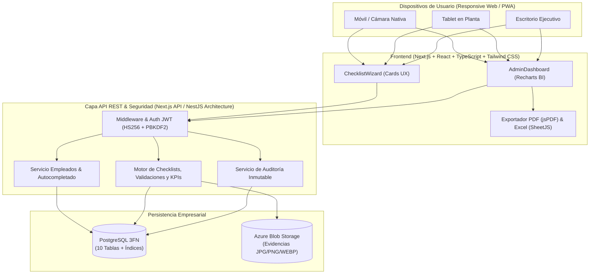
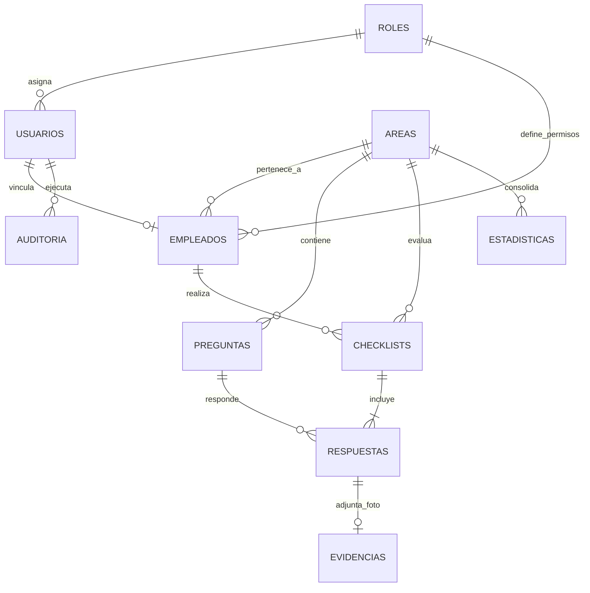
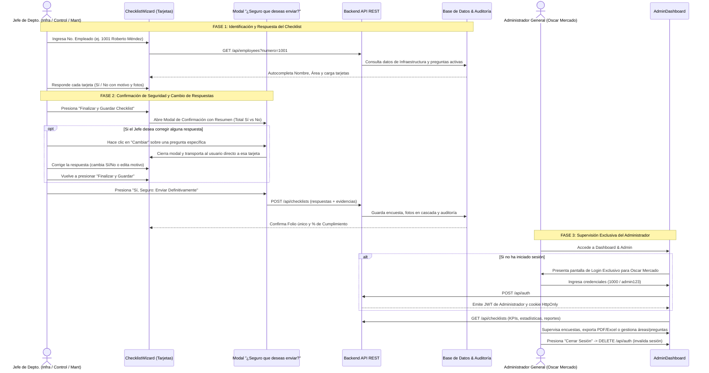

# SmartCheck Enterprise — Documentación Maestra de Arquitectura e Ingeniería de Software

Este documento entrega los **19 puntos arquitectónicos, funcionales, de datos y operativos** solicitados en la **Sección 13 de `Especificaciones.txt`**, acompañando al software funcional desarrollado en este repositorio.

---

## 1. Arquitectura General del Sistema

El sistema **SmartCheck Enterprise** sigue una **Arquitectura Limpia Multicapa (Clean Layered Architecture)** orientada a servicios REST y preparada para despliegue en la nube:

- **Capa de Presentación (Frontend Web / PWA Responsive):**
  - Desarrollada con **Next.js + React 18 + TypeScript + Tailwind CSS**.
  - Enfocada en **Tarjetas Interactivas (Card-based UX)** con avance en 1 clic, barra de progreso animada, captura directa desde cámara móvil/WebRTC, galería o Drag & Drop, y gráficas ejecutivas con **Recharts**.
- **Capa de Aplicación y Servicios de Negocio (API REST / NestJS & Next.js Route Handlers):**
  - Módulos desacoplados para Autenticación JWT (`AuthModule`), Empleados y Usuarios (`EmployeesModule`), Áreas Dinámicas (`AreasModule`), Plantillas de Preguntas (`QuestionsModule`), Motor de Checklists y KPIs (`ChecklistsModule`), y Auditoría (`AuditModule`).
- **Capa de Persistencia y Almacenamiento:**
  - **Base de Datos Relacional:** **PostgreSQL** normalizada en 3FN (esquema DDL completo en [`database/schema_postgresql.sql`](file:///C:/Users/alejpue5/Documents/proyectos/CheckList/database/schema_postgresql.sql)) + motor transaccional local autoinicializado en [`src/lib/db.ts`](file:///C:/Users/alejpue5/Documents/proyectos/CheckList/src/lib/db.ts) para ejecución inmediata.
  - **Almacenamiento de Evidencias Fotográficas:** **Azure Blob Storage** (mediante SAS Tokens firmados y validación estricta de formatos `JPG`, `PNG` y `WEBP`).

---

## 2. Casos de Uso

| ID | Caso de Uso | Actor Principal | Descripción |
| :--- | :--- | :--- | :--- |
| **CU-01** | Identificación automática por Número de Empleado | Jefe de Depto. / Operador | El usuario ingresa su número de empleado; el sistema autocompleta instantáneamente su Nombre Completo, su Área asignada (Infraestructura, Control o Mantenimiento) y la Fecha actual (permitiendo edición manual de fecha). |
| **CU-02** | Ejecución de Checklist mediante Tarjetas | Jefe de Depto. / Operador | El usuario responde cada tarjeta mediante botones grandes **Sí, Cumple** o **No Cumple**, visualizando en todo momento la barra de progreso animada. |
| **CU-03** | Captura de Incidencia y Evidencia Fotográfica | Jefe de Depto. / Operador | Al responder **No**, el sistema despliega automáticamente el campo de **Motivo obligatorio** y el cargador de **Evidencia fotográfica opcional** (Cámara WebRTC/Móvil, Galería o Drag & Drop en formatos JPG, PNG, WEBP). |
| **CU-04** | Confirmación de Envío y Modificación de Respuestas | Jefe de Depto. / Operador | Al finalizar las tarjetas, se presenta el modal "¿Estás seguro de que deseas enviar el checklist?" con resumen cuantitativo y la opción interactiva **"Cambiar"** en cada pregunta para modificar respuestas antes del envío definitivo. |
| **CU-05** | Autenticación y Login Exclusivo de Administrador | Administrador General (Oscar Mercado) | Acceso protegido al centro de control mediante número de empleado (`1000`) y contraseña cifrada. Bloquea el acceso a otros usuarios e incluye botón de **Cerrar Sesión (Logout)** con borrado de cookie y auditoría. |
| **CU-06** | Administración de Usuarios, Áreas y Preguntas | Administrador General (Oscar Mercado) | Alta simplificada de empleados, creación dinámica de áreas operativas sin tocar código y configuración/eliminación de preguntas del banco de checklist. |
| **CU-07** | Consulta de Dashboard Ejecutivo y Estadísticas | Administrador General (Oscar Mercado) | Visualización en tiempo real de KPIs, estadísticas diarias, semanales y mensuales, ranking de áreas, visor completo de encuestas realizadas y eliminación en cascada. |
| **CU-08** | Exportación Ejecutiva de Reportes PDF y Excel | Administrador General (Oscar Mercado) | Generación y descarga de reportes ejecutivos filtrados por Día, Semana, Mes, Rango de fechas, Área y Usuario en formatos `.pdf` y `.xlsx`. |

---

## 3. Historias de Usuario

- **HU-01 (Autocompletado Rápido):** *Como* jefe de departamento de Sistemas (Infraestructura, Control o Mantenimiento), *quiero* ingresar únicamente mi número de empleado al iniciar un checklist *para que* el sistema rellene mi nombre, área y fecha actual automáticamente y pueda comenzar en menos de 5 segundos.
- **HU-02 (Experiencia en Tarjetas de 1 Clic):** *Como* encargado en campo desde celular o tablet, *quiero* responder preguntas en tarjetas grandes con botones táctiles "Sí" y "No" *para* completar mi recorrido sin lidiar con formularios largos y aburridos.
- **HU-03 (Validación de Incidencias):** *Como* supervisor de calidad, *quiero* que cada respuesta negativa ("No") exija obligatoriamente un motivo y permita adjuntar foto desde la cámara o galería *para* tener trazabilidad real de cada falla.
- **HU-04 (Confirmación y Cambio de Respuestas):** *Como* jefe de departamento, *quiero* que antes de enviar el checklist se me pregunte si estoy seguro y se me muestre un resumen con la opción de cambiar cualquier respuesta *para* no enviar datos con errores o descuido.
- **HU-05 (Custodia Exclusiva del Administrador):** *Como* Administrador General (**Oscar Mercado**), *quiero* un login exclusivo con contraseña para el Dashboard y módulos de gestión *para que* los jefes de departamento solo respondan encuestas y no puedan alterar métricas ni configuraciones.
- **HU-06 (Analítica y Exportación):** *Como* Administrador General, *quiero* consultar estadísticas diarias, semanales y mensuales y exportarlas a PDF y Excel con filtros combinables *para* auditorías ejecutivas.

---

## 4. Wireframes de Interfaz

### 4.1 Wireframe: Tarjeta Interactiva de Checklist (Móvil / Escritorio)
```text
+-----------------------------------------------------------------------+
| [<-] #2001 Alejandro Puentes | Área: Infraestructura | [1 a la vez]   |
| Progreso: [====================>          ] 60% (3 de 5 completadas)  |
| (#1 OK) (#2 OK) [#3 ACTUAL] (#4) (#5)                                 |
+-----------------------------------------------------------------------+
|  [3] INF-03 • Comunicaciones y Racks             [Criticidad: MEDIA]  |
|                                                                       |
|  ¿Los gabinetes de telecomunicaciones tienen el cableado organizado,  |
|  puertas cerradas y switches sin puertos en falla?                    |
|                                                                       |
|  (i) Inspeccionar visualmente patch panels y LEDs de estado.          |
|                                                                       |
|  +-------------------------------+  +-------------------------------+ |
|  |         Sí, Cumple         |  |         No Cumple                | |
|  +-------------------------------+  +-------------------------------+ |
|                                                                       |
|  ----- [SE DESPLIEGA AUTOMÁTICAMENTE SI SELECCIONA "No"] ----------   |
|  ! REGISTRO DE INCIDENCIA                                             |
|  Motivo o explicación del "No" (OBLIGATORIO *):                       |
|  [+ Cables sueltos] [+ Puerta sin seguro] [+ Puerto en falla]         |
|  +-----------------------------------------------------------------+  |
|  | Se detecta patch cord suelto en rack principal B2...            |  |
|  +-----------------------------------------------------------------+  |
|  Fotografía de evidencia (OPCIONAL - JPG, PNG, WEBP):                 |
|  +-----------------------------------------------------------------+  |
|  |       Arrastra y suelta una fotografía aquí o selecciona:       |  |
|  |     [ Tomar Foto con Cámara ]   [ Cargar de Galería ]           |  |
|  +-----------------------------------------------------------------+  |
+-----------------------------------------------------------------------+
```

### 4.2 Wireframe: Dashboard Ejecutivo Administrativo
```text
+-----------------------------------------------------------------------+
| SmartCheck Enterprise | Centro de Control      [PDF] [Excel] [Logout] |
| [Dashboard & KPIs] [Estadísticas] [Incidencias] [Reportes] [Usuarios] |
+-----------------------------------------------------------------------+
| Filtros: [Periodo: Todos v] [Área: Todas v] [Usuario: Todos v]        |
+-------------+-------------+-------------+--------------+--------------+
| Checklists  | Resp. Sí    | Resp. No    | % Cumplim.   | % Incidencia |
|     35      |     156     |     19      |    89.1%     |    10.9%     |
+-------------+-------------+-------------+--------------+--------------+
| [Gráfica de Área: Tendencia 7 Días] | [Gráfica Barras: Comparativo]   |
+-------------------------------------+---------------------------------+
| [KPIs por Área: Infra / Control / Mant] | [Tabla Cumplimiento Usuario]|
+-----------------------------------------------------------------------+
```

---

## 5. Diseño UX/UI

1. **Eliminación del Cuestionario Tradicional:** Se reemplazaron las listas interminables de radio-buttons por **Tarjetas Enfocadas (Focus Cards)** con micro-interacciones (`animate-slide-up`, `animate-scale-in`).
2. **Reducción de Clics (1-Click Flow):** En modo *1 a la vez*, presionar **Sí** registra la respuesta y avanza automáticamente a la siguiente tarjeta tras 260ms, permitiendo completar un checklist sin incidencias en **5 clics totales**.
3. **Chips Inteligentes de Motivo Frecuente:** Cuando el usuario presiona **No**, además del campo de texto libre obligatorio, se presentan sugerencias contextuales de 1 clic para acelerar la captura en dispositivos móviles.
4. **Sistema de Color Semántico:**
   - Azul Corporativo (`#2563EB`): Navegación, progreso y acciones primarias.
   - Verde Esmeralda (`#059669` / `#10B981`): Cumplimiento positivo (`Sí`).
   - Rojo Coral (`#E11D48` / `#EF4444`): Incidencias (`No`) y alertas obligatorias.

---

## 6. Diagrama de Arquitectura



---

## 7. Modelo Entidad-Relación (MODELADO)



---

## 8. Diseño Completo de Base de Datos

El script DDL completo para producción en **PostgreSQL** se encuentra en [`database/schema_postgresql.sql`](file:///C:/Users/alejpue5/Documents/proyectos/CheckList/database/schema_postgresql.sql). Incluye las **10 tablas mínimas obligatorias**:

1. **`roles`**: Catálogo RBAC (`ADMIN`, `SUPERVISOR`, `OPERADOR`) con permisos en `JSONB`.
2. **`areas`**: Áreas operativas (`Infraestructura`, `Control`, `Mantenimiento` y áreas futuras).
3. **`usuarios`**: Cuentas con `password_hash` cifrado, control de bloqueos y último acceso.
4. **`empleados`**: Índice único en `numero_empleado` para autocompletado en `< 10ms`.
5. **`preguntas`**: Preguntas dinámicas asociadas a `area_id`, con orden y criticidad.
6. **`checklists`**: Cabecera de cada inspección con folio único, fecha y KPIs precalculados.
7. **`respuestas`**: Detalle por pregunta con `CONSTRAINT chk_motivo_obligatorio_en_no` a nivel de motor de base de datos que impide insertar `respuesta = FALSE` sin `motivo_no`.
8. **`evidencias`**: Metadatos y URL de imagen con validación `CHECK (formato IN ('JPG', 'JPEG', 'PNG', 'WEBP'))`.
9. **`estadisticas`**: Tabla de agregaciones diarias, semanales y mensuales para analítica ejecutiva.
10. **`auditoria`**: Bitácora histórica con `datos_anteriores` y `datos_nuevos` en `JSONB`.

---

## 9. APIs REST Necesarias

| Método | Endpoint | Descripción |
| :--- | :--- | :--- |
| `POST` | `/api/auth` | Autentica exclusivamente al Administrador General (**Oscar Mercado**) por número de empleado (`1000` / `admin` / `oscar.mercado`) y contraseña; retorna token **JWT** firmado y cookie HttpOnly. Rechaza con `HTTP 403` a usuarios no administradores. |
| `GET` | `/api/auth` | Verifica la validez y rol del token JWT activo (`ADMIN`). |
| `DELETE` | `/api/auth` | Cierra la sesión administrativa, elimina la cookie `smartcheck_token` y registra el evento de salida en la bitácora de auditoría. |
| `GET` | `/api/employees?numero={n}` | Busca el número de empleado de jefe de departamento u operador y autocompleta `nombreCompleto`, `area` y las `preguntas` activas de su área. |
| `POST` | `/api/employees` | Da de alta un nuevo empleado/usuario (valida campos obligatorios y opcionales). |
| `PUT` | `/api/employees` | Edita datos de un usuario o activa/desactiva su cuenta. |
| `GET` | `/api/areas` | Lista todas las áreas activas con su conteo de preguntas y empleados. |
| `POST` | `/api/areas` | Crea una nueva área dinámicamente recibiendo solo su nombre y genera su plantilla inicial de 3 preguntas. |
| `DELETE` | `/api/areas?id={id}` | Elimina el área en cascada junto con sus preguntas y reasigna empleados a un área remanente activa. |
| `GET / POST / PUT` | `/api/questions` | Consulta, agrega o edita preguntas del checklist por área. |
| `DELETE` | `/api/questions?id={id}` | Elimina permanentemente una pregunta del banco de inspección. |
| `GET` | `/api/checklists` | Devuelve checklists filtrados, KPIs globales, Estadísticas Diarias, Semanales y Mensuales, comparativo entre áreas, cumplimiento por usuario e incidencias. |
| `POST` | `/api/checklists` | Registra un nuevo checklist tras la confirmación del usuario, validando motivo obligatorio en respuestas `No` y formatos de evidencia (`JPG`, `PNG`, `WEBP`). |
| `PATCH` | `/api/checklists` | Actualiza el estado de seguimiento de una incidencia (`ABIERTA`, `EN_ATENCION`, `RESUELTA`). |
| `DELETE` | `/api/checklists?id={id}` | Elimina una encuesta realizada en cascada borrando todas sus respuestas y fotografías adjuntas en `db.evidencias`. |
| `GET` | `/api/audit` | Devuelve el historial de auditoría de operaciones. |

---

## 10. Estructura de Carpetas del Proyecto

```text
CheckList/
├── database/
│   ├── schema_postgresql.sql      # DDL completo PostgreSQL (10 tablas, índices y triggers)
│   └── smartcheck_db.json         # Base de datos relacional autogenerada con datos semilla
├── src/
│   ├── app/
│   │   ├── api/
│   │   │   ├── areas/route.ts     # API REST de Áreas dinámicas (GET, POST, DELETE)
│   │   │   ├── audit/route.ts     # API REST de Auditoría
│   │   │   ├── auth/route.ts      # API REST de Autenticación JWT y Logout (POST, GET, DELETE)
│   │   │   ├── checklists/route.ts# API REST de Checklists, KPIs y Cascada (GET, POST, PATCH, DELETE)
│   │   │   ├── employees/route.ts # API REST de Usuarios y Autocompletado (GET, POST, PUT)
│   │   │   └── questions/route.ts # API REST de Preguntas (GET, POST, PUT, DELETE)
│   │   ├── globals.css            # Estilos globales y utilidades Tailwind
│   │   ├── layout.tsx             # Layout raíz de la aplicación
│   │   └── page.tsx               # Contenedor principal con píldoras de navegación
│   ├── components/
│   │   ├── AdminDashboard.tsx     # Dashboard Ejecutivo, Estadísticas, Login Admin y Logout
│   │   ├── ArchitectureView.tsx   # Visor interactivo de arquitectura
│   │   └── ChecklistWizard.tsx    # Tarjetas + Cámara WebRTC + Modal Confirmación / Cambiar Respuestas
│   ├── lib/
│   │   ├── auth.ts                # Firma/verificación JWT (jose) y cifrado PBKDF2
│   │   ├── db.ts                  # Motor de persistencia, roles y cálculo de estadísticas
│   │   └── exportReports.ts       # Generación de reportes PDF (jsPDF) y Excel (XLSX)
│   └── types/
│       └── index.ts               # Contratos e interfaces TypeScript
├── DOCUMENTACION_ARQUITECTURA.md  # Documento maestro con los 19 entregables
└── Especificaciones.txt           # Requerimientos originales del sistema
```

---

## 11. Flujo Funcional del Sistema



---

## 12. Dashboard Administrativo y Fórmulas de KPIs

El módulo ejecutivo implementa las fórmulas exactas definidas en la especificación:

$$\text{Cumplimiento General (\%)} = \left( \frac{\text{Total de respuestas Sí}}{\text{Total de respuestas}} \right) \times 100$$

$$\text{Porcentaje de Incidencias (\%)} = \left( \frac{\text{Total de respuestas No}}{\text{Total de respuestas}} \right) \times 100$$

Incluye desglose automático en 3 horizontes temporales:
- **Diario:** Checklists de hoy, cumplimiento del día, respuestas Sí/No y detección automática del **Área con más incidencias**.
- **Semanal:** Cumplimiento de los últimos 7 días, curva de tendencia diaria e incidencias semanales.
- **Mensual:** Evolución histórica intermensual y **Ranking competitivo entre áreas**.

---

## 13. Estrategia de Seguridad y Segregación de Roles

1. **Autenticación JWT (JSON Web Tokens) y Acceso Administrativo Restringido:**
   - Emisión de tokens firmados con algoritmo `HS256` (`jose`), tiempo de expiración de 12 horas y transporte en cookies seguras `HttpOnly` + cabecera `Authorization: Bearer`.
   - **Custodia Exclusiva de Oscar Mercado:** El módulo de Dashboard, KPIs, configuración de preguntas, áreas, personal y reportes exige credenciales de Administrador General (`rolCodigo: 'ADMIN'`). Peticiones de usuarios no administradores a `/api/auth` son rechazadas inmediatamente con `HTTP 403`.
2. **Cierre de Sesión Seguro (Logout con Auditoría):**
   - El endpoint `DELETE /api/auth` revoca la cookie `smartcheck_token`, finaliza la sesión activa del Administrador y asienta un evento `LOGOUT` en la bitácora inmutable de auditoría.
3. **Segregación Operativa para Jefes de Departamento:**
   - Los jefes de las áreas de **Infraestructura**, **Control** y **Mantenimiento** se identifican mediante su número de empleado para responder inspecciones. No cuentan con privilegios administrativos para modificar KPIs, borrar registros ni editar plantillas de preguntas ajenas a su competencia.
4. **Mecanismo Defensivo de Confirmación y Modificación Previa:**
   - Antes de persistir cualquier encuesta en la base de datos, el cliente intercepta el envío y despliega un diálogo modal de confirmación con el resumen de la captura, permitiendo al jefe de área verificar y cambiar cualquier respuesta antes del guardado formal.
5. **Contraseñas Cifradas con Derivación Criptográfica:**
   - Uso de `PBKDF2-SHA256` con 10,000 iteraciones y sal criptográfica (`PASSWORD_SALT`), comparadas en tiempo constante (`crypto.timingSafeEqual`) para inmunidad ante ataques de canal lateral (*timing attacks*).
6. **Validación Defensiva Multimedia:**
   - Verificación estricta de extensiones y firmas MIME (`image/jpeg`, `image/png`, `image/webp`), compresión en canvas y validación estricta de obligatoriedad de motivos en respuestas negativas.
7. **Trazabilidad y Bitácora de Auditoría:**
   - Cada login exitoso, logout, creación/eliminación de área o pregunta, y alta de empleado genera una traza auditable con IP y actor en `auditoria`.

---

## 14. Plan de Pruebas (QA)

- **Pruebas Unitarias:** Validación de fórmulas de KPIs (`(Sí / Total) * 100`), funciones de cifrado de contraseñas y generación de folios.
- **Pruebas de Integración de API:**
  - Verificar que `GET /api/employees?numero=1001` retorne nombre y área correctos.
  - Verificar que `POST /api/checklists` devuelva `HTTP 400` cuando se envía una respuesta `respuesta: false` con `motivoNo: ""`.
  - Verificar que archivos distintos a `JPG`, `PNG` o `WEBP` sean rechazados.
- **Pruebas de Usabilidad (UX) y Responsividad:** Verificación en resoluciones móviles (`375px`), tablets (`768px`) y monitores ejecutivos (`1440px+`).

---

## 15. Estrategia de Despliegue

1. **Entorno Cloud Recomendado:** Azure App Service / Azure Container Apps para la aplicación Full-Stack.
2. **Base de Datos Productiva:** Azure Database for PostgreSQL (Flexible Server) con respaldos automáticos y conexión TLS.
3. **Almacenamiento Multimedia:** Azure Blob Storage con contenedor privado para evidencias y acceso mediante SAS Tokens.
4. **Pipeline CI/CD:** GitHub Actions ejecutando `npm run lint`, `npm run build`, migraciones SQL y despliegue automatizado sin tiempo de inactividad (Blue-Green Deployment).

---

## 16. Roadmap de Desarrollo por Fases

- **Fase 1 — MVP Core & UX de Tarjetas (Completado):** Autocompletado de empleados, motor de checklists basado en tarjetas, validación de respuestas negativas con evidencia fotográfica.
- **Fase 2 — Analítica Ejecutiva & Administración (Completado):** Dashboard con Recharts, estadísticas diarias/semanales/mensuales, CRUD de usuarios, áreas dinámicas y preguntas.
- **Fase 3 — Reporteo Corporativo & Seguridad (Completado):** Exportación a PDF y Excel con filtros avanzados, autenticación JWT y bitácora de auditoría.
- **Fase 4 — Expansión Planta Conectada (Siguiente Etapa):** Sincronización offline (PWA IndexedDB), alertas en tiempo real por WhatsApp/Teams ante incidencias críticas y lectura de códigos QR en estaciones de maquinaria.

---

## 17. Riesgos Técnicos y Mitigación

| Riesgo Técnico | Impacto | Estrategia de Mitigación Implementada |
| :--- | :--- | :--- |
| **Intermitencia de red Wi-Fi en zonas industriales** | Medio | Estado local reactivo en el cliente que conserva las respuestas y evidencias hasta confirmar el guardado exitoso. |
| **Fotografías de alta resolución muy pesadas desde celulares modernos** | Medio | Compresión en canvas (`0.88` JPEG quality) y validación de tamaño máximo antes de transmitir. |
| **Crecimiento histórico de la tabla de respuestas** | Bajo | Índices compuestos por fecha y área (`idx_checklists_area_fecha`) y tabla de pre-agregación `estadisticas`. |

---

## 18. Futuras Mejoras

- **Escaneo de Códigos QR / NFC en Equipos:** Iniciar el checklist específico de una máquina escaneando su etiqueta física.
- **Inteligencia Artificial en Evidencias:** Análisis automático por visión computacional para detectar fugas, cables sueltos o falta de EPP en la foto subida.
- **Flujo de Órdenes de Trabajo (OT):** Conversión automática de una incidencia crítica del área de Mantenimiento en un ticket de reparación asignado a un técnico.

---

## 19. Buenas Prácticas de Escalabilidad y Mantenimiento

- **Diseño Dirigido por Metadatos (Data-Driven Areas):** Las áreas y preguntas no están codificadas de forma rígida (*hardcoded*); viven en base de datos, permitiendo escalar de 3 a 50 áreas sin recompilar la aplicación.
- **Tipado Estricto End-to-End:** Contratos compartidos en TypeScript (`src/types/index.ts`) entre componentes visuales y controladores API.
- **Separación de Responsabilidades:** Lógica de exportación (`src/lib/exportReports.ts`), seguridad (`src/lib/auth.ts`) y acceso a datos (`src/lib/db.ts`) completamente modularizados.
