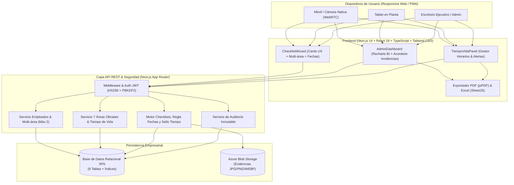
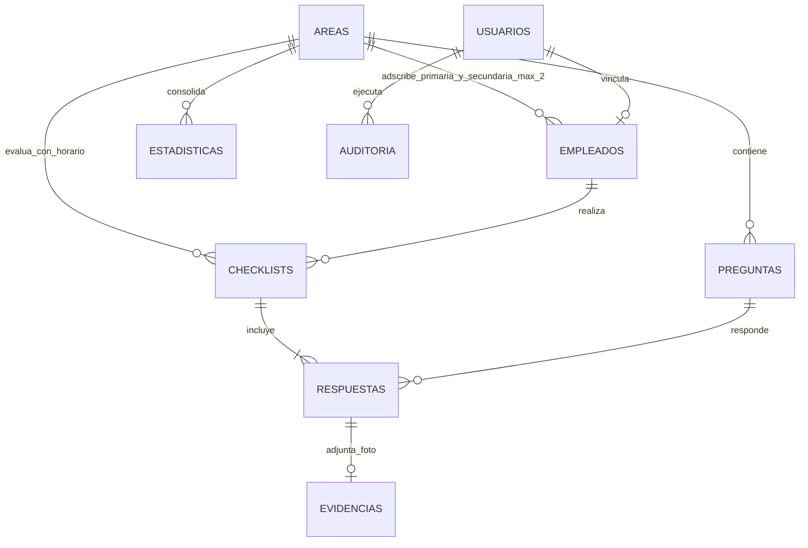
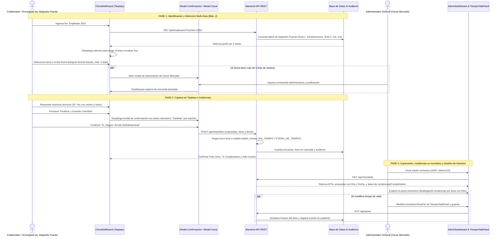

# SmartCheck Enterprise — Documentación Maestra de Arquitectura e Ingeniería de Software

Este documento entrega los **19 puntos arquitectónicos, funcionales, de datos y operativos** solicitados en la **Sección 13 de `Especificaciones.txt`**, acompañando al software funcional desarrollado en este repositorio.

---

## 1. Arquitectura General del Sistema

El sistema **SmartCheck Enterprise** sigue una **Arquitectura Limpia Multicapa (Clean Layered Architecture)** orientada a microservicios modulares, desacoplada y lista para entornos industriales de alta exigencia:

- **Capa de Presentación (Frontend Web / PWA Responsive):**
  - Desarrollada con **Next.js 14 + React 18 + TypeScript + Tailwind CSS**.
  - Enfocada en **Tarjetas Interactivas (Card-based UX)** con navegación táctil fluida, avance automático de 1 clic, selector dinámico para empleados con adscripción multi-área (hasta 2 áreas), panel interactivo de Incidencias/Cumplimiento con acordeón por área, barra de progreso animada, captura WebRTC/galería y gráficas ejecutivas con **Recharts**.
- **Capa de Aplicación y Servicios de Negocio (API REST / Next.js Route Handlers):**
  - Módulos desacoplados para Autenticación JWT y Acceso por Correo/Nómina (`AuthModule`), Padrón de Empleados y Multi-área (`EmployeesModule`), Catálogo de 7 Áreas Oficiales y Tiempo de Vida (`AreasModule`), Plantillas de Preguntas (`QuestionsModule`), Motor de Checklists, Políticas de Fechas y KPIs (`ChecklistsModule`) y Auditoría Inmutable (`AuditModule`).
- **Capa de Persistencia y Almacenamiento:**
  - **Base de Datos Relacional:** Esquema relacional normalizado en 3FN con 9 tablas (esquema DDL completo en [`database/schema_postgresql.sql`](file:///C:/Users/alejpue5/Documents/proyectos/CheckList/database/schema_postgresql.sql) y [`ER/schema_mysql.sql`](file:///C:/Users/alejpue5/Documents/proyectos/CheckList/ER/schema_mysql.sql)) + motor transaccional local autoinicializado en [`src/lib/db.ts`](file:///C:/Users/alejpue5/Documents/proyectos/CheckList/src/lib/db.ts) para ejecución inmediata.
  - **Almacenamiento de Evidencias Multimedia:** **Azure Blob Storage** / Data URLs optimizados con validación de formatos `JPG`, `PNG` y `WEBP`.

---

## 2. Casos de Uso

| ID | Caso de Uso | Actor Principal | Descripción |
| :--- | :--- | :--- | :--- |
| **CU-01** | Identificación y Selección Multi-Área | Jefe de Depto. / Operador | El usuario ingresa su número de empleado. El sistema autocompleta su nombre y, si está asignado a 2 áreas (ej. Alejandro Puente en Infraestructura e Ind. 4.0), le permite seleccionar interactivamente cuál de sus dos áreas inspeccionará en esa sesión. |
| **CU-02** | Validación Estricta de Fechas de Inspección | Jefe de Depto. / Operador / Admin | Prohíbe seleccionar fechas futuras (`max={today}`). Permite libremente fechas de los últimos 5 días. Si se elige una fecha de más de 5 días de antigüedad, exige la autorización exclusiva de Oscar Mercado mediante contraseña y justificación. |
| **CU-03** | Ejecución de Checklist mediante Tarjetas | Jefe de Depto. / Operador | El usuario responde cada reactivo técnico de su área mediante botones grandes **Sí, Cumple** o **No Cumple**, visualizando el tiempo de vida del área (`07:00 - 08:30`) y la barra de progreso en tiempo real. |
| **CU-04** | Captura de Incidencia y Evidencia Fotográfica | Jefe de Depto. / Operador | Al responder **No**, se despliega obligatoriamente el campo de motivo y el cargador de fotografía opcional (Cámara WebRTC/Móvil, Galería o Drag & Drop en JPG, PNG, WEBP). |
| **CU-05** | Confirmación de Envío y Modificación de Respuestas | Jefe de Depto. / Operador | Modal de confirmación previa con resumen cuantitativo y botón interactivo **"Cambiar"** por ítem para corregir respuestas antes de persistir la encuesta en base de datos. |
| **CU-06** | Autenticación y Login Exclusivo de Administrador | Administrador General (Oscar Mercado) | Acceso protegido al centro de control mediante número de empleado (`1000`) y contraseña cifrada. Bloquea a usuarios no administradores (`HTTP 403`) e incluye botón de **Cerrar Sesión (Logout)** con auditoría. |
| **CU-07** | Parametrización de Horarios y Tiempo de Vida | Administrador General (Oscar Mercado) | Modificación en vivo de `horaInicio` y `horaFin` de las 7 áreas industriales oficiales para delimitar la ventana operativa de captura. |
| **CU-08** | Monitoreo del Tiempo de Vida de Encuestas | Administrador General (Oscar Mercado) | Monitoreo en tiempo real del estado de vigencia y puntualidad de las encuestas por área (EN_TIEMPO / FUERA_DE_TIEMPO), porcentaje de cumplimiento y colaboradores pendientes. |
| **CU-09** | Supervisión Ejecutiva de Incidencias y Cumplimiento | Administrador General (Oscar Mercado) | Visualización de KPIs y del nuevo panel interactivo agrupado por área con acordeón para explorar el detalle de fallas con fotos, además de la tabla de encuestas con columna visible de **Día y Fecha** y estado de tiempo de vida. |
| **CU-10** | Exportación Ejecutiva a PDF y Excel | Administrador General (Oscar Mercado) | Descarga de reportes corporativos en horizontal con métricas consolidadas, detalle de incidencias y estado de puntualidad horaria. |

---

## 3. Historias de Usuario

- **HU-01 (Autocompletado y Flexibilidad Multi-Área):** *Como* colaborador con responsabilidades en más de una línea (ej. Alejandro Puente en Infraestructura e Ind. 4.0), *quiero* que al teclear mi nómina el sistema me permita elegir entre mis 2 áreas autorizadas *para que* pueda responder el cuestionario que corresponda a mi recorrido del día.
- **HU-02 (Política Estricta de Fechas):** *Como* Administrador General (**Oscar Mercado**), *quiero* que el sistema impida seleccionar fechas de mañana o futuras, y que si alguien necesita capturar una inspección de hace más de 5 días requiera mi contraseña y justificación *para* garantizar la validez legal y normativa de las auditorías.
- **HU-03 (Experiencia en Tarjetas de 1 Clic):** *Como* encargado en planta desde tableta o celular, *quiero* responder reactivos en tarjetas de alto contraste con botones táctiles *para* concluir mi recorrido en menos de 3 minutos.
- **HU-04 (Control de Incidencias y Evidencias):** *Como* auditor de calidad, *quiero* que cualquier incumplimiento obligue al operador a detallar el motivo y permita adjuntar fotografías *para* documentar la falla con rigor técnico.
- **HU-05 (Confirmación Previa de Envío):** *Como* jefe de departamento, *quiero* verificar el resumen de mis respuestas antes del envío final y tener un botón para cambiar cualquier respuesta errónea con 1 clic.
- **HU-06 (Tiempo de Vida y Alertas Automáticas):** *Como* Administrador General, *quiero* definir un horario de vigencia (ej. 07:00 a 08:30) y que el sistema despache un correo electrónico automático a los encargados que no hayan enviado su checklist al cerrar la ventana *para* mantener la disciplina operativa.
- **HU-07 (Explorador Visual de Incidencias):** *Como* Administrador General, *quiero* ver a un lado de los KPIs un panel organizado por áreas donde pueda desplegar en acordeón las fallas ocurridas con sus fotografías *para* tomar decisiones preventivas inmediatas.
- **HU-08 (Día y Fecha en Bitácora):** *Como* supervisor, *quiero* ver el día de la semana y la fecha directamente en la tabla de encuestas realizadas sin tener que abrir el visor modal *para* agilizar la revisión rápida.

---

## 4. Wireframes de Interfaz

### 4.1 Wireframe: Tarjeta Interactiva de Checklist con Selector Multi-Área y Tiempo de Vida
```text
+-----------------------------------------------------------------------+
| [<-] #2001 Alejandro Puente | [Área 1: Infraestructura] [Área 2: Ind 4.0] (Activa)
| Horario: [07:00 - 08:30] • Estado: [ EN TIEMPO ]      | [Modo: 1 a la vez]
| Fecha: [2026-10-20 (Máx Hoy)] • Progreso: [========>   ] 60% (3 de 5) |
| (#1 OK) (#2 OK) [#3 ACTUAL] (#4) (#5)                                 |
+-----------------------------------------------------------------------+
|  [3] INF-03 • Cableado y Cuarto de Servidores      [Criticidad: MEDIA]|
|                                                                       |
|  ¿Los gabinetes de telecomunicaciones tienen el cableado organizado,  |
|  puertas cerradas y switches sin puertos en falla?                    |
|                                                                       |
|  +-------------------------------+  +-------------------------------+ |
|  |         Sí, Cumple         |  |         No Cumple                | |
|  +-------------------------------+  +-------------------------------+ |
|                                                                       |
|  ----- [SE DESPLIEGA AUTOMÁTICAMENTE SI SELECCIONA "No"] ----------   |
|  ! REGISTRO DE INCIDENCIA (OBLIGATORIO *)                             |
|  [+ Patch cord suelto] [+ Puerta abierta] [+ Temperatura alta]        |
|  +-----------------------------------------------------------------+  |
|  | Se detecta patch cord de switch principal colgando sin peinar... |  |
|  +-----------------------------------------------------------------+  |
|  Fotografía de evidencia (OPCIONAL - JPG, PNG, WEBP):                 |
|  [ Tomar Foto con Cámara WebRTC ]  [ Cargar de Galería ]  [Dropzone]  |
+-----------------------------------------------------------------------+
```

### 4.2 Wireframe: Dashboard Ejecutivo con Panel de Incidencias/Cumplimiento en Acordeón
```text
+-----------------------------------------------------------------------+
| SmartCheck Enterprise | Centro de Control      [PDF] [Excel] [Logout] |
| [Dashboard & KPIs] [Tiempo de Vida] [Incidencias] [Reportes] [Usuarios]
+-----------------------------------------------------------------------+
| Filtros: [Periodo: Hoy v] [Área: Todas v] [Empleado: Todos v]         |
+------------------------------------+----------------------------------+
| RESUMEN DE KPIS                    | PANEL: [Incidencias*] [Cumplim.] |
| Total Checklists: 35               | > Ind. 4.0        (1 Incidencia) |
| Total Sí: 156   | Total No: 19     | v Infraestructura (2 Incidencias)|
| % Cumplimiento General: 89.1%      |   - CHK-2001-A1 | INF-03 | Foto [Ver]|
| % Incidencias: 10.9%               |   - CHK-2001-A2 | INF-05 | Foto [Ver]|
| Área con más incidencias: Infra    | > MES             (0 Incidencias)|
|                                    | > SAP             (0 Incidencias)|
+------------------------------------+----------------------------------+
| BITÁCORA DE ENCUESTAS REALIZADAS                                      |
| Folio        | Día y Fecha    | Hora Reg. | Área   | % Cumplim | Tiempo
| CHK-2026...  | Mar, 20/10/2026| 07:42:15  | Infra  | 80.0%     | EN TIEMPO
| CHK-2026...  | Mar, 20/10/2026| 09:15:02  | MES    | 100.0%    | FUERA TIEMPO
+-----------------------------------------------------------------------+
```

---

## 5. Diseño UX/UI

1. **Eliminación del Cuestionario Tradicional:** Se reemplazaron las listas interminables de radio-buttons por **Tarjetas Enfocadas (Focus Cards)** con micro-interacciones (`animate-slide-up`, `animate-scale-in`).
2. **Reducción de Clics (1-Click Flow):** En modo *1 a la vez*, presionar **Sí** registra la respuesta y avanza automáticamente a la siguiente tarjeta tras 260ms, permitiendo completar un checklist sin incidencias en **5 clics totales**.
3. **Chips Inteligentes de Motivo Frecuente:** Cuando el usuario presiona **No**, además del campo de texto libre obligatorio, se presentan sugerencias contextuales de 1 clic para acelerar la captura en dispositivos móviles.
4. **Sistema de Color Semántico:**
   - Azul Corporativo (`#2563EB`): Navegación, progreso y acciones primarias.
   - Verde Esmeralda (`#059669` / `#10B981`): Cumplimiento positivo (`Sí`).
   - Rojo Coral (`#E11D48` / `#EF4444`): Incidencias (`No`) y alertas obligatorias.

---

## 6. Diagrama de Arquitectura



---

## 7. Modelo Entidad-Relación (MODELADO)



---

## 8. Diseño Completo de Base de Datos

Los scripts DDL completos para producción en **PostgreSQL** y **MySQL Server 8.0+** se encuentran en [`database/schema_postgresql.sql`](file:///C:/Users/alejpue5/Documents/proyectos/CheckList/database/schema_postgresql.sql) y [`ER/schema_mysql.sql`](file:///C:/Users/alejpue5/Documents/proyectos/CheckList/ER/schema_mysql.sql). Tras la **eliminación formal de las tablas roles y notificaciones**, el sistema opera con **9 tablas normalizadas** (con credencial de acceso por correo y número de nómina, y roles administrativos directos):

1. **`areas`**: Las 7 áreas industriales oficiales (**MES**, **Ind. 4.0**, **Infraestructura**, **Staff IT**, **Digitalizacion**, **SAP**, **Soporte Manufactura**) con sus columnas de tiempo de vida `hora_inicio` (default `'07:00'`) y `hora_fin` (default `'08:30'`).
2. **`usuarios`**: Cuentas con `password_hash` cifrado (PBKDF2), rol administrativo directo (`ADMIN`, `SUPERVISOR`, `OPERADOR`), control de bloqueos y último acceso.
3. **`empleados`**: Padrón con índice único en `numero_empleado`, credencial de `correo` institucional y soporte para asignación multi-área (`area_id` principal y `area_id_secundaria`, máximo 2 áreas).
4. **`preguntas`**: Reactivos técnicos dinámicos asociados a `area_id`, con orden secuencial y criticidad.
5. **`checklists`**: Cabecera con folio único, fecha de operación (estrictamente `<= hoy`), `hora_registro`, estado de vigencia horaria (`estado_tiempo`: `EN_TIEMPO` o `FUERA_DE_TIEMPO`) y KPIs precalculados.
6. **`respuestas`**: Detalle por pregunta con `CONSTRAINT chk_motivo_obligatorio_en_no` que impide a nivel de motor registrar `respuesta = FALSE` sin `motivo_no`.
7. **`evidencias`**: Metadatos y URL de imágenes fotográficas con validación `CHECK (formato IN ('JPG', 'JPEG', 'PNG', 'WEBP'))`.
8. **`estadisticas`**: Agregaciones analíticas diarias, semanales y mensuales para optimizar consultas del Dashboard.
9. **`auditoria`**: Bitácora inmutable de eventos con `datos_anteriores` y `datos_nuevos` en `JSONB`.

---

## 9. APIs REST Necesarias

| Método | Endpoint | Descripción |
| :--- | :--- | :--- |
| `POST` | `/api/auth` | Autentica exclusivamente al Administrador General (**Oscar Mercado**) por nómina (`1000` / `admin` / `oscar.mercado`) y contraseña; emite token **JWT** firmado y cookie HttpOnly. Peticiones de otros perfiles son rechazadas con `HTTP 403`. |
| `GET` | `/api/auth` | Valida la sesión activa y verifica el rol `ADMIN`. |
| `DELETE` | `/api/auth` | Cierra la sesión administrativa, destruye la cookie `smartcheck_token` y registra el evento `LOGOUT` en auditoría. |
| `GET` | `/api/employees?numero={n}` | Busca al colaborador por nómina y devuelve su perfil, permitiendo detectar adscripción multi-área (`areaId` y `areaIdSecundaria`) y retornando las preguntas correspondientes. |
| `POST` | `/api/employees` | Alta de colaboradores admitiendo asignación de hasta 2 áreas con validación contra duplicidad. |
| `PUT` | `/api/employees` | Edita asignaciones de áreas (máx. 2) o estado activo/inactivo. |
| `GET` | `/api/areas` | Lista las 7 áreas oficiales con conteo de preguntas, empleados y sus rangos horarios (`horaInicio`, `horaFin`). |
| `POST` | `/api/areas` | Crea una nueva área dinámica con 3 preguntas operativas base y horario default `07:00` - `08:30`. |
| `PUT` | `/api/areas` | Permite a **Oscar Mercado** modificar la ventana del tiempo de vida (`horaInicio`, `horaFin`) de cualquier área, validando formato `HH:MM`. |
| `DELETE` | `/api/areas?id={id}` | Elimina el área en cascada con sus preguntas y reasigna con seguridad a los colaboradores adscritos. |
| `GET / POST / PUT` | `/api/questions` | Consulta, crea o edita reactivos del checklist por área y criticidad. |
| `DELETE` | `/api/questions?id={id}` | Elimina permanentemente una pregunta del banco de inspección. |
| `GET` | `/api/checklists` | Motor analítico: devuelve encuestas filtradas, KPIs, estadísticas en 3 horizontes, arreglos para el panel interactivo de Incidencias/Cumplimiento agrupado por área, y los sellos de tiempo de vida. |
| `POST` | `/api/checklists` | Valida y asienta la encuesta: bloquea fechas futuras (`max={today}`), exige autorización de Oscar Mercado para fechas de más de 5 días atrás, evalúa el sello `estadoTiempo` según la hora local y ventana del área, y exige motivo obligatorio en respuestas `No`. |
| `PATCH` | `/api/checklists` | Actualiza el estado de resolución de una incidencia (`ABIERTA`, `EN_ATENCION`, `RESUELTA`). |
| `DELETE` | `/api/checklists?id={id}` | Elimina una encuesta en cascada junto con sus respuestas y evidencias multimedia en `db.evidencias`. |
| `GET` | `/api/audit` | Devuelve los últimos 100 registros de la bitácora inmutable de operaciones. |

---

## 10. Estructura de Carpetas del Proyecto

```text
CheckList/
├── database/
│   ├── schema_postgresql.sql      # DDL completo PostgreSQL (9 tablas, índices y triggers)
│   └── smartcheck_db.json         # Base de datos relacional local autogenerada con 7 áreas oficiales
├── src/
│   ├── app/
│   │   ├── api/
│   │   │   ├── areas/route.ts     # API Áreas dinámicas y modificación de tiempo de vida (PUT)
│   │   │   ├── audit/route.ts     # API Auditoría inmutable
│   │   │   ├── auth/route.ts      # API Autenticación JWT exclusiva de Oscar Mercado y Logout
│   │   │   ├── checklists/route.ts# API Checklists, validación de fechas, tiempo de vida y KPIs
│   │   │   ├── employees/route.ts # API Empleados y soporte multi-área (máximo 2 áreas)
│   │   │   └── questions/route.ts # API Preguntas dinámicas por área
│   │   ├── globals.css            # Estilos globales y utilidades Tailwind
│   │   ├── layout.tsx             # Layout raíz
│   │   └── page.tsx               # Contenedor principal con navegación por resorte
│   ├── components/
│   │   ├── AdminDashboard.tsx     # Dashboard, KPIs, explorador Incidencias/Cumplimiento en acordeón y tabla
│   │   ├── ArchitectureView.tsx   # Visor interactivo de arquitectura
│   │   ├── ChecklistWizard.tsx    # Tarjetas, selector multi-área, fechas restrictivas y modal Oscar
│   │   └── TiempoVidaPanel.tsx    # Configuración de horas y monitor de tiempo de vida
│   ├── lib/
│   │   ├── auth.ts                # Firma/verificación JWT (jose) y cifrado PBKDF2
│   │   ├── db.ts                  # Motor de persistencia, 7 áreas oficiales y KPIs
│   │   ├── exportReports.ts       # Generación de reportes PDF (jsPDF) y Excel (XLSX) con tiempo de vida
│   │   ├── schedule.ts            # Motor y cálculo de ventanas de encuestas
│   │   └── utils.ts               # Utilidades de combinación de clases Tailwind
│   ├── types/
│   │   └── index.ts               # Contratos e interfaces TypeScript
├── .env.example                   # Plantilla de variables de entorno locales
├── DOCUMENTACION_ARQUITECTURA.md  # Documento maestro con los 19 entregables
├── ER.md                          # Modelo Entidad-Relación y diccionario detallado de datos
├── Especificaciones.txt           # Requerimientos originales del sistema
└── memoria.md                     # Memoria técnica exhaustiva del proyecto
```

---

## 11. Flujo Funcional del Sistema



---

## 12. Dashboard Administrativo y Fórmulas de KPIs

El módulo ejecutivo implementa las fórmulas exactas y mecanismos de supervisión visual solicitados:

$$\text{Cumplimiento General (\%)} = \left( \frac{\text{Total de respuestas Sí}}{\text{Total de respuestas}} \right) \times 100$$

$$\text{Porcentaje de Incidencias (\%)} = \left( \frac{\text{Total de respuestas No}}{\text{Total de respuestas}} \right) \times 100$$

### 12.1 Panel Interactivo de Incidencias / Cumplimiento (Acordeón por Área)
- **Ubicación Estratégica:** Situado directamente al lado de los widgets de KPI.
- **Selector Superior de Pestañas:** Permite conmutar entre **Incidencias** (seleccionada primero por defecto) y **Cumplimiento**.
- **Agrupación y Despliegue en Acordeón:** Presenta las 7 áreas oficiales. Al hacer clic en un área, se despliegan sus incidencias detalladas con fecha, folio, código de reactivo, empleado responsable, motivo obligatorio y fotografía de evidencia en miniatura ampliable.

### 12.2 Métrica y Trazabilidad del Tiempo de Vida
- Cada encuesta realizada almacena la hora exacta de registro y el sello `EN_TIEMPO` o `FUERA_DE_TIEMPO`.
- La tabla de encuestas del Dashboard y la sección de reportes exponen el **Día de la Semana y Fecha** (ej. `Mar, 20/10/2026`) y el indicador de puntualidad sin requerir abrir el modal "Ver Encuesta".

---

## 13. Estrategia de Seguridad y Segregación de Roles

1. **Autenticación JWT, Acceso Administrativo Restringido y Eliminación de la Tabla Roles:**
   - **Eliminación de la tabla `roles`:** Se suprimió la tabla física de roles del esquema de base de datos para optimizar el rendimiento y simplicidad arquitectónica. El control de acceso basado en roles (RBAC) se gestiona de forma directa mediante la columna `rol` en las cuentas administrativas (`usuarios.rol`) y aserciones tipadas estrictamente en TypeScript (`RoleCode`) dentro del payload de los tokens JWT (`JWTPayloadUser`), erradicando sobrecostes de JOINs contra un catálogo inmutable.
   - Emisión de tokens firmados con algoritmo `HS256` (`jose`), tiempo de expiración de 12 horas y transporte en cookies seguras `HttpOnly` + cabecera `Authorization: Bearer`.
   - **Custodia Exclusiva de Oscar Mercado:** El centro de mando administrativo exige rol `ADMIN`. Intentos de acceso de otros usuarios son rechazados con `HTTP 403`.
2. **Política Restrictiva de Fechas y Autorización Extemporánea:**
   - Prohibición estricta de fechas futuras (`max={today}`).
   - La captura de encuestas de más de 5 días de antigüedad requiere la autorización presencial de **Oscar Mercado** mediante validación criptográfica de su contraseña y justificación técnica en `auditoria`. Ni el administrador puede autorizar fechas futuras.
3. **Regla de Negocio Multi-Área Blindada:**
   - Se valida tanto en interfaz como en la API REST que un colaborador no pueda tener más de 2 áreas asignadas ni la misma área duplicada como primaria y secundaria.
4. **Segregación Operativa para Encargados:**
   - Los encargados de las 7 áreas industriales oficiales únicamente pueden responder cuestionarios correspondientes a sus áreas asignadas, sin privilegios para alterar métricas ni borrar historial.
5. **Contraseñas Cifradas y Trazabilidad Inmutable:**
   - Derivación `PBKDF2-SHA256` con 10,000 iteraciones y registro de cada operación en la bitácora `auditoria` con IP, actor y marca de tiempo.

---

## 14. Plan de Pruebas (QA)

- **Pruebas Unitarias:** Validación de fórmulas de KPIs (`(Sí / Total) * 100`), funciones de cifrado de contraseñas y generación de folios.
- **Pruebas de Integración de API:**
  - Verificar que `GET /api/employees?numero=1001` retorne nombre y área correctos.
  - Verificar que `POST /api/checklists` devuelva `HTTP 400` cuando se envía una respuesta `respuesta: false` con `motivoNo: ""`.
  - Verificar que archivos distintos a `JPG`, `PNG` o `WEBP` sean rechazados.
- **Pruebas de Usabilidad (UX) y Responsividad:** Verificación en resoluciones móviles (`375px`), tablets (`768px`) y monitores ejecutivos (`1440px+`).

---

## 15. Estrategia de Despliegue

1. **Entorno Cloud Recomendado:** Azure App Service / Azure Container Apps para la aplicación Full-Stack.
2. **Base de Datos Productiva:** Azure Database for PostgreSQL (Flexible Server) con respaldos automáticos y conexión TLS.
3. **Almacenamiento Multimedia:** Azure Blob Storage con contenedor privado para evidencias y acceso mediante SAS Tokens.
4. **Pipeline CI/CD:** GitHub Actions ejecutando `npm run lint`, `npm run build`, migraciones SQL y despliegue automatizado sin tiempo de inactividad (Blue-Green Deployment).

---

## 16. Roadmap de Desarrollo por Fases

- **Fase 1 — MVP Core & UX de Tarjetas (Completado):** Autocompletado de empleados, motor de checklists basado en tarjetas, validación de respuestas negativas con evidencia fotográfica.
- **Fase 2 — Analítica Ejecutiva & Administración (Completado):** Dashboard con Recharts, estadísticas diarias/semanales/mensuales, CRUD de usuarios, áreas dinámicas y preguntas.
- **Fase 3 — Reporteo Corporativo & Seguridad (Completado):** Exportación a PDF y Excel con filtros avanzados, autenticación JWT y bitácora de auditoría.
- **Fase 4 — Expansión Planta Conectada (Siguiente Etapa):** Sincronización offline (PWA IndexedDB), alertas en tiempo real por WhatsApp/Teams ante incidencias críticas y lectura de códigos QR en estaciones de maquinaria.

---

## 17. Riesgos Técnicos y Mitigación

| Riesgo Técnico | Impacto | Estrategia de Mitigación Implementada |
| :--- | :--- | :--- |
| **Intermitencia de red Wi-Fi en zonas industriales** | Medio | Estado local reactivo en el cliente que conserva las respuestas y evidencias hasta confirmar el guardado exitoso. |
| **Fotografías de alta resolución muy pesadas desde celulares modernos** | Medio | Compresión en canvas (`0.88` JPEG quality) y validación de tamaño máximo antes de transmitir. |
| **Crecimiento histórico de la tabla de respuestas** | Bajo | Índices compuestos por fecha y área (`idx_checklists_area_fecha`) y tabla de pre-agregación `estadisticas`. |

---

## 18. Futuras Mejoras

- **Escaneo de Códigos QR / NFC en Equipos:** Iniciar el checklist específico de una máquina escaneando su etiqueta física.
- **Inteligencia Artificial en Evidencias:** Análisis automático por visión computacional para detectar fugas, cables sueltos o falta de EPP en la foto subida.
- **Flujo de Órdenes de Trabajo (OT):** Conversión automática de una incidencia crítica del área de Mantenimiento en un ticket de reparación asignado a un técnico.

---

## 19. Buenas Prácticas de Escalabilidad y Mantenimiento

- **Diseño Dirigido por Metadatos (Data-Driven Areas):** Las áreas y preguntas no están codificadas de forma rígida (*hardcoded*); viven en base de datos, permitiendo escalar de 3 a 50 áreas sin recompilar la aplicación.
- **Tipado Estricto End-to-End:** Contratos compartidos en TypeScript (`src/types/index.ts`) entre componentes visuales y controladores API.
- **Separación de Responsabilidades:** Lógica de exportación (`src/lib/exportReports.ts`), seguridad (`src/lib/auth.ts`) y acceso a datos (`src/lib/db.ts`) completamente modularizados.
