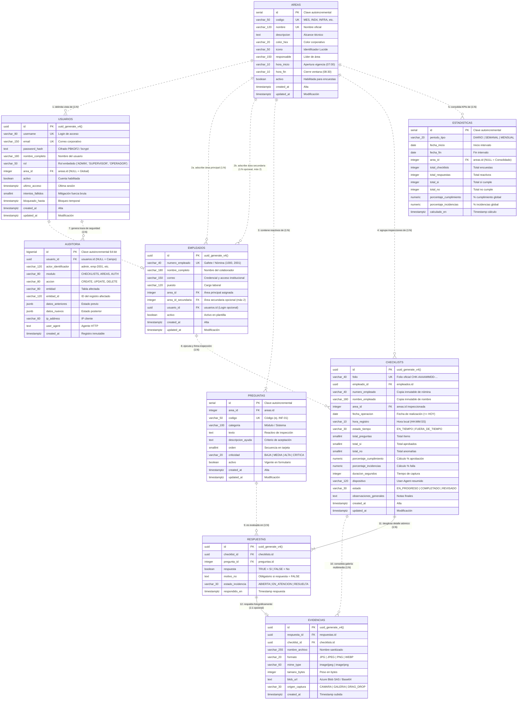
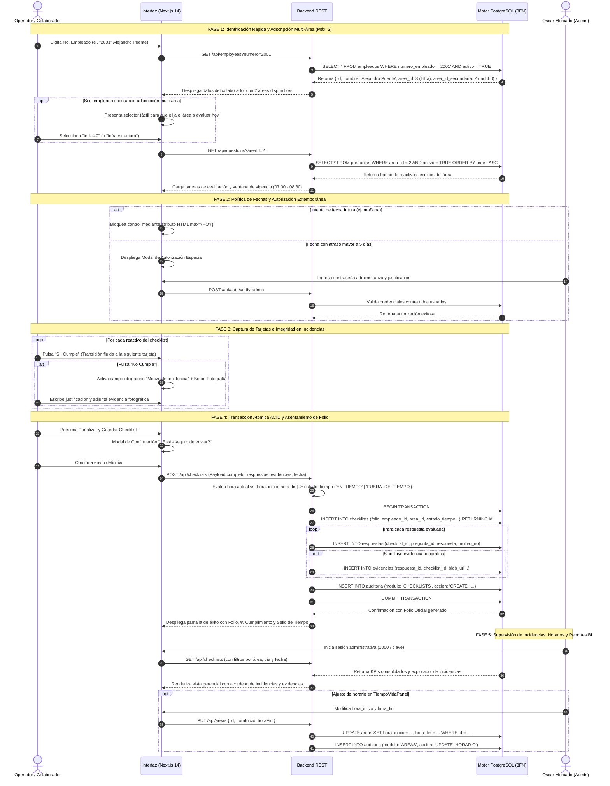

# Modelo Entidad-Relación y Arquitectura Física de Base de Datos — SmartCheck Enterprise

Este documento constituye la especificación formal del **Modelo Entidad-Relación Extendido (EER - Enhanced Entity-Relationship)** y el **Diccionario de Datos Físico** de **SmartCheck Enterprise**, estructurado conforme a las mejores prácticas de **Ingeniería en Base de Datos Relacionales** y alineado a la notación visual estándar de herramientas como **MySQL Workbench**, **Oracle SQL Developer Data Modeler** y **ERwin Data Modeler**.

---

## 1. Diagrama Físico Entidad-Relación (EER — Estilo MySQL Workbench)

El siguiente diagrama presenta el esquema relacional completo compuesto por **9 tablas en Tercera Forma Normal (3FN)** sobre motor **PostgreSQL** (arquitectura optimizada tras la **eliminación de las tablas roles y notificaciones**), con tipado estricto, claves primarias (`PK`), claves foráneas (`FK`), atributos obligatorios (`NOT NULL`), opcionales (`NULL`), subpaneles de índices físicos (`Indexes`) y cardinalidades con notación **Crow's Foot (Pata de Cuervo)**:


> [!TIP]
> **Formatos de Alta Resolución Disponibles en esta Carpeta:**
> - 📄 **Vectorial SVG (Escalabilidad Infinita):** [`ER_Diagrama_Fisico.svg`](file:///C:/Users/alejpue5/Documents/Proyectos/CheckList/ER/ER_Diagrama_Fisico.svg)
> - 🌐 **Visor Interactivo Web con Zoom y Panorámica:** [`ER_Diagrama_Workbench.html`](file:///C:/Users/alejpue5/Documents/Proyectos/CheckList/ER/ER_Diagrama_Workbench.html) (Abrir con doble clic en cualquier navegador).
> - 🖼️ **Captura Rasterizada HD (2K):** [`ER_Diagrama_Fisico.png`](file:///C:/Users/alejpue5/Documents/Proyectos/CheckList/ER/ER_Diagrama_Fisico.png)

---

## 2. Convenciones y Simbología de Ingeniería en Base de Datos

En estricto apego al estándar de modelado relacional físico observado en herramientas profesionales de diseño (e.g. *MySQL Workbench* en `ER_Ejemplo.png` y `ER_Ejemplo2.png`), se emplean las siguientes convenciones semánticas:

### 2.1 Marcadores de Atributos y Claves
| Símbolo | Significado Relacional | Descripción Técnica |
| :---: | :--- | :--- |
| 🔑 | **Primary Key (PK)** | Identificador único irrepetible de la entidad (`UUID`, `SERIAL` o `BIGSERIAL`). |
| 🔴 | **Foreign Key (FK)** | Clave foránea que referencia la clave primaria de una tabla padre. Posee índice `BTREE`. |
| 🔷 | **Not Null (NN)** | Atributo físico de captura obligatoria (`NOT NULL`). |
| ⚪ | **Nullable (NULL)** | Atributo opcional que admite valores ausentes o nulos (`NULL`). |
| 🔑🔴 | **Composite PK / FK** | Clave primaria compuesta conformada por claves foráneas (tablas de rompimiento N:M). |

### 2.2 Notación de Líneas y Conectores de Relación
| Tipo de Trazo | Denominación Relacional | Criterio de Ingeniería |
| :---: | :--- | :--- |
| **`- - - - -` (Línea Discontinua)** | **Relación No Identificadora (Non-Identifying)** | La clave foránea es un atributo ordinario en la tabla hija y **no forma parte de su clave primaria**. La tabla hija posee identidad propia e independiente (ej. `empleado_id` en `checklists`). |
| **`───────` (Línea Continua)** | **Relación Identificadora (Identifying)** | La existencia de la fila hija depende existencialmente de la tabla padre, o la clave foránea forma parte de su clave primaria compuesta (ej. `checklist_id` en `respuestas`). |

### 2.3 Simbología Crow's Foot (Pata de Cuervo)
- **`||` (Uno y sólo uno):** Cardinalidad exacta obligatoria ($1:1$).
- **`|o` (Cero o uno):** Cardinalidad opcional ($0..1$).
- **`|{` (Uno o muchos):** Cardinalidad múltiple obligatoria ($1..N$).
- **`o{` (Cero o muchos):** Cardinalidad múltiple opcional ($0..N$).

---

## 3. Especificación Mermaid Crow's Foot (Render Nativo en Markdown)

Para entornos con renderizadores Markdown automáticos (GitHub, GitLab, Obsidian, VS Code), el siguiente bloque define formalmente las 10 entidades con sus tipos físicos PostgreSQL, tipos de clave y tipos de línea relacional:



---

## 4. Matriz Maestra de Relaciones Físicas e Integridad Referencial

La siguiente matriz documenta formalmente la interconexión entre entidades, especificando el tipo de relación según la teoría de bases de datos, las claves involucradas y el comportamiento de las restricciones `ON UPDATE` y `ON DELETE`:

| Tabla Padre (Origen) | PK Padre | Tabla Hija (Destino) | FK Hija | Tipo Relación | Cardinalidad | Regla `ON UPDATE` | Regla `ON DELETE` | Propósito y Regla de Negocio |
| :--- | :--- | :--- | :--- | :---: | :---: | :---: | :---: | :--- |
| **`areas`** | `id` | **`usuarios`** | `area_id` | No Identificadora | $1:N$ (opc.) | `CASCADE` | `SET NULL` | Si un departamento se elimina, el usuario administrativo pasa a rol transversal global. |
| **`areas`** | `id` | **`empleados`** | `area_id` | No Identificadora | $1:N$ | `CASCADE` | `RESTRICT` | Adscripción técnica obligatoria del colaborador a una de las áreas oficiales. |
| **`areas`** | `id` | **`empleados`** | `area_id_secundaria` | No Identificadora | $1:N$ (opc.) | `CASCADE` | `SET NULL` | Adscripción multi-área complementaria (máximo estricto de 2 áreas por empleado, ej. Alejandro Puente en Infraestructura e Ind. 4.0). |
| **`areas`** | `id` | **`preguntas`** | `area_id` | No Identificadora | $1:N$ | `CASCADE` | `CASCADE` | Cada pregunta pertenece a un área. Si el área es depurada, sus reactivos asociados se eliminan. |
| **`areas`** | `id` | **`checklists`** | `area_id` | No Identificadora | $1:N$ | `CASCADE` | `RESTRICT` | Protege el historial de inspecciones concluidas; impide borrar áreas que cuenten con auditorías. |
| **`areas`** | `id` | **`estadisticas`** | `area_id` | No Identificadora | $1:N$ (opc.) | `CASCADE` | `CASCADE` | Segmentación por departamento para KPIs (`NULL` para la métrica global de la planta). |
| **`usuarios`** | `id` | **`empleados`** | `usuario_id` | No Identificadora | $1:1$ (opc.) | `CASCADE` | `SET NULL` | Vincula al colaborador con credenciales de acceso administrativo al Centro de Control. |
| **`usuarios`** | `id` | **`auditoria`** | `usuario_id` | No Identificadora | $1:N$ (opc.) | `CASCADE` | `SET NULL` | Si un usuario es revocado, la bitácora inmutable histórica preserva su registro. |
| **`empleados`** | `id` | **`checklists`** | `empleado_id` | No Identificadora | $1:N$ | `CASCADE` | `RESTRICT` | Certifica la autoría de la inspección. Protege registros históricos contra borrado accidental. |
| **`checklists`** | `id` | **`respuestas`** | `checklist_id` | Identificadora | $1:N$ | `CASCADE` | `CASCADE` | La respuesta no tiene sentido existencial sin su checklist contenedor. |
| **`preguntas`** | `id` | **`respuestas`** | `pregunta_id` | No Identificadora | $1:N$ | `CASCADE` | `RESTRICT` | Impide borrar un ítem de inspección si ya cuenta con respuestas históricas asentadas. |
| **`respuestas`** | `id` | **`evidencias`** | `respuesta_id` | Identificadora | $1:1$ (opc.) | `CASCADE` | `CASCADE` | Si una incidencia se elimina, la evidencia fotográfica asociada se purga. |
| **`checklists`** | `id` | **`evidencias`** | `checklist_id` | No Identificadora | $1:N$ | `CASCADE` | `CASCADE` | Acelera la recuperación en lote de la galería fotográfica de un recorrido completo. |

---

## 5. Diccionario de Datos Físico (Formato Tabla MySQL Workbench)

Cada tabla está documentada a continuación siguiendo la estructura exacta de las tarjetas visuales de **MySQL Workbench** (`ER_Ejemplo.png`, `ER_Ejemplo2.png`), detallando columnas, tipos SQL, claves, nulabilidad, valores predeterminados y el panel de **Índices Físicos (`Indexes`)**.

---

### 5.1 Tabla: `areas` (Catálogo Departamental y Horarios de Vigencia)
- **Esquema:** `public` | **Motor:** PostgreSQL Relational (ACID)
- **Propósito:** Define los departamentos evaluables oficiales (**MES**, **Ind. 4.0**, **Infraestructura**, **Staff IT**, **Digitalizacion**, **SAP**, **Soporte Manufactura**) y la ventana horaria oficial del tiempo de vida de la encuesta.

| Clave | Columna | Tipo de Dato SQL | Nulabilidad | Valor Default | Restricciones / Claves | Descripción Técnica |
| :---: | :--- | :--- | :--- | :---: | :--- | :--- | :--- |
| 🔑 | `id` | `SERIAL` | `NOT NULL` | *nextval()* | `PRIMARY KEY` | Identificador autoincremental del área. |
| 🔷 | `codigo` | `VARCHAR(50)` | `NOT NULL` | — | `UNIQUE` | Clave técnica única (`MES`, `IND4`, `INFRA`, etc.). |
| 🔷 | `nombre` | `VARCHAR(120)` | `NOT NULL` | — | `UNIQUE` | Nombre descriptivo oficial del departamento. |
| ⚪ | `descripcion` | `TEXT` | `NULL` | — | — | Responsabilidades y alcance técnico del área. |
| 🔷 | `color_hex` | `VARCHAR(20)` | `NOT NULL` | `'#2563EB'` | — | Identificador cromático para UI, gráficas y KPIs. |
| 🔷 | `icono` | `VARCHAR(50)` | `NOT NULL` | `'Building2'` | — | Nombre del icono de la librería Lucide React. |
| ⚪ | `responsable` | `VARCHAR(150)` | `NULL` | — | — | Nombre del líder técnico o jefe de departamento. |
| 🔷 | `hora_inicio` | `VARCHAR(10)` | `NOT NULL` | `'07:00'` | — | Hora de apertura de la ventana del tiempo de vida (`HH:MM`). |
| 🔷 | `hora_fin` | `VARCHAR(10)` | `NOT NULL` | `'08:30'` | — | Hora límite de cierre de la ventana de vigencia (`HH:MM`). |
| 🔷 | `activo` | `BOOLEAN` | `NOT NULL` | `TRUE` | — | Estado operativo para habilitar o pausar evaluaciones. |
| 🔷 | `created_at` | `TIMESTAMPTZ` | `NOT NULL` | `NOW()` | — | Timestamp de inserción. |
| 🔷 | `updated_at` | `TIMESTAMPTZ` | `NOT NULL` | `NOW()` | — | Timestamp de actualización por trigger. |

```sql
-- Panel de Índices Físicos (Indexes)
PRIMARY:              areas_pkey (id) [BTREE, UNIQUE]
areas_codigo_key:     (codigo) [BTREE, UNIQUE]
areas_nombre_key:     (nombre) [BTREE, UNIQUE]
```

---

### 5.2 Tabla: `usuarios` (Cuentas Autenticadas del Centro de Control)
- **Esquema:** `public` | **Motor:** PostgreSQL Relational (ACID)
- **Propósito:** Administración de accesos con contraseña para supervisores y administradores de plataforma (ej. Administrador General Oscar Mercado con login `1000`), con rol directo sin tabla intermedia.

| Clave | Columna | Tipo de Dato SQL | Nulabilidad | Valor Default | Restricciones / Claves | Descripción Técnica |
| :---: | :--- | :--- | :---: | :--- | :--- | :--- |
| 🔑 | `id` | `UUID` | `NOT NULL` | `uuid_generate_v4()` | `PRIMARY KEY` | Identificador universal único de 128 bits. |
| 🔷 | `username` | `VARCHAR(80)` | `NOT NULL` | — | `UNIQUE` | Nombre de usuario para inicio de sesión seguro. |
| ⚪ | `email` | `VARCHAR(150)` | `NULL` | — | `UNIQUE` | Correo electrónico corporativo de contacto. |
| 🔷 | `password_hash` | `TEXT` | `NOT NULL` | — | — | Hash criptográfico seguro (PBKDF2 / Argon2 / bcrypt). |
| 🔷 | `nombre_completo` | `VARCHAR(180)` | `NOT NULL` | — | — | Nombre y apellidos del usuario. |
| 🔷 | `rol` | `VARCHAR(50)` | `NOT NULL` | `'ADMIN'` | `CHECK (rol IN ('ADMIN', 'SUPERVISOR', 'OPERADOR'))` | Rol y privilegios asociados directamente. |
| 🔴 | `area_id` | `INTEGER` | `NULL` | — | `FK -> areas(id)` | Área asignada (`NULL` para supervisión transversal global). |
| 🔷 | `activo` | `BOOLEAN` | `NOT NULL` | `TRUE` | — | Bandera de habilitación de cuenta. |
| ⚪ | `ultimo_acceso` | `TIMESTAMPTZ` | `NULL` | — | — | Marca temporal del último login exitoso. |
| 🔷 | `intentos_fallidos` | `SMALLINT` | `NOT NULL` | `0` | — | Contador para mitigación de ataques por fuerza bruta. |
| ⚪ | `bloqueado_hasta` | `TIMESTAMPTZ` | `NULL` | — | — | Timestamp límite de bloqueo preventivo de cuenta. |
| 🔷 | `created_at` | `TIMESTAMPTZ` | `NOT NULL` | `NOW()` | — | Fecha y hora de alta en la base de datos. |
| 🔷 | `updated_at` | `TIMESTAMPTZ` | `NOT NULL` | `NOW()` | — | Fecha y hora de última modificación por trigger. |

```sql
-- Panel de Índices Físicos (Indexes)
PRIMARY:                   usuarios_pkey (id) [BTREE, UNIQUE]
usuarios_username_key:     (username) [BTREE, UNIQUE]
usuarios_email_key:        (email) [BTREE, UNIQUE]
idx_usuarios_rol:          (rol) [BTREE]
idx_usuarios_area_id:      (area_id) [BTREE]
```

---

### 5.3 Tabla: `empleados` (Padrón Operativo y Adscripción Multi-Área)
- **Esquema:** `public` | **Motor:** PostgreSQL Relational (ACID)
- **Propósito:** Registro de operadores y jefes de área. Permite el autocompletado en **<10ms** por `numero_empleado` y soporta formalmente la asignación de **hasta 2 áreas operativas por colaborador**.

| Clave | Columna | Tipo de Dato SQL | Nulabilidad | Valor Default | Restricciones / Claves | Descripción Técnica |
| :---: | :--- | :--- | :---: | :--- | :--- | :--- |
| 🔑 | `id` | `UUID` | `NOT NULL` | `uuid_generate_v4()` | `PRIMARY KEY` | Identificador universal único. |
| 🔷 | `numero_empleado` | `VARCHAR(40)` | `NOT NULL` | — | `UNIQUE` | Número de nómina o gafete (ej. `1000`, `2001`, `3001`). |
| 🔷 | `nombre_completo` | `VARCHAR(180)` | `NOT NULL` | — | — | Nombre completo del colaborador operativo. |
| ⚪ | `correo` | `VARCHAR(150)` | `NULL` | — | — | Correo para despacho automático de alertas SMTP. |
| ⚪ | `puesto` | `VARCHAR(120)` | `NULL` | — | — | Título del cargo laboral en la organización. |
| 🔴 | `area_id` | `INTEGER` | `NOT NULL` | — | `FK -> areas(id)` | Adscripción departamental principal. |
| 🔴 | `area_id_secundaria` | `INTEGER` | `NULL` | — | `FK -> areas(id)` | Segunda área opcional asignada (límite máx. 2 áreas). |
| 🔴 | `usuario_id` | `UUID` | `NULL` | — | `FK -> usuarios(id)` | Vínculo opcional con credenciales del Dashboard. |
| 🔷 | `activo` | `BOOLEAN` | `NOT NULL` | `TRUE` | — | Estatus de disponibilidad operativa en nómina. |
| 🔷 | `created_at` | `TIMESTAMPTZ` | `NOT NULL` | `NOW()` | — | Timestamp de alta. |
| 🔷 | `updated_at` | `TIMESTAMPTZ` | `NOT NULL` | `NOW()` | — | Timestamp de edición por trigger. |

```sql
-- Panel de Índices Físicos (Indexes)
PRIMARY:                        empleados_pkey (id) [BTREE, UNIQUE]
empleados_numero_empleado_key:  (numero_empleado) [BTREE, UNIQUE]
idx_empleados_numero:           (numero_empleado) [BTREE]
idx_empleados_area:             (area_id) [BTREE]
idx_empleados_area_sec:         (area_id_secundaria) [BTREE] WHERE area_id_secundaria IS NOT NULL
idx_empleados_usuario:          (usuario_id) [BTREE]
idx_empleados_activo:           (activo) [BTREE]
```

---

### 5.4 Tabla: `preguntas` (Banco Dinámico de Reactivos por Área)
- **Esquema:** `public` | **Motor:** PostgreSQL Relational (ACID)
- **Propósito:** Catálogo de ítems de evaluación técnica agrupados por área industrial, con nivel de criticidad y orden de presentación en las tarjetas del formulario.

| Clave | Columna | Tipo de Dato SQL | Nulabilidad | Valor Default | Restricciones / Claves | Descripción Técnica |
| :---: | :--- | :--- | :---: | :--- | :--- | :--- |
| 🔑 | `id` | `SERIAL` | `NOT NULL` | *nextval()* | `PRIMARY KEY` | Identificador autoincremental del reactivo. |
| 🔴 | `area_id` | `INTEGER` | `NOT NULL` | — | `FK -> areas(id)` | Área técnica evaluada por este reactivo. |
| 🔷 | `codigo` | `VARCHAR(50)` | `NOT NULL` | — | `UNIQUE` | Código técnico único del ítem (ej. `INF-01`, `IND-02`). |
| 🔷 | `categoria` | `VARCHAR(100)` | `NOT NULL` | — | — | Subsistema evaluado (Climatización, Sensores IoT, Redes). |
| 🔷 | `texto` | `TEXT` | `NOT NULL` | — | — | Pregunta desplegada al colaborador en campo. |
| ⚪ | `descripcion_ayuda` | `TEXT` | `NULL` | — | — | Guía explicativa con el estándar de aceptación. |
| 🔷 | `orden` | `SMALLINT` | `NOT NULL` | `1` | — | Posición secuencial de la tarjeta interactiva. |
| 🔷 | `criticidad` | `VARCHAR(20)` | `NOT NULL` | `'MEDIA'` | `CHECK (BAJA, MEDIA, ALTA, CRITICA)` | Nivel de severidad ante un eventual fallo. |
| 🔷 | `activo` | `BOOLEAN` | `NOT NULL` | `TRUE` | — | Permite dar de baja reactivos preservando historial. |
| 🔷 | `created_at` | `TIMESTAMPTZ` | `NOT NULL` | `NOW()` | — | Fecha y hora de creación. |
| 🔷 | `updated_at` | `TIMESTAMPTZ` | `NOT NULL` | `NOW()` | — | Fecha de actualización por trigger. |

```sql
-- Panel de Índices Físicos (Indexes)
PRIMARY:                      preguntas_pkey (id) [BTREE, UNIQUE]
preguntas_codigo_key:         (codigo) [BTREE, UNIQUE]
idx_preguntas_area_orden:     (area_id, orden) [BTREE] WHERE activo = TRUE
```

---

### 5.5 Tabla: `checklists` (Cabecera de Inspecciones Realizadas)
- **Esquema:** `public` | **Motor:** PostgreSQL Relational (ACID)
- **Propósito:** Registro maestro de cada inspección ejecutada en planta, folio oficial, sello de vigencia horaria, métricas precalculadas y datos inmutables de autoría.

| Clave | Columna | Tipo de Dato SQL | Nulabilidad | Valor Default | Restricciones / Claves | Descripción Técnica |
| :---: | :--- | :--- | :---: | :--- | :--- | :--- |
| 🔑 | `id` | `UUID` | `NOT NULL` | `uuid_generate_v4()` | `PRIMARY KEY` | Identificador universal único de la inspección. |
| 🔷 | `folio` | `VARCHAR(40)` | `NOT NULL` | — | `UNIQUE` | Folio de control único (`CHK-20261019-2001-A1B2`). |
| 🔴 | `empleado_id` | `UUID` | `NOT NULL` | — | `FK -> empleados(id)` | Identificador del empleado ejecutor. |
| 🔷 | `numero_empleado` | `VARCHAR(40)` | `NOT NULL` | — | — | Copia inmutable del gafete al momento de captura. |
| 🔷 | `nombre_empleado` | `VARCHAR(180)` | `NOT NULL` | — | — | Copia inmutable del nombre al momento de captura. |
| 🔴 | `area_id` | `INTEGER` | `NOT NULL` | — | `FK -> areas(id)` | Departamento físico inspeccionado en la sesión. |
| 🔷 | `fecha_operacion` | `DATE` | `NOT NULL` | `CURRENT_DATE` | `CHECK (fecha <= HOY)` | Fecha formal (atrasos >5 días requieren clave admin). |
| 🔷 | `hora_registro` | `VARCHAR(10)` | `NOT NULL` | — | — | Hora local exacta de asentamiento (`HH:MM:SS`). |
| 🔷 | `estado_tiempo` | `VARCHAR(30)` | `NOT NULL` | — | `CHECK (EN_TIEMPO, FUERA_DE_TIEMPO)` | Puntualidad según la ventana del área (`07:00 - 08:30`). |
| 🔷 | `total_preguntas` | `SMALLINT` | `NOT NULL` | `0` | — | Conteo total de tarjetas respondidas. |
| 🔷 | `total_si` | `SMALLINT` | `NOT NULL` | `0` | — | Conteo total de ítems conformes ("Sí, Cumple"). |
| 🔷 | `total_no` | `SMALLINT` | `NOT NULL` | `0` | — | Conteo total de anomalías registradas ("No Cumple"). |
| 🔷 | `porcentaje_cumplimiento` | `NUMERIC(5,2)` | `NOT NULL` | `0.00` | — | $(\text{total\_si} / \text{total\_preguntas}) \times 100$. |
| 🔷 | `porcentaje_incidencias` | `NUMERIC(5,2)` | `NOT NULL` | `0.00` | — | $(\text{total\_no} / \text{total\_preguntas}) \times 100$. |
| ⚪ | `duracion_segundos` | `INTEGER` | `NULL` | `0` | — | Segundos transcurridos en completar la sesión. |
| ⚪ | `dispositivo` | `VARCHAR(120)` | `NULL` | — | — | Firma sintética de hardware/navegador cliente. |
| 🔷 | `estado` | `VARCHAR(30)` | `NOT NULL` | `'COMPLETADO'` | `CHECK (EN_PROGRESO, COMPLETADO, REVISADO)` | Fase en el flujo operativo de la encuesta. |
| ⚪ | `observaciones_generales` | `TEXT` | `NULL` | — | — | Comentarios adicionales del responsable técnico. |
| 🔷 | `created_at` | `TIMESTAMPTZ` | `NOT NULL` | `NOW()` | — | Marca temporal exacta de inserción. |
| 🔷 | `updated_at` | `TIMESTAMPTZ` | `NOT NULL` | `NOW()` | — | Marca de última edición por trigger. |

```sql
-- Panel de Índices Físicos (Indexes)
PRIMARY:                      checklists_pkey (id) [BTREE, UNIQUE]
checklists_folio_key:         (folio) [BTREE, UNIQUE]
idx_checklists_fecha:         (fecha_operacion DESC) [BTREE]
idx_checklists_area_fecha:    (area_id, fecha_operacion DESC) [BTREE]
idx_checklists_empleado:      (empleado_id, fecha_operacion DESC) [BTREE]
idx_checklists_estado_tiempo: (estado_tiempo, fecha_operacion DESC) [BTREE]
```

---

### 5.6 Tabla: `respuestas` (Detalle Atómico e Incidencias por Reactivo)
- **Esquema:** `public` | **Motor:** PostgreSQL Relational (ACID)
- **Propósito:** Detalla la evaluación de cada tarjeta individual. Implementa la **regla de oro del negocio**: ante `respuesta = FALSE`, el `motivo_no` es estrictamente mandatorio a nivel de motor SQL.

| Clave | Columna | Tipo de Dato SQL | Nulabilidad | Valor Default | Restricciones / Claves | Descripción Técnica |
| :---: | :--- | :--- | :---: | :--- | :--- | :--- |
| 🔑 | `id` | `UUID` | `NOT NULL` | `uuid_generate_v4()` | `PRIMARY KEY` | Identificador universal único de la respuesta. |
| 🔴 | `checklist_id` | `UUID` | `NOT NULL` | — | `FK -> checklists(id)` | Clave foránea al checklist contenedor. |
| 🔴 | `pregunta_id` | `INTEGER` | `NOT NULL` | — | `FK -> preguntas(id)` | Clave foránea al ítem de inspección evaluado. |
| 🔷 | `respuesta` | `BOOLEAN` | `NOT NULL` | — | — | `TRUE` = Sí, Cumple (✅) \| `FALSE` = No Cumple (❌). |
| ⚪ | `motivo_no` | `TEXT` | `NULL` | — | `CHECK chk_motivo_no` | Justificación técnica obligatoria si `respuesta = FALSE`. |
| ⚪ | `estado_incidencia` | `VARCHAR(30)` | `NULL` | `'ABIERTA'` | `CHECK (N/A, ABIERTA, EN_ATENCION, RESUELTA)` | Ciclo de resolución para anomalías detectadas. |
| 🔷 | `respondido_en` | `TIMESTAMPTZ` | `NOT NULL` | `NOW()` | — | Timestamp exacto en que se contestó el reactivo. |

> **Restricción CHECK de Integridad a Nivel de Motor:**
> ```sql
> CONSTRAINT chk_motivo_obligatorio_en_no CHECK (
>     (respuesta = TRUE) OR (respuesta = FALSE AND motivo_no IS NOT NULL AND LENGTH(TRIM(motivo_no)) > 0)
> );
> ```

```sql
-- Panel de Índices Físicos (Indexes)
PRIMARY:                              respuestas_pkey (id) [BTREE, UNIQUE]
uk_respuestas_checklist_pregunta:     (checklist_id, pregunta_id) [BTREE, UNIQUE]
idx_respuestas_checklist:             (checklist_id) [BTREE]
idx_respuestas_pregunta:              (pregunta_id) [BTREE]
idx_respuestas_incidencias:           (respuesta, respondido_en DESC) [BTREE] WHERE respuesta = FALSE
```

---

### 5.7 Tabla: `evidencias` (Soporte Multimedia y Fotografías)
- **Esquema:** `public` | **Motor:** PostgreSQL Relational (ACID)
- **Propósito:** Persistencia de metadatos y ubicaciones (Azure Blob Storage o Base64) de las imágenes adjuntas a las respuestas con incidencias.

| Clave | Columna | Tipo de Dato SQL | Nulabilidad | Valor Default | Restricciones / Claves | Descripción Técnica |
| :---: | :--- | :--- | :---: | :--- | :--- | :--- |
| 🔑 | `id` | `UUID` | `NOT NULL` | `uuid_generate_v4()` | `PRIMARY KEY` | Identificador universal único de la fotografía. |
| 🔴 | `respuesta_id` | `UUID` | `NOT NULL` | — | `FK -> respuestas(id)` | Respuesta específica a la que sirve de soporte. |
| 🔴 | `checklist_id` | `UUID` | `NOT NULL` | — | `FK -> checklists(id)` | Checklist contenedor para consultas en lote. |
| 🔷 | `nombre_archivo` | `VARCHAR(255)` | `NOT NULL` | — | — | Nombre físico del archivo sanitizado. |
| 🔷 | `formato` | `VARCHAR(20)` | `NOT NULL` | — | `CHECK (JPG, JPEG, PNG, WEBP)` | Extensión técnica admitida. |
| 🔷 | `mime_type` | `VARCHAR(60)` | `NOT NULL` | — | `CHECK (image/jpeg, ...)` | Tipo MIME oficial validado. |
| 🔷 | `tamano_bytes` | `INTEGER` | `NOT NULL` | `0` | — | Peso exacto en bytes de la imagen. |
| 🔷 | `blob_url` | `TEXT` | `NOT NULL` | — | — | SAS Token URI de Azure Blob Storage / Data URL. |
| 🔷 | `origen_captura` | `VARCHAR(30)` | `NOT NULL` | `'GALERIA'` | `CHECK (CAMARA, GALERIA, DRAG_DROP)` | Mecanismo de captura empleado por el colaborador. |
| 🔷 | `created_at` | `TIMESTAMPTZ` | `NOT NULL` | `NOW()` | — | Timestamp de subida a la base de datos. |

```sql
-- Panel de Índices Físicos (Indexes)
PRIMARY:                      evidencias_pkey (id) [BTREE, UNIQUE]
idx_evidencias_respuesta:     (respuesta_id) [BTREE]
idx_evidencias_checklist:     (checklist_id) [BTREE]
```

---

### 5.8 Tabla: `estadisticas` (Consolidación de Métricas y BI)
- **Esquema:** `public` | **Motor:** PostgreSQL Relational (ACID)
- **Propósito:** Agregaciones analíticas optimizadas para el Dashboard Ejecutivo en horizontes temporal Diario, Semanal y Mensual.

| Clave | Columna | Tipo de Dato SQL | Nulabilidad | Valor Default | Restricciones / Claves | Descripción Técnica |
| :---: | :--- | :--- | :---: | :--- | :--- | :--- |
| 🔑 | `id` | `SERIAL` | `NOT NULL` | *nextval()* | `PRIMARY KEY` | Identificador autoincremental de la métrica agregada. |
| 🔷 | `periodo_tipo` | `VARCHAR(20)` | `NOT NULL` | — | `CHECK (DIARIO, SEMANAL, MENSUAL)` | Horizonte analítico del cálculo. |
| 🔷 | `fecha_inicio` | `DATE` | `NOT NULL` | — | — | Fecha de apertura del periodo. |
| 🔷 | `fecha_fin` | `DATE` | `NOT NULL` | — | — | Fecha de cierre del periodo. |
| 🔴 | `area_id` | `INTEGER` | `NULL` | — | `FK -> areas(id)` | Área evaluada (`NULL` para métrica global de planta). |
| 🔷 | `total_checklists` | `INTEGER` | `NOT NULL` | `0` | — | Sumatoria de encuestas completadas. |
| 🔷 | `total_respuestas` | `INTEGER` | `NOT NULL` | `0` | — | Sumatoria de reactivos evaluados. |
| 🔷 | `total_si` | `INTEGER` | `NOT NULL` | `0` | — | Sumatoria de conformidades aprobadas. |
| 🔷 | `total_no` | `INTEGER` | `NOT NULL` | `0` | — | Sumatoria de no conformidades detectadas. |
| 🔷 | `porcentaje_cumplimiento` | `NUMERIC(5,2)` | `NOT NULL` | `0.00` | — | $(\text{total\_si} / \text{total\_respuestas}) \times 100$. |
| 🔷 | `porcentaje_incidencias` | `NUMERIC(5,2)` | `NOT NULL` | `0.00` | — | $(\text{total\_no} / \text{total\_respuestas}) \times 100$. |
| 🔷 | `calculado_en` | `TIMESTAMPTZ` | `NOT NULL` | `NOW()` | — | Timestamp de generación del cálculo. |

```sql
-- Panel de Índices Físicos (Indexes)
PRIMARY:                              estadisticas_pkey (id) [BTREE, UNIQUE]
uk_estadisticas_periodo_fecha_area:   (periodo_tipo, fecha_inicio, area_id) [BTREE, UNIQUE]
idx_estadisticas_periodo:             (periodo_tipo, fecha_inicio DESC) [BTREE]
```

---

### 5.9 Tabla: `auditoria` (Bitácora Inmutable de Seguridad y Trazabilidad)
- **Esquema:** `public` | **Motor:** PostgreSQL Relational (ACID)
- **Propósito:** Registro inmutable de operaciones CRUD, logins, logouts, cambios de horarios y eliminaciones para cumplimiento normativo e inspecciones.

| Clave | Columna | Tipo de Dato SQL | Nulabilidad | Valor Default | Restricciones / Claves | Descripción Técnica |
| :---: | :--- | :--- | :---: | :--- | :--- | :--- |
| 🔑 | `id` | `BIGSERIAL` | `NOT NULL` | *nextval()* | `PRIMARY KEY` | Clave secuencial de 64 bits para alto volumen. |
| 🔴 | `usuario_id` | `UUID` | `NULL` | — | `FK -> usuarios(id)` | Actor autenticado que detonó el evento (`NULL` si fue público). |
| 🔷 | `actor_identificador` | `VARCHAR(120)` | `NOT NULL` | — | — | Identificador visible (`admin`, `emp-2001`, `1000`). |
| 🔷 | `modulo` | `VARCHAR(80)` | `NOT NULL` | — | — | Subsistema afectado (`AUTH`, `CHECKLISTS`, `AREAS`). |
| 🔷 | `accion` | `VARCHAR(80)` | `NOT NULL` | — | — | Operación ejecutada (`LOGIN`, `CREATE`, `UPDATE_HORARIO`). |
| 🔷 | `entidad` | `VARCHAR(80)` | `NOT NULL` | — | — | Tabla afectada (`checklists`, `areas`, `usuarios`). |
| ⚪ | `entidad_id` | `VARCHAR(120)` | `NULL` | — | — | Clave primaria del registro alterado. |
| ⚪ | `datos_anteriores` | `JSONB` | `NULL` | — | — | Snapshot del estado antes de la mutación. |
| ⚪ | `datos_nuevos` | `JSONB` | `NULL` | — | — | Snapshot del estado posterior a la mutación. |
| ⚪ | `ip_address` | `VARCHAR(60)` | `NULL` | — | — | Dirección IP cliente de procedencia. |
| ⚪ | `user_agent` | `TEXT` | `NULL` | — | — | Firma técnica del navegador cliente. |
| 🔷 | `created_at` | `TIMESTAMPTZ` | `NOT NULL` | `NOW()` | — | Timestamp inmutable de asentamiento. |

```sql
-- Panel de Índices Físicos (Indexes)
PRIMARY:                          auditoria_pkey (id) [BTREE, UNIQUE]
idx_auditoria_usuario:            (usuario_id) [BTREE]
idx_auditoria_fecha_modulo:       (created_at DESC, modulo) [BTREE]
```

---

## 6. Flujo Transaccional y Procedencia de Datos en Tiempo Real

El siguiente diagrama de secuencia describe el ciclo de vida transaccional completo, ilustrando cómo el motor de base de datos extrae, valida y persiste información en cada fase operativa:



---

## 7. Scripts DDL de Índices y Triggers de Automatización

Para replicar este esquema físico en cualquier entorno de producción PostgreSQL, se incluyen las definiciones de índices especializados y funciones de disparo:

```sql
-- =============================================================================
-- ÍNDICES DE ALTO RENDIMIENTO (RESPUESTA < 10 MS EN CONSULTAS DE CAMPO)
-- =============================================================================

-- 1. Búsqueda instantánea en autocompletado de empleados
CREATE INDEX idx_empleados_numero ON empleados(numero_empleado);
CREATE INDEX idx_empleados_area ON empleados(area_id);
CREATE INDEX idx_empleados_area_sec ON empleados(area_id_secundaria) WHERE area_id_secundaria IS NOT NULL;
CREATE INDEX idx_empleados_activo ON empleados(activo);

-- 2. Carga optimizada de preguntas activas por área
CREATE INDEX idx_preguntas_area_orden ON preguntas(area_id, orden) WHERE activo = TRUE;

-- 3. Filtrado temporal y por área para el Dashboard Ejecutivo
CREATE INDEX idx_checklists_fecha ON checklists(fecha_operacion DESC);
CREATE INDEX idx_checklists_area_fecha ON checklists(area_id, fecha_operacion DESC);
CREATE INDEX idx_checklists_empleado ON checklists(empleado_id, fecha_operacion DESC);
CREATE INDEX idx_checklists_estado_tiempo ON checklists(estado_tiempo, fecha_operacion DESC);

-- 4. Recuperación rápida de respuestas e incidencias
CREATE INDEX idx_respuestas_checklist ON respuestas(checklist_id);
CREATE INDEX idx_respuestas_incidencias ON respuestas(respuesta, respondido_en DESC) WHERE respuesta = FALSE;

-- 5. Consulta y recuperación de fotografías
CREATE INDEX idx_evidencias_respuesta ON evidencias(respuesta_id);
CREATE INDEX idx_evidencias_checklist ON evidencias(checklist_id);

-- 6. Agregaciones de Business Intelligence y Trazabilidad de Auditoría
CREATE INDEX idx_estadisticas_periodo ON estadisticas(periodo_tipo, fecha_inicio DESC);
CREATE INDEX idx_auditoria_usuario ON auditoria(usuario_id);
CREATE INDEX idx_auditoria_fecha_modulo ON auditoria(created_at DESC, modulo);

-- =============================================================================
-- TRIGGER AUTOMÁTICO DE AUDITORÍA Y ACTUALIZACIÓN DE TIMESTAMPS
-- =============================================================================
CREATE OR REPLACE FUNCTION fn_actualizar_timestamp()
RETURNS TRIGGER AS $$
BEGIN
    NEW.updated_at = NOW();
    RETURN NEW;
END;
$$ LANGUAGE plpgsql;

CREATE TRIGGER trg_areas_updated BEFORE UPDATE ON areas FOR EACH ROW EXECUTE FUNCTION fn_actualizar_timestamp();
CREATE TRIGGER trg_usuarios_updated BEFORE UPDATE ON usuarios FOR EACH ROW EXECUTE FUNCTION fn_actualizar_timestamp();
CREATE TRIGGER trg_empleados_updated BEFORE UPDATE ON empleados FOR EACH ROW EXECUTE FUNCTION fn_actualizar_timestamp();
CREATE TRIGGER trg_preguntas_updated BEFORE UPDATE ON preguntas FOR EACH ROW EXECUTE FUNCTION fn_actualizar_timestamp();
CREATE TRIGGER trg_checklists_updated BEFORE UPDATE ON checklists FOR EACH ROW EXECUTE FUNCTION fn_actualizar_timestamp();
```

---

## 8. Conclusiones y Validación de Ingeniería en Base de Datos

1. **Cumplimiento Estricto de la 3FN (Tercera Forma Normal):**
   No existen dependencias transitivas ni redundancias no controladas. Cada atributo atómico depende únicamente de la clave primaria de su respectiva tabla.
2. **Desnormalización Histórica Controlada en `checklists`:**
   Los campos `numero_empleado` y `nombre_empleado` se persisten deliberadamente como copias inmutables dentro de `checklists` para garantizar que la firma histórica de una inspección permanezca inalterable ante futuras modificaciones en la plantilla de personal.
3. **Defensa en Profundidad para la Calidad de los Datos:**
   La obligatoriedad de justificar un "No Cumple" no depende únicamente de la validación en la interfaz de usuario; está blindada a nivel de esquema mediante la restricción `chk_motivo_obligatorio_en_no`.
4. **Soporte Formal para Adscripción Multi-Área (Máximo 2 Áreas):**
   La coexistencia de `area_id` y `area_id_secundaria` en `empleados` permite que perfiles polivalentes como Alejandro Puente seleccionen el área técnica a evaluar en su turno sin duplicar registros ni romper la integridad referencial.
5. **Eliminación Formal de Tablas 'roles' y 'notificaciones':**
   Se eliminaron formalmente las tablas `roles` y `notificaciones` reduciendo el modelo a 9 entidades relacionales optimizadas. El atributo `correo` se preserva exclusivamente como credencial de inicio de sesión y cuenta de usuario, eliminando dependencias de envíos externos, colas SMTP y tablas transitorias de alertas.
