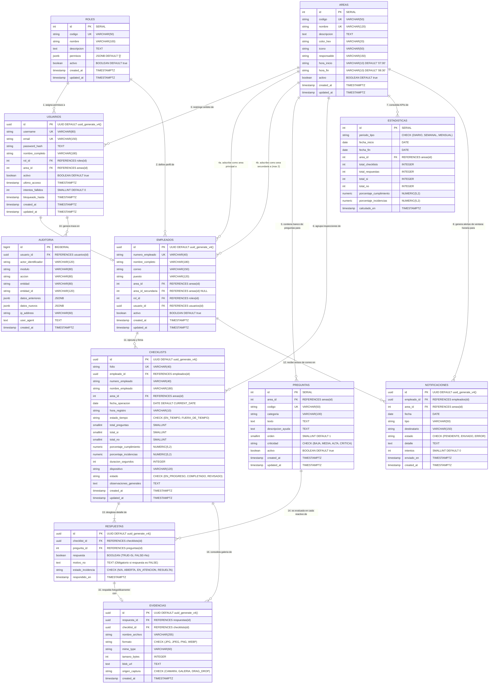
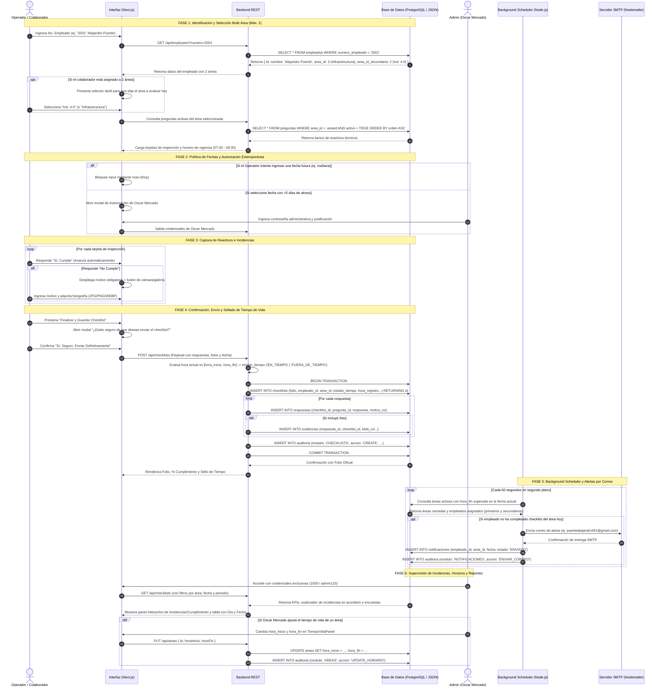

# Modelo Entidad-Relación y Arquitectura de Datos — SmartCheck Enterprise

Este documento detalla formalmente el **Modelo Entidad-Relación (MER)**, el diccionario de datos, el flujo de interconexión y las reglas de integridad referencial de la base de datos de **SmartCheck Enterprise**.

---

## 1. Visión General de la Base de Datos

La base de datos de SmartCheck Enterprise está diseñada bajo la **Tercera Forma Normal (3FN)** en un motor relacional **PostgreSQL**, garantizando:
- **Cero redundancia crítica:** Cada dato tiene una única fuente de verdad.
- **Trazabilidad de procedencia:** Cada registro operativo indica explícitamente de qué tablas extrae su información previa (empleado ejecutor, área evaluada, banco de reactivos).
- **Integridad referencial estricta:** Restricciones a nivel de motor de base de datos (`FOREIGN KEY`, `CHECK`, `UNIQUE`, `ON DELETE CASCADE / RESTRICT`).
- **Soporte transaccional ACID:** Operaciones atómicas al persistir checklists, respuestas vinculadas, evidencias multimedia y eventos de auditoría.

---

## 2. Diagrama Entidad-Relación (ER)

El siguiente diagrama modela las **10 entidades del sistema**, sus atributos esenciales (llaves primarias `PK`, foráneas `FK` y restricciones) y la cardinalidad de sus vínculos.



---

## 3. Matriz Maestra de Relaciones y Procedencia de Datos

La siguiente tabla describe **de dónde extrae datos cada tabla**, los campos foráneos involucrados, su cardinalidad y el comportamiento de integridad referencial configurado:

| Tabla Hija (Destino) | Clave Foránea (`FK`) | Tabla Padre (Origen / De dónde extrae datos) | Clave Primaria (`PK`) | Cardinalidad | Regla `ON UPDATE` | Regla `ON DELETE` | ¿Qué datos y lógica extrae de la tabla origen? |
| :--- | :--- | :--- | :--- | :---: | :---: | :---: | :--- |
| **`usuarios`** | `rol_id` | **`roles`** | `id` | $1:N$ | `CASCADE` | `RESTRICT` | Extrae el catálogo de permisos (`JSONB`) y el código de rol (`ADMIN`, `SUPERVISOR`, `OPERADOR`). Impide borrar un rol si hay cuentas asignadas. |
| **`usuarios`** | `area_id` | **`areas`** | `id` | $1:N$ | `CASCADE` | `SET NULL` | Extrae el área a la que pertenece el usuario administrativo. Si se elimina el área, el usuario se conserva sin área específica. |
| **`empleados`** | `area_id` | **`areas`** | `id` | $1:N$ | `CASCADE` | `RESTRICT` | Extrae la pertenencia departamental primaria del empleado (entre las 7 áreas oficiales: **MES**, **Ind. 4.0**, **Infraestructura**, **Staff IT**, **Digitalizacion**, **SAP**, **Soporte Manufactura**). |
| **`empleados`** | `area_id_secundaria` | **`areas`** | `id` | $1:N$ (opcional) | `CASCADE` | `SET NULL` | Extrae la adscripción técnica secundaria del colaborador (máximo estricto de 2 áreas por empleado, configurado para perfiles como **Alejandro Puente** en Infraestructura e Ind. 4.0). |
| **`empleados`** | `rol_id` | **`roles`** | `id` | $1:N$ | `CASCADE` | `RESTRICT` | Extrae la categorización funcional y permisos en el sistema. |
| **`empleados`** | `usuario_id` | **`usuarios`** | `id` | $1:1$ (opcional) | `CASCADE` | `SET NULL` | Extrae las credenciales del usuario en caso de contar con login al sistema administrativo (ej. Administrador General Oscar Mercado con número `1000`). |
| **`preguntas`** | `area_id` | **`areas`** | `id` | $1:N$ | `CASCADE` | `CASCADE` | Extrae la adscripción técnica. Cada pregunta pertenece a una única área. Si se elimina un área, sus preguntas asociadas se depuran automáticamente. |
| **`checklists`** | `empleado_id` | **`empleados`** | `id` | $1:N$ | `CASCADE` | `RESTRICT` | Extrae la identidad del responsable de la inspección. Protege el historial: no se puede borrar un empleado si ya firmó checklists oficiales. |
| **`checklists`** | `area_id` | **`areas`** | `id` | $1:N$ | `CASCADE` | `RESTRICT` | Extrae el departamento que fue evaluado durante el recorrido, permitiendo agrupar métricas y reportes ejecutivos. |
| **`respuestas`** | `checklist_id` | **`checklists`** | `id` | $1:N$ | `CASCADE` | `CASCADE` | Extrae la cabecera de la inspección. Si se elimina un checklist del sistema, todas sus respuestas detalladas se eliminan en cascada. |
| **`respuestas`** | `pregunta_id` | **`preguntas`** | `id` | $1:N$ | `CASCADE` | `RESTRICT` | Extrae el reactivo evaluado (código, categoría, texto de pregunta). Impide borrar una pregunta si ya cuenta con respuestas históricas auditadas. |
| **`evidencias`** | `respuesta_id` | **`respuestas`** | `id` | $1:1$ (opcional) | `CASCADE` | `CASCADE` | Extrae la incidencia específica (`respuesta = FALSE`) a la que sirve de soporte fotográfico. |
| **`evidencias`** | `checklist_id` | **`checklists`** | `id` | $1:N$ | `CASCADE` | `CASCADE` | Extrae la inspección general para permitir consultas directas y galerías consolidadas por checklist sin joins profundos. |
| **`estadisticas`** | `area_id` | **`areas`** | `id` | $1:N$ | `CASCADE` | `CASCADE` | Extrae la segmentación por área para reportes diarios, semanales y mensuales (o `NULL` si representa el consolidado global de toda la empresa). |
| **`notificaciones`** | `empleado_id` | **`empleados`** | `id` | $1:N$ | `CASCADE` | `CASCADE` | Extrae la ficha del colaborador que no completó su checklist dentro de la ventana de tiempo de vida para enviarle la alerta por correo. |
| **`notificaciones`** | `area_id` | **`areas`** | `id` | $1:N$ | `CASCADE` | `CASCADE` | Extrae el departamento y su horario de vigencia (`hora_inicio` - `hora_fin`) que originó la alerta automática de cierre de ventana. |
| **`auditoria`** | `usuario_id` | **`usuarios`** | `id` | $1:N$ | `CASCADE` | `SET NULL` | Extrae la cuenta del usuario autenticado que ejecutó la operación en el sistema. Si la cuenta es dada de baja, el registro de auditoría permanece inmutable. |

---

## 4. Diccionario de Datos y Especificación Detallada de Tablas

### 4.1 Tabla: `roles` (Control de Acceso Basado en Roles - RBAC)
- **Propósito:** Catálogo maestro que define los roles del sistema y la matriz de permisos en formato JSON estructurado.
- **Tablas de donde extrae datos:** Ninguna (es una tabla catálogo raíz).
- **Tablas hacia donde provee datos:** `usuarios`, `empleados`.

| Columna | Tipo de Dato | Restricciones | Descripción |
| :--- | :--- | :--- | :--- |
| `id` | `SERIAL` | `PRIMARY KEY` | Identificador autoincremental del rol. |
| `codigo` | `VARCHAR(50)` | `NOT NULL, UNIQUE` | Código mnemotécnico (`ADMIN`, `SUPERVISOR`, `OPERADOR`). |
| `nombre` | `VARCHAR(100)` | `NOT NULL` | Nombre descriptivo del rol (ej. "Administrador General"). |
| `descripcion` | `TEXT` | `NULL` | Alcance y responsabilidades asignadas al rol. |
| `permisos` | `JSONB` | `NOT NULL, DEFAULT '[]'` | Lista de permisos granulares (`["*"]`, `["dashboard.view"]`, etc.). |
| `activo` | `BOOLEAN` | `NOT NULL, DEFAULT TRUE` | Indicador de disponibilidad lógica. |
| `created_at` | `TIMESTAMPTZ` | `NOT NULL, DEFAULT NOW()` | Fecha y hora de creación. |
| `updated_at` | `TIMESTAMPTZ` | `NOT NULL, DEFAULT NOW()` | Fecha y hora de última modificación. |

---

### 4.2 Tabla: `areas` (Departamentos Operativos)
- **Propósito:** Define los 7 departamentos evaluables oficiales (**MES**, **Ind. 4.0**, **Infraestructura**, **Staff IT**, **Digitalizacion**, **SAP**, **Soporte Manufactura** y futuras áreas configurables sin modificar código), así como la ventana horaria oficial del tiempo de vida de la encuesta.
- **Tablas de donde extrae datos:** Ninguna (tabla catálogo raíz).
- **Tablas hacia donde provee datos:** `usuarios`, `empleados` (área primaria y secundaria), `preguntas`, `checklists`, `estadisticas`, `notificaciones`.

| Columna | Tipo de Dato | Restricciones | Descripción |
| :--- | :--- | :--- | :--- |
| `id` | `SERIAL` | `PRIMARY KEY` | Identificador autoincremental del área. |
| `codigo` | `VARCHAR(50)` | `NOT NULL, UNIQUE` | Clave corta única (`MES`, `IND4`, `INFRA`, `STAF`, `DIGI`, `SAP`, `SMAN`). |
| `nombre` | `VARCHAR(120)` | `NOT NULL, UNIQUE` | Nombre completo oficial del departamento. |
| `descripcion` | `TEXT` | `NULL` | Alcance técnico y responsabilidades del área. |
| `color_hex` | `VARCHAR(20)` | `NOT NULL, DEFAULT '#2563EB'` | Código de color para identificación en UI y gráficas ejecutivas. |
| `icono` | `VARCHAR(50)` | `NOT NULL, DEFAULT 'Building2'` | Identificador del icono para frontend (ej. `Server`, `Cpu`, `Layers`, `Bot`). |
| `responsable` | `VARCHAR(150)` | `NULL` | Nombre del líder o jefe de departamento a cargo. |
| `hora_inicio` | `VARCHAR(10)` | `NOT NULL, DEFAULT '07:00'` | Hora de apertura de la ventana del tiempo de vida de la encuesta (`HH:MM`). |
| `hora_fin` | `VARCHAR(10)` | `NOT NULL, DEFAULT '08:30'` | Hora límite de cierre de la ventana de vigencia de la encuesta (`HH:MM`). |
| `activo` | `BOOLEAN` | `NOT NULL, DEFAULT TRUE` | Indicador de estado para permitir o pausar evaluaciones. |
| `created_at` | `TIMESTAMPTZ` | `NOT NULL, DEFAULT NOW()` | Fecha de registro. |
| `updated_at` | `TIMESTAMPTZ` | `NOT NULL, DEFAULT NOW()` | Fecha de actualización vía trigger. |

---

### 4.3 Tabla: `usuarios` (Cuentas de Acceso Administrativo)
- **Propósito:** Gestión de cuentas autenticadas para administradores y supervisores de plataforma. Protege el centro de control con login exclusivo y contraseñas cifradas.
- **Tablas de donde extrae datos:**
  - Extrae `rol_id` desde **`roles(id)`** para determinar privilegios y autorizaciones en la API.
  - Extrae `area_id` desde **`areas(id)`** para delimitar vistas y filtros permitidos.
- **Tablas hacia donde provee datos:** `empleados` (vía `usuario_id`), `auditoria` (vía `usuario_id`).

| Columna | Tipo de Dato | Restricciones | Descripción |
| :--- | :--- | :--- | :--- |
| `id` | `UUID` | `PRIMARY KEY, DEFAULT uuid_generate_v4()` | Identificador universal único. |
| `username` | `VARCHAR(80)` | `NOT NULL, UNIQUE` | Nombre de usuario para login (ej. `admin`, `1000`). |
| `email` | `VARCHAR(150)` | `UNIQUE, NULL` | Correo electrónico corporativo. |
| `password_hash` | `TEXT` | `NOT NULL` | Hash de contraseña seguro (PBKDF2 / Argon2 / bcrypt). |
| `nombre_completo` | `VARCHAR(180)` | `NOT NULL` | Nombre completo del usuario. |
| `rol_id` | `INTEGER` | `NOT NULL, FK -> roles(id)` | **Extrae:** ID del rol asignado (ej. ADMIN). |
| `area_id` | `INTEGER` | `NULL, FK -> areas(id)` | **Extrae:** ID del área a la que está asignado (o `NULL` si es global). |
| `activo` | `BOOLEAN` | `NOT NULL, DEFAULT TRUE` | Control de habilitación del usuario. |
| `ultimo_acceso` | `TIMESTAMPTZ` | `NULL` | Timestamp del último inicio de sesión exitoso. |
| `intentos_fallidos` | `SMALLINT` | `NOT NULL, DEFAULT 0` | Contador para mitigación de ataques por fuerza bruta. |
| `bloqueado_hasta` | `TIMESTAMPTZ` | `NULL` | Fecha/hora hasta la cual la cuenta está temporalmente bloqueada. |
| `created_at` | `TIMESTAMPTZ` | `NOT NULL, DEFAULT NOW()` | Fecha de registro del usuario. |
| `updated_at` | `TIMESTAMPTZ` | `NOT NULL, DEFAULT NOW()` | Fecha de modificación del registro. |

---

### 4.4 Tabla: `empleados` (Padrón Operativo del Personal)
- **Propósito:** Registro maestro de operadores y jefes de departamento. Permite la búsqueda y **autocompletado instantáneo (<10ms)** ingresando únicamente el `numero_empleado`, y soporta la regla de adscripción multi-área con un límite máximo estricto de 2 áreas operativas.
- **Tablas de donde extrae datos:**
  - Extrae `area_id` desde **`areas(id)`**: Asigna el área principal técnica del empleado.
  - Extrae `area_id_secundaria` desde **`areas(id)`**: Permite asignar una segunda área complementaria (ej. Alejandro Puente adscrito a Infraestructura e Ind. 4.0).
  - Extrae `rol_id` desde **`roles(id)`**: Define el nivel jerárquico dentro de la organización.
  - Extrae `usuario_id` desde **`usuarios(id)`**: Si el empleado tiene acceso al centro de control administrativo (ej. Oscar Mercado con `numero_empleado = '1000'`).
- **Tablas hacia donde provee datos:** `checklists` (vía `empleado_id`), `notificaciones` (vía `empleado_id`).

| Columna | Tipo de Dato | Restricciones | Descripción |
| :--- | :--- | :--- | :--- |
| `id` | `UUID` | `PRIMARY KEY, DEFAULT uuid_generate_v4()` | Identificador universal único. |
| `numero_empleado` | `VARCHAR(40)` | `NOT NULL, UNIQUE` | Número de nómina o gafete (ej. `1000`, `2001`, `3001`). Indexado. |
| `nombre_completo` | `VARCHAR(180)` | `NOT NULL` | Nombre y apellidos del trabajador. |
| `correo` | `VARCHAR(150)` | `NULL` | Correo electrónico de contacto o notificaciones (ej. `puentealejandro491@gmail.com`). |
| `puesto` | `VARCHAR(120)` | `NULL` | Título del puesto (ej. "Jefe de Infraestructura", "Especialista Ind 4.0"). |
| `area_id` | `INTEGER` | `NOT NULL, FK -> areas(id)` | **Extrae:** Identificador del área operativa principal. |
| `area_id_secundaria` | `INTEGER` | `NULL, FK -> areas(id)` | **Extrae:** Segunda área opcional asignada por Oscar Mercado (máx. 2 áreas). |
| `rol_id` | `INTEGER` | `NOT NULL, FK -> roles(id)` | **Extrae:** Rol jerárquico asignado. |
| `usuario_id` | `UUID` | `NULL, FK -> usuarios(id)` | **Extrae:** Vínculo opcional con su cuenta de acceso al Dashboard. |
| `activo` | `BOOLEAN` | `NOT NULL, DEFAULT TRUE` | Estatus operativo en plantilla. |
| `created_at` | `TIMESTAMPTZ` | `NOT NULL, DEFAULT NOW()` | Fecha de alta en el sistema. |
| `updated_at` | `TIMESTAMPTZ` | `NOT NULL, DEFAULT NOW()` | Fecha de última edición. |

---

### 4.5 Tabla: `preguntas` (Banco Dinámico de Inspección por Área)
- **Propósito:** Almacena los ítems o preguntas que componen el checklist de cada una de las 7 áreas industriales oficiales, incluyendo nivel de criticidad y orden de presentación en las tarjetas interactivas.
- **Tablas de donde extrae datos:**
  - Extrae `area_id` desde **`areas(id)`**: Asocia cada reactivo al departamento correspondiente. Cuando un empleado inicia su checklist, el sistema extrae todas las preguntas activas donde `preguntas.area_id = empleado.area_id` (o del área seleccionada en caso multi-área).
- **Tablas hacia donde provee datos:** `respuestas` (vía `pregunta_id`).

| Columna | Tipo de Dato | Restricciones | Descripción |
| :--- | :--- | :--- | :--- |
| `id` | `SERIAL` | `PRIMARY KEY` | Identificador único del reactivo. |
| `area_id` | `INTEGER` | `NOT NULL, FK -> areas(id)` | **Extrae:** ID del área técnica a la que pertenece esta pregunta. |
| `codigo` | `VARCHAR(50)` | `NOT NULL, UNIQUE` | Clave técnica única (ej. `INF-01`, `IND-02`, `MES-03`). |
| `categoria` | `VARCHAR(100)` | `NOT NULL` | Módulo o subsistema (ej. Climatización, Redes, Sensores IoT, Servidores ERP). |
| `texto` | `TEXT` | `NOT NULL` | Texto de la pregunta que responde el operador. |
| `descripcion_ayuda` | `TEXT` | `NULL` | Guía técnica explicativa desplegada en la tarjeta. |
| `orden` | `SMALLINT` | `NOT NULL, DEFAULT 1` | Posición secuencial de la tarjeta en el flujo. |
| `criticidad` | `VARCHAR(20)` | `NOT NULL, CHECK (criticidad IN ('BAJA', 'MEDIA', 'ALTA', 'CRITICA'))` | Severidad del reactivo ante un eventual incumplimiento. |
| `activo` | `BOOLEAN` | `NOT NULL, DEFAULT TRUE` | Permite retirar preguntas del flujo sin eliminar historial. |
| `created_at` | `TIMESTAMPTZ` | `NOT NULL, DEFAULT NOW()` | Fecha de alta del reactivo. |
| `updated_at` | `TIMESTAMPTZ` | `NOT NULL, DEFAULT NOW()` | Fecha de modificación. |

---

### 4.6 Tabla: `checklists` (Cabecera de Inspecciones Realizadas)
- **Propósito:** Registra cada ejecución de inspección realizada en campo, con su folio oficial, fecha de operación, hora de registro, estado del tiempo de vida, métricas precalculadas y resumen de cumplimiento.
- **Tablas de donde extrae datos:**
  - Extrae `empleado_id` desde **`empleados(id)`**: Persona responsable que contestó y confirmó el checklist.
  - Extrae `area_id` desde **`areas(id)`**: Departamento físico evaluado durante la inspección.
  - Hereda `numero_empleado` y `nombre_empleado` desde **`empleados`** en el momento de la captura (para preservar el registro inmutable en caso de modificaciones futuras del catálogo).
- **Tablas hacia donde provee datos:** `respuestas` (vía `checklist_id`), `evidencias` (vía `checklist_id`).

| Columna | Tipo de Dato | Restricciones | Descripción |
| :--- | :--- | :--- | :--- |
| `id` | `UUID` | `PRIMARY KEY, DEFAULT uuid_generate_v4()` | Identificador universal único de la inspección. |
| `folio` | `VARCHAR(40)` | `NOT NULL, UNIQUE` | Folio de control único generado (ej. `CHK-20261019-2001-A1B2`). |
| `empleado_id` | `UUID` | `NOT NULL, FK -> empleados(id)` | **Extrae:** ID del empleado ejecutor. |
| `numero_empleado` | `VARCHAR(40)` | `NOT NULL` | **Extrae de:** `empleados.numero_empleado` (copia inmutable). |
| `nombre_empleado` | `VARCHAR(180)` | `NOT NULL` | **Extrae de:** `empleados.nombre_completo` (copia inmutable). |
| `area_id` | `INTEGER` | `NOT NULL, FK -> areas(id)` | **Extrae:** ID del área inspeccionada. |
| `fecha_operacion` | `DATE` | `NOT NULL, DEFAULT CURRENT_DATE` | Fecha formal de la inspección (estrictamente <= HOY; si es >5 días atrás, requiere autorización Oscar Mercado). |
| `hora_registro` | `VARCHAR(10)` | `NOT NULL` | Hora local exacta en la que se asentó la encuesta (`HH:MM:SS`). |
| `estado_tiempo` | `VARCHAR(30)` | `NOT NULL, CHECK (estado_tiempo IN ('EN_TIEMPO', 'FUERA_DE_TIEMPO'))` | Estado de vigencia horaria respecto a la ventana del área (`07:00 - 08:30`). |
| `total_preguntas` | `SMALLINT` | `NOT NULL, DEFAULT 0` | Total de tarjetas evaluadas en la sesión. |
| `total_si` | `SMALLINT` | `NOT NULL, DEFAULT 0` | Total de preguntas contestadas afirmativamente ("Sí, Cumple"). |
| `total_no` | `SMALLINT` | `NOT NULL, DEFAULT 0` | Total de preguntas contestadas negativamente ("No Cumple"). |
| `porcentaje_cumplimiento` | `NUMERIC(5,2)` | `NOT NULL, DEFAULT 0.00` | Cálculo automático: $(\text{total\_si} / \text{total\_preguntas}) \times 100$. |
| `porcentaje_incidencias` | `NUMERIC(5,2)` | `NOT NULL, DEFAULT 0.00` | Cálculo automático: $(\text{total\_no} / \text{total\_preguntas}) \times 100$. |
| `duracion_segundos` | `INTEGER` | `DEFAULT 0` | Tiempo total transcurrido desde el inicio hasta el envío del checklist. |
| `dispositivo` | `VARCHAR(120)` | `NULL` | Información del dispositivo/navegador que ejecutó la captura. |
| `estado` | `VARCHAR(30)` | `NOT NULL, CHECK (estado IN ('EN_PROGRESO', 'COMPLETADO', 'REVISADO'))` | Estado del ciclo de vida del checklist. |
| `observaciones_generales` | `TEXT` | `NULL` | Notas u observaciones adicionales del responsable. |
| `created_at` | `TIMESTAMPTZ` | `NOT NULL, DEFAULT NOW()` | Fecha y hora exacta de inserción en la base de datos. |
| `updated_at` | `TIMESTAMPTZ` | `NOT NULL, DEFAULT NOW()` | Fecha de última modificación. |

---

### 4.7 Tabla: `respuestas` (Detalle Ítem por Ítem e Incidencias)
- **Propósito:** Detalla la evaluación de cada pregunta individual dentro de un checklist. Contiene la **regla de integridad estricta del negocio**: si la respuesta es `No Cumple`, el campo `motivo_no` es estrictamente obligatorio a nivel de motor de base de datos.
- **Tablas de donde extrae datos:**
  - Extrae `checklist_id` desde **`checklists(id)`**: Inspección a la que pertenece esta respuesta.
  - Extrae `pregunta_id` desde **`preguntas(id)`**: Reactivo técnico que fue contestado.
- **Tablas hacia donde provee datos:** `evidencias` (vía `respuesta_id`).

| Columna | Tipo de Dato | Restricciones | Descripción |
| :--- | :--- | :--- | :--- |
| `id` | `UUID` | `PRIMARY KEY, DEFAULT uuid_generate_v4()` | Identificador universal único de la respuesta. |
| `checklist_id` | `UUID` | `NOT NULL, FK -> checklists(id)` | **Extrae:** ID del checklist padre al que pertenece este ítem. |
| `pregunta_id` | `INTEGER` | `NOT NULL, FK -> preguntas(id)` | **Extrae:** ID de la pregunta evaluada. |
| `respuesta` | `BOOLEAN` | `NOT NULL` | Valor booleano: `TRUE` = "Sí, Cumple" (✅), `FALSE` = "No Cumple" (❌). |
| `motivo_no` | `TEXT` | `NULL` | Justificación obligatoria cuando `respuesta = FALSE`. Validado por restricción de tabla. |
| `estado_incidencia` | `VARCHAR(30)` | `DEFAULT 'ABIERTA', CHECK (estado_incidencia IN ('N/A', 'ABIERTA', 'EN_ATENCION', 'RESUELTA'))` | Estado de seguimiento técnico para incidencias detectadas. |
| `respondido_en` | `TIMESTAMPTZ` | `NOT NULL, DEFAULT NOW()` | Momento en el que se contestó el reactivo. |

> **Regla de Integridad (CHECK Constraint):**
> ```sql
> CONSTRAINT chk_motivo_obligatorio_en_no CHECK (
>     (respuesta = TRUE) OR (respuesta = FALSE AND motivo_no IS NOT NULL AND LENGTH(TRIM(motivo_no)) > 0)
> )
> ```
> El motor de base de datos rechaza cualquier intento de registrar un `"No Cumple"` sin motivo explicativo.

---

### 4.8 Tabla: `evidencias` (Soporte Multimedia y Fotografías)
- **Propósito:** Almacena los metadatos y ubicaciones (URL de Azure Blob Storage o Base64 Data URL) de las fotografías adjuntas a las respuestas negativas como evidencia de incumplimiento.
- **Tablas de donde extrae datos:**
  - Extrae `respuesta_id` desde **`respuestas(id)`**: Respuesta de incidencia específica que motivó la fotografía.
  - Extrae `checklist_id` desde **`checklists(id)`**: Inspección global para acelerar búsquedas agrupadas.
- **Tablas hacia donde provee datos:** Ninguna (es un nodo final de soporte documental).

| Columna | Tipo de Dato | Restricciones | Descripción |
| :--- | :--- | :--- | :--- |
| `id` | `UUID` | `PRIMARY KEY, DEFAULT uuid_generate_v4()` | Identificador único del archivo de evidencia. |
| `respuesta_id` | `UUID` | `NOT NULL, FK -> respuestas(id)` | **Extrae:** ID de la respuesta negativa respaldada. |
| `checklist_id` | `UUID` | `NOT NULL, FK -> checklists(id)` | **Extrae:** ID del checklist contenedor. |
| `nombre_archivo` | `VARCHAR(255)` | `NOT NULL` | Nombre físico del archivo sanitizado. |
| `formato` | `VARCHAR(20)` | `NOT NULL, CHECK (formato IN ('JPG', 'JPEG', 'PNG', 'WEBP'))` | Formato admitido de imagen. |
| `mime_type` | `VARCHAR(60)` | `NOT NULL, CHECK (mime_type IN ('image/jpeg', 'image/png', 'image/webp'))` | Tipo MIME oficial validado. |
| `tamano_bytes` | `INTEGER` | `NOT NULL, DEFAULT 0` | Peso de la imagen en bytes. |
| `blob_url` | `TEXT` | `NOT NULL` | URI pública o SAS token de Azure Blob Storage / Data URL persistido. |
| `origen_captura` | `VARCHAR(30)` | `NOT NULL, DEFAULT 'GALERIA', CHECK (origen_captura IN ('CAMARA', 'GALERIA', 'DRAG_DROP'))` | Método empleado por el usuario para anexar la fotografía. |
| `created_at` | `TIMESTAMPTZ` | `NOT NULL, DEFAULT NOW()` | Fecha y hora de carga de la evidencia. |

---

### 4.9 Tabla: `estadisticas` (Consolidación de Métricas y Business Intelligence)
- **Propósito:** Tabla de agregaciones analíticas para alimentar el Dashboard Ejecutivo en tres horizontes temporales (**Diario**, **Semanal** y **Mensual**), optimizando el tiempo de consulta sin recalcular miles de registros en caliente.
- **Tablas de donde extrae datos:**
  - Extrae `area_id` desde **`areas(id)`**: Agrupa por área (o almacena `NULL` para la métrica consolidada de toda la empresa).
  - Extrae y consolida las sumatorias desde **`checklists`** (`total_preguntas`, `total_si`, `total_no`).
- **Tablas hacia donde provee datos:** Módulos de analítica, gráficas de Recharts y exportación a PDF/Excel.

| Columna | Tipo de Dato | Restricciones | Descripción |
| :--- | :--- | :--- | :--- |
| `id` | `SERIAL` | `PRIMARY KEY` | Identificador autoincremental de la métrica agregada. |
| `periodo_tipo` | `VARCHAR(20)` | `NOT NULL, CHECK (periodo_tipo IN ('DIARIO', 'SEMANAL', 'MENSUAL'))` | Horizonte analítico del cálculo. |
| `fecha_inicio` | `DATE` | `NOT NULL` | Fecha de apertura de la ventana de análisis. |
| `fecha_fin` | `DATE` | `NOT NULL` | Fecha de cierre de la ventana de análisis. |
| `area_id` | `INTEGER` | `NULL, FK -> areas(id)` | **Extrae:** Área evaluada (o `NULL` si representa el total global). |
| `total_checklists` | `INTEGER` | `NOT NULL, DEFAULT 0` | Volumen de inspecciones concluidas en el periodo. |
| `total_respuestas` | `INTEGER` | `NOT NULL, DEFAULT 0` | Cantidad total de preguntas evaluadas. |
| `total_si` | `INTEGER` | `NOT NULL, DEFAULT 0` | Total de ítems aprobados. |
| `total_no` | `INTEGER` | `NOT NULL, DEFAULT 0` | Total de anomalías o fallas detectadas. |
| `porcentaje_cumplimiento` | `NUMERIC(5,2)` | `NOT NULL, DEFAULT 0.00` | $(\text{total\_si} / \text{total\_respuestas}) \times 100$. |
| `porcentaje_incidencias` | `NUMERIC(5,2)` | `NOT NULL, DEFAULT 0.00` | $(\text{total\_no} / \text{total\_respuestas}) \times 100$. |
| `calculado_en` | `TIMESTAMPTZ` | `NOT NULL, DEFAULT NOW()` | Marca temporal de la ejecución del recálculo. |

---

### 4.10 Tabla: `auditoria` (Bitácora Inmutable de Seguridad y Trazabilidad)
- **Propósito:** Registro estricto de eventos de seguridad, operaciones CRUD, inicios y cierres de sesión, eliminaciones en cascada y modificaciones del sistema para cumplimiento normativo.
- **Tablas de donde extrae datos:**
  - Extrae `usuario_id` desde **`usuarios(id)`**: Identidad digital del actor autenticado que ejecutó la operación (o `NULL` si fue una operación pública de campo).
- **Tablas hacia donde provee datos:** Vistas de auditoría del Administrador General.

| Columna | Tipo de Dato | Restricciones | Descripción |
| :--- | :--- | :--- | :--- |
| `id` | `BIGSERIAL` | `PRIMARY KEY` | Identificador único secuencial de 64 bits. |
| `usuario_id` | `UUID` | `NULL, FK -> usuarios(id)` | **Extrae:** ID del usuario responsable del evento. |
| `actor_identificador` | `VARCHAR(120)` | `NOT NULL` | Referencia visible del actor (ej. `admin`, `emp-2001`, `1000`). |
| `modulo` | `VARCHAR(80)` | `NOT NULL` | Subsistema involucrado (`AUTH`, `CHECKLISTS`, `AREAS`, `USUARIOS`). |
| `accion` | `VARCHAR(80)` | `NOT NULL` | Verbo ejecutado (`LOGIN`, `LOGOUT`, `CREATE`, `UPDATE`, `DELETE_CASCADE`). |
| `entidad` | `VARCHAR(80)` | `NOT NULL` | Tabla o recurso afectado (`checklists`, `usuarios`, `areas`). |
| `entidad_id` | `VARCHAR(120)` | `NULL` | ID del registro modificado o eliminado. |
| `datos_anteriores` | `JSONB` | `NULL` | Estado del registro antes de la mutación. |
| `datos_nuevos` | `JSONB` | `NULL` | Estado del registro después de la mutación. |
| `ip_address` | `VARCHAR(60)` | `NULL` | Dirección IP cliente desde donde se originó la petición. |
| `user_agent` | `TEXT` | `NULL` | Firma del navegador o agente HTTP que invocó la acción. |
| `created_at` | `TIMESTAMPTZ` | `NOT NULL, DEFAULT NOW()` | Marca temporal inmutable del evento. |

---

### 4.11 Tabla: `notificaciones` (Control y Bitácora de Alertas de Tiempo de Vida)
- **Propósito:** Registro y monitoreo de los correos electrónicos despachados automáticamente por el sistema cuando concluye la ventana horaria de un área (`hora_fin`) sin que los encargados hayan respondido su checklist diario.
- **Tablas de donde extrae datos:**
  - Extrae `empleado_id` desde **`empleados(id)`**: Destinatario de la alerta que tiene asignada dicha área (primaria o secundaria).
  - Extrae `area_id` desde **`areas(id)`**: Departamento cuya ventana operativa cerró sin checklist registrado.
- **Tablas hacia donde provee datos:** Módulo `TiempoVidaPanel.tsx` del Administrador General y reportes de auditoría.

| Columna | Tipo de Dato | Restricciones | Descripción |
| :--- | :--- | :--- | :--- |
| `id` | `UUID` | `PRIMARY KEY, DEFAULT uuid_generate_v4()` | Identificador universal único de la notificación. |
| `empleado_id` | `UUID` | `NOT NULL, FK -> empleados(id)` | **Extrae:** ID del colaborador notificado. |
| `area_id` | `INTEGER` | `NOT NULL, FK -> areas(id)` | **Extrae:** ID del área técnica que cerró su ventana sin encuesta. |
| `fecha` | `DATE` | `NOT NULL` | Fecha de la jornada evaluada (`YYYY-MM-DD`). |
| `tipo` | `VARCHAR(50)` | `NOT NULL, DEFAULT 'TIEMPO_VIDA_EXPIRADO'` | Código de plantilla o tipo de notificación enviada. |
| `destinatario` | `VARCHAR(150)` | `NOT NULL` | Correo electrónico de destino (ej. `puentealejandro491@gmail.com`). |
| `estado` | `VARCHAR(30)` | `NOT NULL, CHECK (estado IN ('PENDIENTE', 'ENVIADO', 'ERROR'))` | Estado del envío a través del servidor SMTP (Nodemailer). |
| `detalle` | `TEXT` | `NULL` | Mensaje descriptivo o respuesta del servidor de correo. |
| `intentos` | `SMALLINT` | `NOT NULL, DEFAULT 0` | Contador de reintentos en caso de falla de conexión. |
| `enviado_en` | `TIMESTAMPTZ` | `NULL` | Marca de tiempo exacta del envío exitoso. |
| `created_at` | `TIMESTAMPTZ` | `NOT NULL, DEFAULT NOW()` | Fecha y hora de creación del registro. |

---

## 5. Flujo Operativo y Extracción de Datos Paso a Paso

A continuación se describe la secuencia técnica de cómo la base de datos interactúa, extrae y persiste la información durante el ciclo de vida del software:



---

## 6. Índices de Rendimiento para Alta Concurrencia

Para garantizar tiempos de respuesta inferiores a **10 milisegundos** bajo operaciones en campo, el esquema cuenta con los siguientes índices especializados:

```sql
-- 1. Búsqueda instantánea en autocompletado de empleados
CREATE INDEX idx_empleados_numero ON empleados(numero_empleado);
CREATE INDEX idx_empleados_area ON empleados(area_id);
CREATE INDEX idx_empleados_activo ON empleados(activo);

-- 2. Carga optimizada de banco de preguntas activas por área
CREATE INDEX idx_preguntas_area_orden ON preguntas(area_id, orden) WHERE activo = TRUE;

-- 3. Consultas y filtrado temporal de checklists para el Dashboard
CREATE INDEX idx_checklists_fecha ON checklists(fecha_operacion DESC);
CREATE INDEX idx_checklists_area_fecha ON checklists(area_id, fecha_operacion DESC);
CREATE INDEX idx_checklists_empleado ON checklists(empleado_id, fecha_operacion DESC);

-- 4. Búsqueda rápida de respuestas e incidencias activas
CREATE INDEX idx_respuestas_checklist ON respuestas(checklist_id);
CREATE INDEX idx_respuestas_incidencias ON respuestas(respuesta, respondido_en DESC) WHERE respuesta = FALSE;

-- 5. Recuperación de evidencias fotográficas
CREATE INDEX idx_evidencias_respuesta ON evidencias(respuesta_id);
CREATE INDEX idx_evidencias_checklist ON evidencias(checklist_id);

-- 6. Agregaciones de Business Intelligence y bitácora de auditoría
CREATE INDEX idx_estadisticas_periodo ON estadisticas(periodo_tipo, fecha_inicio DESC);
CREATE INDEX idx_auditoria_fecha_modulo ON auditoria(created_at DESC, modulo);

-- 7. Consultas de personal multi-área y vigencia de tiempo de vida
CREATE INDEX idx_empleados_area_secundaria ON empleados(area_id_secundaria) WHERE area_id_secundaria IS NOT NULL;
CREATE INDEX idx_checklists_estado_tiempo ON checklists(estado_tiempo, fecha_operacion DESC);
CREATE INDEX idx_notificaciones_fecha_area ON notificaciones(fecha, area_id, estado);
```

---

## 7. Triggers y Funciones de Automatización

El esquema implementa un trigger que sincroniza automáticamente el campo `updated_at` cada vez que se actualiza una fila en las tablas maestras, previniendo desfases temporales en auditorías:

```sql
CREATE OR REPLACE FUNCTION fn_actualizar_timestamp()
RETURNS TRIGGER AS $$
BEGIN
    NEW.updated_at = NOW();
    RETURN NEW;
END;
$$ LANGUAGE plpgsql;

CREATE TRIGGER trg_areas_updated BEFORE UPDATE ON areas FOR EACH ROW EXECUTE FUNCTION fn_actualizar_timestamp();
CREATE TRIGGER trg_usuarios_updated BEFORE UPDATE ON usuarios FOR EACH ROW EXECUTE FUNCTION fn_actualizar_timestamp();
CREATE TRIGGER trg_empleados_updated BEFORE UPDATE ON empleados FOR EACH ROW EXECUTE FUNCTION fn_actualizar_timestamp();
CREATE TRIGGER trg_preguntas_updated BEFORE UPDATE ON preguntas FOR EACH ROW EXECUTE FUNCTION fn_actualizar_timestamp();
CREATE TRIGGER trg_checklists_updated BEFORE UPDATE ON checklists FOR EACH ROW EXECUTE FUNCTION fn_actualizar_timestamp();
```

---

## 8. Conclusiones Arquitectónicas del Modelo de Datos

1. **Autonomía Operativa de Áreas:** La tabla `areas` actúa como pivote dinámico. Si el negocio requiere incorporar nuevas áreas técnicas (ej. *Seguridad Industrial* o *Telecomunicaciones Avanzadas*), se añade un registro en `areas` y sus respectivas `preguntas` sin necesidad de alterar el código fuente ni la estructura del motor de base de datos.
2. **Defensa en Profundidad en Incidencias:** La exigencia del motivo ante un "No Cumple" está blindada tanto en el frontend React, como en la capa API REST y en la restricción `chk_motivo_obligatorio_en_no` de la base de datos.
3. **Persistencia Híbrida y Portabilidad:** El modelo está implementado nativamente en SQL de producción para **PostgreSQL** ([`database/schema_postgresql.sql`](file:///C:/Users/alejpue5/Documents/proyectos/CheckList/database/schema_postgresql.sql)) y cuenta con un adaptador local JSON transaccional en [`src/lib/db.ts`](file:///C:/Users/alejpue5/Documents/proyectos/CheckList/src/lib/db.ts) con soporte para imágenes optimizadas y Azure Blob Storage.
4. **Arquitectura Multi-Área con Límite Estricto (Máx. 2):** El modelo soporta formalmente la asignación de hasta dos áreas por colaborador (`area_id` y `area_id_secundaria`), validando la no repetición de departamentos y permitiendo que trabajadores como Alejandro Puente elijan interactivamente el área a auditar en cada sesión.
5. **Vigencia Temporal y Alertas Proactivas por Correo:** La incorporación de `hora_inicio` y `hora_fin` en `areas`, el sellado `estado_tiempo` en `checklists` y la tabla `notificaciones` permiten medir la puntualidad en reportes y automatizar el despacho de correos SMTP (Nodemailer) cuando una jornada concluye sin encuesta.
