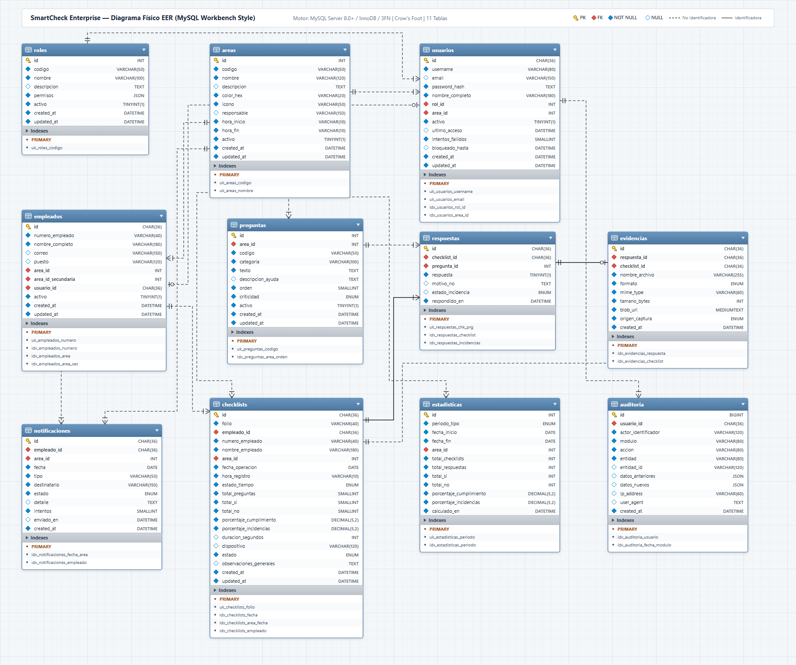
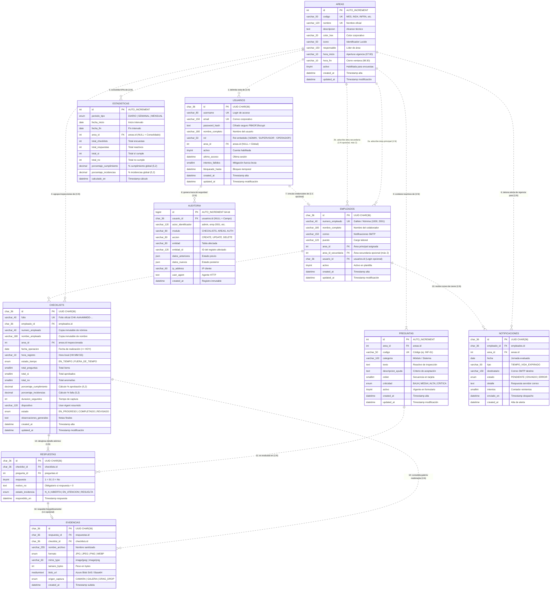
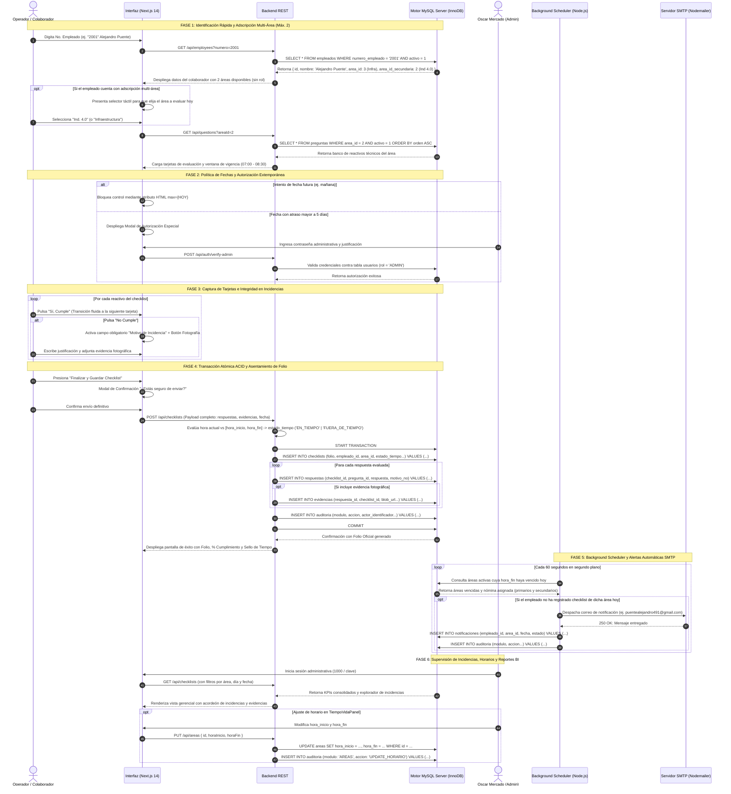

# Modelo Entidad-Relación y Arquitectura Física de Base de Datos — SmartCheck Enterprise

Este documento constituye la especificación formal del **Modelo Entidad-Relación Extendido (EER - Enhanced Entity-Relationship)** y el **Diccionario de Datos Físico** de **SmartCheck Enterprise**, diseñado para **MySQL Server 8.0+** (Motor **InnoDB**, codificación **utf8mb4** y ordenamiento **utf8mb4_unicode_ci**) en estricto apego a las mejores prácticas de **Ingeniería en Base de Datos Relacionales** y a la notación visual estándar de **MySQL Workbench** (`ER_Ejemplo.png`, `ER_Ejemplo2.png`).

---

## 1. Diagrama Físico Entidad-Relación (EER — Estilo MySQL Workbench)

El siguiente diagrama presenta el esquema relacional completo compuesto por **10 tablas en Tercera Forma Normal (3FN)** sobre motor **MySQL Server 8.0+ (InnoDB)** (arquitectura optimizada tras la **eliminación de la tabla roles**), con tipado físico estricto, claves primarias (`PK`), claves foráneas (`FK`), atributos obligatorios (`NOT NULL`), opcionales (`NULL`), subpaneles de índices físicos (`Indexes`) y cardinalidades con notación **Crow's Foot (Pata de Cuervo)**:



> [!TIP]
> **Artefactos y Recursos de Base de Datos Disponibles en esta Carpeta:**
> - 💾 **Script DDL Oficial para MySQL Server 8.0+:** [`schema_mysql.sql`](file:///C:/Users/alejpue5/Documents/Proyectos/CheckList/ER/schema_mysql.sql) (Script completo ejecutable con creación de tablas, índices, llaves foráneas y datos semilla).
> - 📄 **Vectorial SVG (Escalabilidad Infinita):** [`ER_Diagrama_Fisico.svg`](file:///C:/Users/alejpue5/Documents/Proyectos/CheckList/ER/ER_Diagrama_Fisico.svg)
> - 🌐 **Visor Interactivo Web con Zoom y Panorámica:** [`ER_Diagrama_Workbench.html`](file:///C:/Users/alejpue5/Documents/Proyectos/CheckList/ER/ER_Diagrama_Workbench.html) (Abrir con doble clic en cualquier navegador).
> - 🖼️ **Captura Rasterizada HD (2K):** [`ER_Diagrama_Fisico.png`](file:///C:/Users/alejpue5/Documents/Proyectos/CheckList/ER/ER_Diagrama_Fisico.png)

---

## 2. Convenciones y Simbología de Ingeniería en Base de Datos (MySQL Workbench)

En estricto apego al estándar de modelado relacional físico observado en herramientas profesionales de diseño (e.g. *MySQL Workbench* en `ER_Ejemplo.png` y `ER_Ejemplo2.png`), se emplean las siguientes convenciones semánticas:

### 2.1 Marcadores de Atributos y Claves
| Símbolo | Significado Relacional | Descripción Técnica en MySQL Server |
| :---: | :--- | :--- |
| 🔑 | **Primary Key (PK)** | Identificador único irrepetible de la entidad (`INT AUTO_INCREMENT`, `BIGINT AUTO_INCREMENT` o `CHAR(36)` UUID). |
| 🔴 | **Foreign Key (FK)** | Clave foránea que referencia la clave primaria de una tabla padre. Posee índice `BTREE` automático. |
| 🔷 | **Not Null (NN)** | Atributo físico de captura obligatoria (`NOT NULL`). |
| ⚪ | **Nullable (NULL)** | Atributo opcional que admite valores ausentes o nulos (`NULL`). |

### 2.2 Notación de Líneas y Conectores de Relación
| Tipo de Trazo | Denominación Relacional | Criterio de Ingeniería |
| :---: | :--- | :--- |
| **`- - - - -` (Línea Discontinua)** | **Relación No Identificadora (Non-Identifying)** | La clave foránea es un atributo ordinario en la tabla hija y **no forma parte de su clave primaria**. La tabla hija posee identidad propia e independiente (ej. `empleado_id` en `checklists`). |
| **`───────` (Línea Continua)** | **Relación Identificadora (Identifying)** | La existencia de la fila hija depende existencialmente de la tabla padre, o la clave foránea forma parte de su clave primaria compuesta (ej. `checklist_id` en `respuestas`). |

### 2.3 Simbología Crow's Foot (Pata de Cuervo)
- **`||` (Uno y sólo uno):** Cardinalidad exacta obligatoria ($1:1$).
- **`|o` (Cero o uno):** Cardinalidad opcional ($0..1$).
- **`|{` (Uno o muchos):** Cardinalidad múltiple obligatoria ($1..N$).
- **`o{` (Cero o muchos):** Cardinalidad múltiple opcional ($0..N$).

---

## 3. Especificación Mermaid Crow's Foot (Render Nativo en Markdown)

Para entornos con renderizadores Markdown automáticos (GitHub, GitLab, Obsidian, VS Code), el siguiente bloque define formalmente las 10 entidades con sus tipos físicos **MySQL Server 8.0+**, tipos de clave y tipos de línea relacional:



---

## 4. Matriz Maestra de Relaciones Físicas e Integridad Referencial

La siguiente matriz documenta formalmente la interconexión entre entidades en MySQL Server, especificando el tipo de relación según la teoría relacional, las claves foráneas y las reglas de cascada:

| Tabla Padre (Origen) | PK Padre | Tabla Hija (Destino) | FK Hija | Tipo Relación | Cardinalidad | Regla `ON UPDATE` | Regla `ON DELETE` | Propósito y Regla de Negocio |
| :--- | :--- | :--- | :--- | :---: | :---: | :---: | :---: | :--- |
| **`areas`** | `id` | **`usuarios`** | `area_id` | No Identificadora | $1:N$ (opc.) | `CASCADE` | `SET NULL` | Si un departamento se elimina, el usuario administrativo pasa a rol transversal global. |
| **`areas`** | `id` | **`empleados`** | `area_id` | No Identificadora | $1:N$ | `CASCADE` | `RESTRICT` | Adscripción técnica obligatoria del colaborador a una de las 7 áreas oficiales. |
| **`areas`** | `id` | **`empleados`** | `area_id_secundaria` | No Identificadora | $1:N$ (opc.) | `CASCADE` | `SET NULL` | Adscripción multi-área complementaria (máximo estricto de 2 áreas por empleado, ej. Alejandro Puente en Infraestructura e Ind. 4.0). |
| **`areas`** | `id` | **`preguntas`** | `area_id` | No Identificadora | $1:N$ | `CASCADE` | `CASCADE` | Cada pregunta pertenece a un área. Si el área es depurada, sus reactivos asociados se eliminan. |
| **`areas`** | `id` | **`checklists`** | `area_id` | No Identificadora | $1:N$ | `CASCADE` | `RESTRICT` | Protege el historial de inspecciones concluidas; impide borrar áreas que cuenten con auditorías. |
| **`areas`** | `id` | **`estadisticas`** | `area_id` | No Identificadora | $1:N$ (opc.) | `CASCADE` | `CASCADE` | Segmentación por departamento para KPIs (`NULL` para la métrica global de la planta). |
| **`areas`** | `id` | **`notificaciones`** | `area_id` | No Identificadora | $1:N$ | `CASCADE` | `CASCADE` | Identifica el departamento cuya ventana operativa concluyó sin checklist registrado. |
| **`usuarios`** | `id` | **`empleados`** | `usuario_id` | No Identificadora | $1:1$ (opc.) | `CASCADE` | `SET NULL` | Vincula al colaborador con credenciales de acceso administrativo al Centro de Control. |
| **`usuarios`** | `id` | **`auditoria`** | `usuario_id` | No Identificadora | $1:N$ (opc.) | `CASCADE` | `SET NULL` | Si un usuario es revocado, la bitácora inmutable histórica preserva su registro. |
| **`empleados`** | `id` | **`checklists`** | `empleado_id` | No Identificadora | $1:N$ | `CASCADE` | `RESTRICT` | Certifica la autoría de la inspección. Protege registros históricos contra borrado accidental. |
| **`empleados`** | `id` | **`notificaciones`** | `empleado_id` | No Identificadora | $1:N$ | `CASCADE` | `CASCADE` | Destinatario del correo de aviso cuando no completó el checklist del área asignada. |
| **`checklists`** | `id` | **`respuestas`** | `checklist_id` | Identificadora | $1:N$ | `CASCADE` | `CASCADE` | La respuesta no tiene sentido existencial sin su checklist contenedor. |
| **`preguntas`** | `id` | **`respuestas`** | `pregunta_id` | No Identificadora | $1:N$ | `CASCADE` | `RESTRICT` | Impide borrar un ítem de inspección si ya cuenta con respuestas históricas asentadas. |
| **`respuestas`** | `id` | **`evidencias`** | `respuesta_id` | Identificadora | $1:1$ (opc.) | `CASCADE` | `CASCADE` | Si una incidencia se elimina, la evidencia fotográfica asociada se purga. |
| **`checklists`** | `id` | **`evidencias`** | `checklist_id` | No Identificadora | $1:N$ | `CASCADE` | `CASCADE` | Acelera la recuperación en lote de la galería fotográfica de un recorrido completo. |

---

## 5. Diccionario de Datos Físico (Formato Tabla MySQL Workbench)

Cada tabla está documentada a continuación siguiendo la estructura exacta de las tarjetas visuales de **MySQL Workbench** (`ER_Ejemplo.png`, `ER_Ejemplo2.png`), detallando columnas, tipos SQL físicos para **MySQL Server 8.0+**, claves, nulabilidad, valores predeterminados y el panel de **Índices Físicos (`Indexes`)**.

---

### 5.1 Tabla: `areas` (Catálogo Departamental y Horarios de Vigencia)
- **Base de Datos:** `smartcheck_db` | **Motor:** MySQL Server 8.0+ (InnoDB, ACID, utf8mb4)
- **Propósito:** Define los departamentos evaluables oficiales (**MES**, **Ind. 4.0**, **Infraestructura**, **Staff IT**, **Digitalizacion**, **SAP**, **Soporte Manufactura**) y la ventana horaria oficial del tiempo de vida de la encuesta.

| Clave | Columna | Tipo de Dato MySQL | Nulabilidad | Valor Default | Restricciones / Claves | Descripción Técnica |
| :---: | :--- | :--- | :---: | :--- | :--- | :--- |
| 🔑 | `id` | `INT` | `NOT NULL` | `AUTO_INCREMENT` | `PRIMARY KEY` | Identificador autoincremental del área. |
| 🔷 | `codigo` | `VARCHAR(50)` | `NOT NULL` | — | `UNIQUE` | Clave técnica única (`MES`, `IND4`, `INFRA`, etc.). |
| 🔷 | `nombre` | `VARCHAR(120)` | `NOT NULL` | — | `UNIQUE` | Nombre descriptivo oficial del departamento. |
| ⚪ | `descripcion` | `TEXT` | `NULL` | — | — | Responsabilidades y alcance técnico del área. |
| 🔷 | `color_hex` | `VARCHAR(20)` | `NOT NULL` | `'#2563EB'` | — | Identificador cromático para UI, gráficas y KPIs. |
| 🔷 | `icono` | `VARCHAR(50)` | `NOT NULL` | `'Building2'` | — | Nombre del icono de la librería Lucide React. |
| ⚪ | `responsable` | `VARCHAR(150)` | `NULL` | — | — | Nombre del líder técnico o jefe de departamento. |
| 🔷 | `hora_inicio` | `VARCHAR(10)` | `NOT NULL` | `'07:00'` | — | Hora de apertura de la ventana del tiempo de vida (`HH:MM`). |
| 🔷 | `hora_fin` | `VARCHAR(10)` | `NOT NULL` | `'08:30'` | — | Hora límite de cierre de la ventana de vigencia (`HH:MM`). |
| 🔷 | `activo` | `TINYINT(1)` | `NOT NULL` | `1` | — | Estado operativo para habilitar o pausar evaluaciones. |
| 🔷 | `created_at` | `DATETIME(3)` | `NOT NULL` | `CURRENT_TIMESTAMP(3)` | — | Timestamp de inserción. |
| 🔷 | `updated_at` | `DATETIME(3)` | `NOT NULL` | `CURRENT_TIMESTAMP(3)` | `ON UPDATE CURRENT_TIMESTAMP(3)` | Timestamp de actualización por motor. |

```sql
-- Panel de Índices Físicos (Indexes)
PRIMARY:              PRIMARY (id) [BTREE, UNIQUE]
uk_areas_codigo:      (codigo) [BTREE, UNIQUE]
uk_areas_nombre:      (nombre) [BTREE, UNIQUE]
```

---

### 5.2 Tabla: `usuarios` (Cuentas Autenticadas del Centro de Control)
- **Base de Datos:** `smartcheck_db` | **Motor:** MySQL Server 8.0+ (InnoDB, ACID, utf8mb4)
- **Propósito:** Administración de accesos con contraseña para supervisores y administradores de plataforma (ej. Administrador General Oscar Mercado con login `1000` / `admin`), con rol administrativo directo sin tabla auxiliar.

| Clave | Columna | Tipo de Dato MySQL | Nulabilidad | Valor Default | Restricciones / Claves | Descripción Técnica |
| :---: | :--- | :--- | :---: | :--- | :--- | :--- |
| 🔑 | `id` | `CHAR(36)` | `NOT NULL` | — | `PRIMARY KEY` | Identificador universal único UUID en formato CHAR(36). |
| 🔷 | `username` | `VARCHAR(80)` | `NOT NULL` | — | `UNIQUE` | Nombre de usuario para inicio de sesión seguro. |
| ⚪ | `email` | `VARCHAR(150)` | `NULL` | — | `UNIQUE` | Correo electrónico corporativo de contacto. |
| 🔷 | `password_hash` | `TEXT` | `NOT NULL` | — | — | Hash criptográfico seguro (PBKDF2 / Argon2 / bcrypt). |
| 🔷 | `nombre_completo` | `VARCHAR(180)` | `NOT NULL` | — | — | Nombre y apellidos del usuario. |
| 🔷 | `rol` | `VARCHAR(50)` | `NOT NULL` | `'ADMIN'` | — | Rol y privilegios asociados directamente ('ADMIN', 'SUPERVISOR', 'OPERADOR'). |
| 🔴 | `area_id` | `INT` | `NULL` | — | `FK -> areas(id)` | Área asignada (`NULL` para supervisión transversal global). |
| 🔷 | `activo` | `TINYINT(1)` | `NOT NULL` | `1` | — | Bandera de habilitación de cuenta. |
| ⚪ | `ultimo_acceso` | `DATETIME(3)` | `NULL` | — | — | Marca temporal del último login exitoso. |
| 🔷 | `intentos_fallidos` | `SMALLINT` | `NOT NULL` | `0` | — | Contador para mitigación de ataques por fuerza bruta. |
| ⚪ | `bloqueado_hasta` | `DATETIME(3)` | `NULL` | — | — | Timestamp límite de bloqueo preventivo de cuenta. |
| 🔷 | `created_at` | `DATETIME(3)` | `NOT NULL` | `CURRENT_TIMESTAMP(3)` | — | Fecha y hora de alta en la base de datos. |
| 🔷 | `updated_at` | `DATETIME(3)` | `NOT NULL` | `CURRENT_TIMESTAMP(3)` | `ON UPDATE CURRENT_TIMESTAMP(3)` | Fecha y hora de última modificación. |

```sql
-- Panel de Índices Físicos (Indexes)
PRIMARY:                   PRIMARY (id) [BTREE, UNIQUE]
uk_usuarios_username:      (username) [BTREE, UNIQUE]
uk_usuarios_email:         (email) [BTREE, UNIQUE]
idx_usuarios_rol:          (rol) [BTREE]
idx_usuarios_area_id:      (area_id) [BTREE]
```

---

### 5.3 Tabla: `empleados` (Padrón Operativo — SIN ROL DE SISTEMA)
- **Base de Datos:** `smartcheck_db` | **Motor:** MySQL Server 8.0+ (InnoDB, ACID, utf8mb4)
- **Propósito:** Registro de operadores y jefes de área en planta. Permite el autocompletado en **<10ms** por `numero_empleado` y soporta formalmente la asignación de **hasta 2 áreas operativas por colaborador**. **No contiene campo de rol**.

| Clave | Columna | Tipo de Dato MySQL | Nulabilidad | Valor Default | Restricciones / Claves | Descripción Técnica |
| :---: | :--- | :--- | :---: | :--- | :--- | :--- |
| 🔑 | `id` | `CHAR(36)` | `NOT NULL` | — | `PRIMARY KEY` | Identificador universal único UUID. |
| 🔷 | `numero_empleado` | `VARCHAR(40)` | `NOT NULL` | — | `UNIQUE` | Número de nómina o gafete (ej. `1000`, `2001`, `3001`). |
| 🔷 | `nombre_completo` | `VARCHAR(180)` | `NOT NULL` | — | — | Nombre completo del colaborador operativo. |
| ⚪ | `correo` | `VARCHAR(150)` | `NULL` | — | — | Correo para despacho automático de alertas SMTP. |
| ⚪ | `puesto` | `VARCHAR(120)` | `NULL` | — | — | Título del cargo laboral en la organización. |
| 🔴 | `area_id` | `INT` | `NOT NULL` | — | `FK -> areas(id)` | Adscripción departamental principal. |
| 🔴 | `area_id_secundaria` | `INT` | `NULL` | — | `FK -> areas(id)` | Segunda área opcional asignada (límite máx. 2 áreas). |
| 🔴 | `usuario_id` | `CHAR(36)` | `NULL` | — | `FK -> usuarios(id)` | Vínculo opcional con credenciales del Dashboard. |
| 🔷 | `activo` | `TINYINT(1)` | `NOT NULL` | `1` | — | Estatus de disponibilidad operativa en nómina. |
| 🔷 | `created_at` | `DATETIME(3)` | `NOT NULL` | `CURRENT_TIMESTAMP(3)` | — | Timestamp de alta. |
| 🔷 | `updated_at` | `DATETIME(3)` | `NOT NULL` | `CURRENT_TIMESTAMP(3)` | `ON UPDATE CURRENT_TIMESTAMP(3)` | Timestamp de edición por motor. |

```sql
-- Panel de Índices Físicos (Indexes)
PRIMARY:                   PRIMARY (id) [BTREE, UNIQUE]
uk_empleados_numero:       (numero_empleado) [BTREE, UNIQUE]
idx_empleados_numero:      (numero_empleado) [BTREE]
idx_empleados_area:        (area_id) [BTREE]
idx_empleados_area_sec:    (area_id_secundaria) [BTREE]
idx_empleados_usuario:     (usuario_id) [BTREE]
idx_empleados_activo:      (activo) [BTREE]
```

---

### 5.4 Tabla: `preguntas` (Banco Dinámico de Reactivos por Área)
- **Base de Datos:** `smartcheck_db` | **Motor:** MySQL Server 8.0+ (InnoDB, ACID, utf8mb4)
- **Propósito:** Catálogo de ítems de evaluación técnica agrupados por área industrial, con nivel de criticidad (`ENUM`) y orden secuencial.

| Clave | Columna | Tipo de Dato MySQL | Nulabilidad | Valor Default | Restricciones / Claves | Descripción Técnica |
| :---: | :--- | :--- | :---: | :--- | :--- | :--- |
| 🔑 | `id` | `INT` | `NOT NULL` | `AUTO_INCREMENT` | `PRIMARY KEY` | Identificador autoincremental del reactivo. |
| 🔴 | `area_id` | `INT` | `NOT NULL` | — | `FK -> areas(id)` | Área técnica evaluada por este reactivo. |
| 🔷 | `codigo` | `VARCHAR(50)` | `NOT NULL` | — | `UNIQUE` | Código técnico único del ítem (ej. `INF-01`, `IND-02`). |
| 🔷 | `categoria` | `VARCHAR(100)` | `NOT NULL` | — | — | Subsistema evaluado (Climatización, Sensores IoT, Redes). |
| 🔷 | `texto` | `TEXT` | `NOT NULL` | — | — | Pregunta desplegada al colaborador en campo. |
| ⚪ | `descripcion_ayuda` | `TEXT` | `NULL` | — | — | Guía explicativa con el estándar de aceptación. |
| 🔷 | `orden` | `SMALLINT` | `NOT NULL` | `1` | — | Posición secuencial de la tarjeta interactiva. |
| 🔷 | `criticidad` | `ENUM(...)` | `NOT NULL` | `'MEDIA'` | `ENUM('BAJA','MEDIA','ALTA','CRITICA')` | Nivel de severidad ante un eventual fallo. |
| 🔷 | `activo` | `TINYINT(1)` | `NOT NULL` | `1` | — | Permite dar de baja reactivos preservando historial. |
| 🔷 | `created_at` | `DATETIME(3)` | `NOT NULL` | `CURRENT_TIMESTAMP(3)` | — | Fecha y hora de creación. |
| 🔷 | `updated_at` | `DATETIME(3)` | `NOT NULL` | `CURRENT_TIMESTAMP(3)` | `ON UPDATE CURRENT_TIMESTAMP(3)` | Fecha de actualización. |

```sql
-- Panel de Índices Físicos (Indexes)
PRIMARY:                      PRIMARY (id) [BTREE, UNIQUE]
uk_preguntas_codigo:          (codigo) [BTREE, UNIQUE]
idx_preguntas_area_orden:     (area_id, orden, activo) [BTREE]
```

---

### 5.5 Tabla: `checklists` (Cabecera de Inspecciones Realizadas)
- **Base de Datos:** `smartcheck_db` | **Motor:** MySQL Server 8.0+ (InnoDB, ACID, utf8mb4)
- **Propósito:** Registro maestro de cada inspección ejecutada en planta, folio oficial, sello de vigencia horaria, métricas precalculadas y datos inmutables de autoría.

| Clave | Columna | Tipo de Dato MySQL | Nulabilidad | Valor Default | Restricciones / Claves | Descripción Técnica |
| :---: | :--- | :--- | :---: | :--- | :--- | :--- |
| 🔑 | `id` | `CHAR(36)` | `NOT NULL` | — | `PRIMARY KEY` | Identificador universal único de la inspección UUID. |
| 🔷 | `folio` | `VARCHAR(40)` | `NOT NULL` | — | `UNIQUE` | Folio de control único (`CHK-20261019-2001-A1B2`). |
| 🔴 | `empleado_id` | `CHAR(36)` | `NOT NULL` | — | `FK -> empleados(id)` | Identificador del empleado ejecutor. |
| 🔷 | `numero_empleado` | `VARCHAR(40)` | `NOT NULL` | — | — | Copia inmutable del gafete al momento de captura. |
| 🔷 | `nombre_empleado` | `VARCHAR(180)` | `NOT NULL` | — | — | Copia inmutable del nombre al momento de captura. |
| 🔴 | `area_id` | `INT` | `NOT NULL` | — | `FK -> areas(id)` | Departamento físico inspeccionado en la sesión. |
| 🔷 | `fecha_operacion` | `DATE` | `NOT NULL` | — | — | Fecha formal (atrasos >5 días requieren clave admin). |
| 🔷 | `hora_registro` | `VARCHAR(10)` | `NOT NULL` | — | — | Hora local exacta de asentamiento (`HH:MM:SS`). |
| 🔷 | `estado_tiempo` | `ENUM(...)` | `NOT NULL` | `'EN_TIEMPO'` | `ENUM('EN_TIEMPO','FUERA_DE_TIEMPO')` | Puntualidad según la ventana del área (`07:00 - 08:30`). |
| 🔷 | `total_preguntas` | `SMALLINT` | `NOT NULL` | `0` | — | Conteo total de tarjetas respondidas. |
| 🔷 | `total_si` | `SMALLINT` | `NOT NULL` | `0` | — | Conteo total de ítems conformes ("Sí, Cumple"). |
| 🔷 | `total_no` | `SMALLINT` | `NOT NULL` | `0` | — | Conteo total de anomalías registradas ("No Cumple"). |
| 🔷 | `porcentaje_cumplimiento` | `DECIMAL(5,2)` | `NOT NULL` | `0.00` | — | $(\text{total\_si} / \text{total\_preguntas}) \times 100$. |
| 🔷 | `porcentaje_incidencias` | `DECIMAL(5,2)` | `NOT NULL` | `0.00` | — | $(\text{total\_no} / \text{total\_preguntas}) \times 100$. |
| ⚪ | `duracion_segundos` | `INT` | `NULL` | `0` | — | Segundos transcurridos en completar la sesión. |
| ⚪ | `dispositivo` | `VARCHAR(120)` | `NULL` | — | — | Firma sintética de hardware/navegador cliente. |
| 🔷 | `estado` | `ENUM(...)` | `NOT NULL` | `'COMPLETADO'` | `ENUM('EN_PROGRESO','COMPLETADO','REVISADO')` | Fase en el flujo operativo de la encuesta. |
| ⚪ | `observaciones_generales` | `TEXT` | `NULL` | — | — | Comentarios adicionales del responsable técnico. |
| 🔷 | `created_at` | `DATETIME(3)` | `NOT NULL` | `CURRENT_TIMESTAMP(3)` | — | Marca temporal exacta de inserción. |
| 🔷 | `updated_at` | `DATETIME(3)` | `NOT NULL` | `CURRENT_TIMESTAMP(3)` | `ON UPDATE CURRENT_TIMESTAMP(3)` | Marca de última edición. |

```sql
-- Panel de Índices Físicos (Indexes)
PRIMARY:                      PRIMARY (id) [BTREE, UNIQUE]
uk_checklists_folio:          (folio) [BTREE, UNIQUE]
idx_checklists_fecha:         (fecha_operacion DESC) [BTREE]
idx_checklists_area_fecha:    (area_id, fecha_operacion DESC) [BTREE]
idx_checklists_empleado:      (empleado_id, fecha_operacion DESC) [BTREE]
idx_checklists_estado_tiempo: (estado_tiempo, fecha_operacion DESC) [BTREE]
```

---

### 5.6 Tabla: `respuestas` (Detalle Atómico e Incidencias por Reactivo)
- **Base de Datos:** `smartcheck_db` | **Motor:** MySQL Server 8.0+ (InnoDB, ACID, utf8mb4)
- **Propósito:** Detalla la evaluación de cada tarjeta individual. Implementa la **regla de oro del negocio**: ante `respuesta = 0`, el `motivo_no` es estrictamente mandatorio a nivel de motor SQL.

| Clave | Columna | Tipo de Dato MySQL | Nulabilidad | Valor Default | Restricciones / Claves | Descripción Técnica |
| :---: | :--- | :--- | :---: | :--- | :--- | :--- |
| 🔑 | `id` | `CHAR(36)` | `NOT NULL` | — | `PRIMARY KEY` | Identificador universal único de la respuesta. |
| 🔴 | `checklist_id` | `CHAR(36)` | `NOT NULL` | — | `FK -> checklists(id)` | Clave foránea al checklist contenedor. |
| 🔴 | `pregunta_id` | `INT` | `NOT NULL` | — | `FK -> preguntas(id)` | Clave foránea al ítem de inspección evaluado. |
| 🔷 | `respuesta` | `TINYINT(1)` | `NOT NULL` | — | — | `1` = Sí, Cumple (✅) \| `0` = No Cumple (❌). |
| ⚪ | `motivo_no` | `TEXT` | `NULL` | — | `CHECK chk_motivo_no` | Justificación técnica obligatoria si `respuesta = 0`. |
| ⚪ | `estado_incidencia` | `ENUM(...)` | `NOT NULL` | `'ABIERTA'` | `ENUM('N/A','ABIERTA','EN_ATENCION','RESUELTA')` | Ciclo de resolución para anomalías detectadas. |
| 🔷 | `respondido_en` | `DATETIME(3)` | `NOT NULL` | `CURRENT_TIMESTAMP(3)` | — | Timestamp exacto en que se contestó el reactivo. |

> **Restricción CHECK de Integridad a Nivel de Motor (MySQL 8.0+):**
> ```sql
> CONSTRAINT chk_motivo_obligatorio_en_no CHECK (
>     (`respuesta` = 1) OR 
>     (`respuesta` = 0 AND `motivo_no` IS NOT NULL AND CHAR_LENGTH(TRIM(`motivo_no`)) > 0)
> );
> ```

```sql
-- Panel de Índices Físicos (Indexes)
PRIMARY:                              PRIMARY (id) [BTREE, UNIQUE]
uk_respuestas_checklist_pregunta:     (checklist_id, pregunta_id) [BTREE, UNIQUE]
idx_respuestas_checklist:             (checklist_id) [BTREE]
idx_respuestas_pregunta:              (pregunta_id) [BTREE]
idx_respuestas_incidencias:           (respuesta, respondido_en DESC) [BTREE]
```

---

### 5.7 Tabla: `evidencias` (Soporte Multimedia y Fotografías)
- **Base de Datos:** `smartcheck_db` | **Motor:** MySQL Server 8.0+ (InnoDB, ACID, utf8mb4)
- **Propósito:** Persistencia de metadatos y ubicaciones (Azure Blob Storage o Base64) de las imágenes adjuntas a las respuestas con incidencias.

| Clave | Columna | Tipo de Dato MySQL | Nulabilidad | Valor Default | Restricciones / Claves | Descripción Técnica |
| :---: | :--- | :--- | :---: | :--- | :--- | :--- |
| 🔑 | `id` | `CHAR(36)` | `NOT NULL` | — | `PRIMARY KEY` | Identificador universal único de la fotografía. |
| 🔴 | `respuesta_id` | `CHAR(36)` | `NOT NULL` | — | `FK -> respuestas(id)` | Respuesta específica a la que sirve de soporte. |
| 🔴 | `checklist_id` | `CHAR(36)` | `NOT NULL` | — | `FK -> checklists(id)` | Checklist contenedor para consultas en lote. |
| 🔷 | `nombre_archivo` | `VARCHAR(255)` | `NOT NULL` | — | — | Nombre físico del archivo sanitizado. |
| 🔷 | `formato` | `ENUM(...)` | `NOT NULL` | — | `ENUM('JPG','JPEG','PNG','WEBP')` | Extensión técnica admitida. |
| 🔷 | `mime_type` | `VARCHAR(60)` | `NOT NULL` | — | — | Tipo MIME oficial validado. |
| 🔷 | `tamano_bytes` | `INT` | `NOT NULL` | `0` | — | Peso exacto en bytes de la imagen. |
| 🔷 | `blob_url` | `MEDIUMTEXT` | `NOT NULL` | — | — | SAS Token URI de Azure Blob Storage / Data URL. |
| 🔷 | `origen_captura` | `ENUM(...)` | `NOT NULL` | `'GALERIA'` | `ENUM('CAMARA','GALERIA','DRAG_DROP')` | Mecanismo de captura empleado por el colaborador. |
| 🔷 | `created_at` | `DATETIME(3)` | `NOT NULL` | `CURRENT_TIMESTAMP(3)` | — | Timestamp de subida a la base de datos. |

```sql
-- Panel de Índices Físicos (Indexes)
PRIMARY:                      PRIMARY (id) [BTREE, UNIQUE]
idx_evidencias_respuesta:     (respuesta_id) [BTREE]
idx_evidencias_checklist:     (checklist_id) [BTREE]
```

---

### 5.8 Tabla: `estadisticas` (Consolidación de Métricas y BI)
- **Base de Datos:** `smartcheck_db` | **Motor:** MySQL Server 8.0+ (InnoDB, ACID, utf8mb4)
- **Propósito:** Agregaciones analíticas optimizadas para el Dashboard Ejecutivo en horizontes temporales Diario, Semanal y Mensual.

| Clave | Columna | Tipo de Dato MySQL | Nulabilidad | Valor Default | Restricciones / Claves | Descripción Técnica |
| :---: | :--- | :--- | :---: | :--- | :--- | :--- |
| 🔑 | `id` | `INT` | `NOT NULL` | `AUTO_INCREMENT` | `PRIMARY KEY` | Identificador autoincremental de la métrica agregada. |
| 🔷 | `periodo_tipo` | `ENUM(...)` | `NOT NULL` | — | `ENUM('DIARIO','SEMANAL','MENSUAL')` | Horizonte analítico del cálculo. |
| 🔷 | `fecha_inicio` | `DATE` | `NOT NULL` | — | — | Fecha de apertura del periodo. |
| 🔷 | `fecha_fin` | `DATE` | `NOT NULL` | — | — | Fecha de cierre del periodo. |
| 🔴 | `area_id` | `INT` | `NULL` | — | `FK -> areas(id)` | Área evaluada (`NULL` para métrica global de planta). |
| 🔷 | `total_checklists` | `INT` | `NOT NULL` | `0` | — | Sumatoria de encuestas completadas. |
| 🔷 | `total_respuestas` | `INT` | `NOT NULL` | `0` | — | Sumatoria de reactivos evaluados. |
| 🔷 | `total_si` | `INT` | `NOT NULL` | `0` | — | Sumatoria de conformidades aprobadas. |
| 🔷 | `total_no` | `INT` | `NOT NULL` | `0` | — | Sumatoria de no conformidades detectadas. |
| 🔷 | `porcentaje_cumplimiento` | `DECIMAL(5,2)` | `NOT NULL` | `0.00` | — | $(\text{total\_si} / \text{total\_respuestas}) \times 100$. |
| 🔷 | `porcentaje_incidencias` | `DECIMAL(5,2)` | `NOT NULL` | `0.00` | — | $(\text{total\_no} / \text{total\_respuestas}) \times 100$. |
| 🔷 | `calculado_en` | `DATETIME(3)` | `NOT NULL` | `CURRENT_TIMESTAMP(3)` | — | Timestamp de generación del cálculo. |

```sql
-- Panel de Índices Físicos (Indexes)
PRIMARY:                              PRIMARY (id) [BTREE, UNIQUE]
uk_estadisticas_periodo_fecha_area:   (periodo_tipo, fecha_inicio, area_id) [BTREE, UNIQUE]
idx_estadisticas_periodo:             (periodo_tipo, fecha_inicio DESC) [BTREE]
idx_estadisticas_area:                (area_id) [BTREE]
```

---

### 5.9 Tabla: `notificaciones` (Control de Alertas de Tiempo de Vida)
- **Base de Datos:** `smartcheck_db` | **Motor:** MySQL Server 8.0+ (InnoDB, ACID, utf8mb4)
- **Propósito:** Registro y monitoreo de los correos electrónicos SMTP despachados automáticamente cuando vence la ventana horaria de un área sin encuesta registrada.

| Clave | Columna | Tipo de Dato MySQL | Nulabilidad | Valor Default | Restricciones / Claves | Descripción Técnica |
| :---: | :--- | :--- | :---: | :--- | :--- | :--- |
| 🔑 | `id` | `CHAR(36)` | `NOT NULL` | — | `PRIMARY KEY` | Identificador universal único de la alerta. |
| 🔴 | `empleado_id` | `CHAR(36)` | `NOT NULL` | — | `FK -> empleados(id)` | Colaborador notificado por omisión. |
| 🔴 | `area_id` | `INT` | `NOT NULL` | — | `FK -> areas(id)` | Área técnica que concluyó su vigencia. |
| 🔷 | `fecha` | `DATE` | `NOT NULL` | — | — | Jornada operativa evaluada (`YYYY-MM-DD`). |
| 🔷 | `tipo` | `VARCHAR(50)` | `NOT NULL` | `'TIEMPO_VIDA_EXPIRADO'` | — | Plantilla de alerta emitida. |
| 🔷 | `destinatario` | `VARCHAR(150)` | `NOT NULL` | — | — | Correo electrónico destino (ej. `puentealejandro491@gmail.com`). |
| 🔷 | `estado` | `ENUM(...)` | `NOT NULL` | `'PENDIENTE'` | `ENUM('PENDIENTE','ENVIADO','ERROR')` | Estado de entrega por Nodemailer SMTP. |
| ⚪ | `detalle` | `TEXT` | `NULL` | — | — | Respuesta del servidor SMTP o código de error. |
| 🔷 | `intentos` | `SMALLINT` | `NOT NULL` | `0` | — | Contador de reintentos por falla de transporte. |
| ⚪ | `enviado_en` | `DATETIME(3)` | `NULL` | — | — | Timestamp exacto de confirmación SMTP. |
| 🔷 | `created_at` | `DATETIME(3)` | `NOT NULL` | `CURRENT_TIMESTAMP(3)` | — | Timestamp de encolamiento de la notificación. |

```sql
-- Panel de Índices Físicos (Indexes)
PRIMARY:                          PRIMARY (id) [BTREE, UNIQUE]
idx_notificaciones_fecha_area:    (fecha, area_id, estado) [BTREE]
idx_notificaciones_empleado:      (empleado_id) [BTREE]
```

---

### 5.10 Tabla: `auditoria` (Bitácora Inmutable de Seguridad y Trazabilidad)
- **Base de Datos:** `smartcheck_db` | **Motor:** MySQL Server 8.0+ (InnoDB, ACID, utf8mb4)
- **Propósito:** Registro inmutable de operaciones CRUD, logins, logouts, cambios de horarios y eliminaciones para cumplimiento normativo e inspecciones.

| Clave | Columna | Tipo de Dato MySQL | Nulabilidad | Valor Default | Restricciones / Claves | Descripción Técnica |
| :---: | :--- | :--- | :---: | :--- | :--- | :--- |
| 🔑 | `id` | `BIGINT` | `NOT NULL` | `AUTO_INCREMENT` | `PRIMARY KEY` | Clave secuencial de 64 bits para alto volumen. |
| 🔴 | `usuario_id` | `CHAR(36)` | `NULL` | — | `FK -> usuarios(id)` | Actor autenticado que detonó el evento (`NULL` si fue público). |
| 🔷 | `actor_identificador` | `VARCHAR(120)` | `NOT NULL` | — | — | Identificador visible (`admin`, `emp-2001`, `1000`). |
| 🔷 | `modulo` | `VARCHAR(80)` | `NOT NULL` | — | — | Subsistema afectado (`AUTH`, `CHECKLISTS`, `AREAS`). |
| 🔷 | `accion` | `VARCHAR(80)` | `NOT NULL` | — | — | Operación ejecutada (`LOGIN`, `CREATE`, `UPDATE_HORARIO`). |
| 🔷 | `entidad` | `VARCHAR(80)` | `NOT NULL` | — | — | Tabla afectada (`checklists`, `areas`, `usuarios`). |
| ⚪ | `entidad_id` | `VARCHAR(120)` | `NULL` | — | — | Clave primaria del registro alterado. |
| ⚪ | `datos_anteriores` | `JSON` | `NULL` | — | — | Snapshot del estado antes de la mutación. |
| ⚪ | `datos_nuevos` | `JSON` | `NULL` | — | — | Snapshot del estado posterior a la mutación. |
| ⚪ | `ip_address` | `VARCHAR(60)` | `NULL` | — | — | Dirección IP cliente de procedencia. |
| ⚪ | `user_agent` | `TEXT` | `NULL` | — | — | Firma técnica del navegador cliente. |
| 🔷 | `created_at` | `DATETIME(3)` | `NOT NULL` | `CURRENT_TIMESTAMP(3)` | — | Timestamp inmutable de asentamiento. |

```sql
-- Panel de Índices Físicos (Indexes)
PRIMARY:                          PRIMARY (id) [BTREE, UNIQUE]
idx_auditoria_usuario:            (usuario_id) [BTREE]
idx_auditoria_fecha_modulo:       (created_at DESC, modulo) [BTREE]
```

---

## 6. Flujo Transaccional y Procedencia de Datos en Tiempo Real

El siguiente diagrama de secuencia describe el ciclo de vida transaccional completo, ilustrando cómo el motor **MySQL Server 8.0+ (InnoDB)** extrae, valida y persiste información en cada fase operativa:



---

## 7. Script DDL Oficial para MySQL Server 8.0+

El script físico oficial completo se encuentra disponible en [`ER/schema_mysql.sql`](file:///C:/Users/alejpue5/Documents/Proyectos/CheckList/ER/schema_mysql.sql). A continuación se incluye un extracto representativo de su estructura:

```sql
-- Creación de Base de Datos y Selección
CREATE DATABASE IF NOT EXISTS `smartcheck_db`
  CHARACTER SET utf8mb4
  COLLATE utf8mb4_unicode_ci;

USE `smartcheck_db`;

-- Tabla de Empleados en MySQL Server (Sin columna de rol)
CREATE TABLE `empleados` (
  `id` CHAR(36) NOT NULL PRIMARY KEY,
  `numero_empleado` VARCHAR(40) NOT NULL,
  `nombre_completo` VARCHAR(180) NOT NULL,
  `correo` VARCHAR(150) NULL,
  `puesto` VARCHAR(120) NULL,
  `area_id` INT NOT NULL,
  `area_id_secundaria` INT NULL,
  `usuario_id` CHAR(36) NULL,
  `activo` TINYINT(1) NOT NULL DEFAULT 1,
  `created_at` DATETIME(3) NOT NULL DEFAULT CURRENT_TIMESTAMP(3),
  `updated_at` DATETIME(3) NOT NULL DEFAULT CURRENT_TIMESTAMP(3) ON UPDATE CURRENT_TIMESTAMP(3),
  UNIQUE KEY `uk_empleados_numero` (`numero_empleado`),
  KEY `idx_empleados_numero` (`numero_empleado`),
  KEY `idx_empleados_area` (`area_id`),
  KEY `idx_empleados_area_sec` (`area_id_secundaria`),
  KEY `idx_empleados_usuario` (`usuario_id`),
  KEY `idx_empleados_activo` (`activo`),
  CONSTRAINT `fk_empleados_areas_primaria` FOREIGN KEY (`area_id`) REFERENCES `areas` (`id`) ON UPDATE CASCADE ON DELETE RESTRICT,
  CONSTRAINT `fk_empleados_areas_secundaria` FOREIGN KEY (`area_id_secundaria`) REFERENCES `areas` (`id`) ON UPDATE CASCADE ON DELETE SET NULL,
  CONSTRAINT `fk_empleados_usuarios` FOREIGN KEY (`usuario_id`) REFERENCES `usuarios` (`id`) ON UPDATE CASCADE ON DELETE SET NULL
) ENGINE=InnoDB DEFAULT CHARSET=utf8mb4 COLLATE=utf8mb4_unicode_ci;

-- Tabla de Respuestas con Restricción CHECK nativa de MySQL 8.0+
CREATE TABLE `respuestas` (
  `id` CHAR(36) NOT NULL PRIMARY KEY,
  `checklist_id` CHAR(36) NOT NULL,
  `pregunta_id` INT NOT NULL,
  `respuesta` TINYINT(1) NOT NULL,
  `motivo_no` TEXT NULL,
  `estado_incidencia` ENUM('N/A', 'ABIERTA', 'EN_ATENCION', 'RESUELTA') NOT NULL DEFAULT 'ABIERTA',
  `respondido_en` DATETIME(3) NOT NULL DEFAULT CURRENT_TIMESTAMP(3),
  UNIQUE KEY `uk_respuestas_checklist_pregunta` (`checklist_id`, `pregunta_id`),
  KEY `idx_respuestas_checklist` (`checklist_id`),
  KEY `idx_respuestas_pregunta` (`pregunta_id`),
  KEY `idx_respuestas_incidencias` (`respuesta`, `respondido_en` DESC),
  CONSTRAINT `fk_respuestas_checklists` FOREIGN KEY (`checklist_id`) REFERENCES `checklists` (`id`) ON UPDATE CASCADE ON DELETE CASCADE,
  CONSTRAINT `fk_respuestas_preguntas` FOREIGN KEY (`pregunta_id`) REFERENCES `preguntas` (`id`) ON UPDATE CASCADE ON DELETE RESTRICT,
  CONSTRAINT `chk_motivo_obligatorio_en_no` CHECK (
    (`respuesta` = 1) OR 
    (`respuesta` = 0 AND `motivo_no` IS NOT NULL AND CHAR_LENGTH(TRIM(`motivo_no`)) > 0)
  )
) ENGINE=InnoDB DEFAULT CHARSET=utf8mb4 COLLATE=utf8mb4_unicode_ci;
```

---

## 8. Conclusiones y Validación de Ingeniería en Base de Datos

1. **Migración a Motor Relacional MySQL Server 8.0+ (InnoDB):**
   El esquema aprovecha al 100% las capacidades avanzadas de **MySQL 8.0+**: validación nativa de `CHECK CONSTRAINTS`, tipos de datos nativos `JSON` para snapshots de auditoría, soporte de precisión de milisegundos en marcas temporales `DATETIME(3)` con actualización automática mediante `ON UPDATE CURRENT_TIMESTAMP(3)`, y codificación `utf8mb4_unicode_ci` con soporte para caracteres multilingües y emojis.
2. **Eliminación Formal de la Tabla 'roles' y Desacoplamiento de Privilegios:**
   Se eliminó por completo la tabla `roles` del modelo de datos de producción (reduciendo las entidades relacionales de 11 a 10 tablas normalizadas). Tanto en los colaboradores operativos de planta (`empleados`, desvinculados de roles informáticos) como en las cuentas administrativas (`usuarios`), los privilegios se manejan directamente: en `usuarios` mediante la columna `rol` ('ADMIN', 'SUPERVISOR', 'OPERADOR') y mediante tokens criptográficos JWT (`RoleCode`), suprimiendo la sobrecarga relacional de un catálogo estático de roles sin menoscabo de la seguridad.
3. **Cumplimiento Estricto de la 3FN (Tercera Forma Normal):**
   No existen redundancias no controladas. Cada dato atómico posee una única fuente de verdad; los campos `numero_empleado` y `nombre_empleado` en `checklists` actúan únicamente como copias inmutables de asentamiento histórico para preservar la validez legal de las auditorías firmadas.
4. **Soporte Nativo Multi-Área con Límite de 2 Departamentos:**
   El modelo relacional implementa `area_id` (obligatoria) y `area_id_secundaria` (opcional con clave foránea `SET NULL`), permitiendo adscripciones duales sin duplicar registros de empleados ni vulnerar la integridad referencial.
