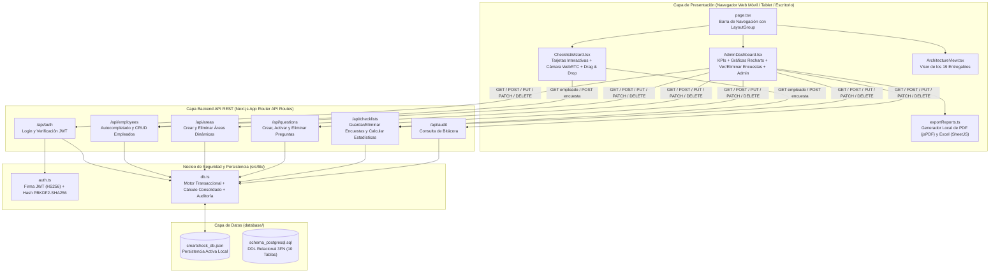
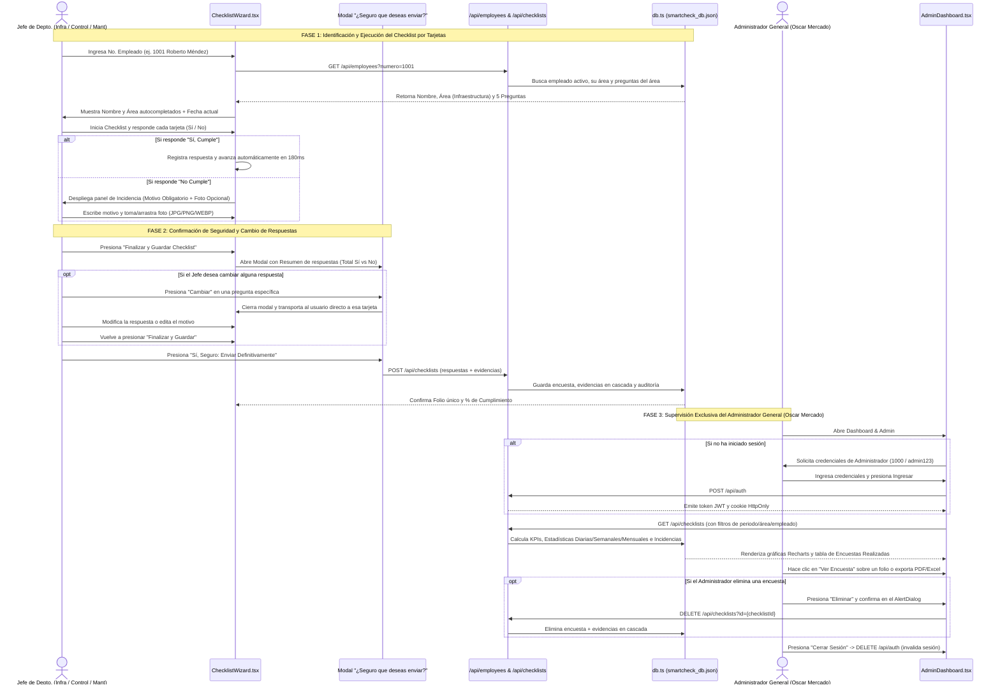
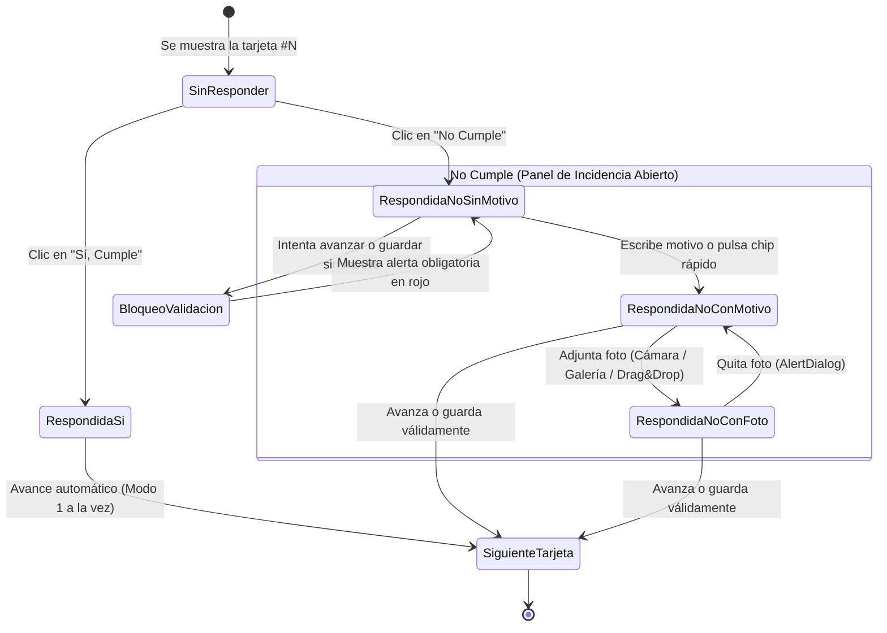

# Memoria Técnica y Funcional del Proyecto — SmartCheck Enterprise

Este documento constituye la **Memoria Técnica, Arquitectónica y de Código** del sistema **SmartCheck Enterprise**. Aquí se documenta en gran detalle todo lo desarrollado, el funcionamiento interno del software de extremo a extremo, el propósito de cada carpeta del repositorio, la explicación línea por línea y función por función de cada archivo de código, y los diagramas visuales de funcionamiento.

---

## 1. Visión General de lo Realizado

Se diseñó y construyó una aplicación web empresarial Full-Stack (**SmartCheck Enterprise**) con una clara segregación funcional de roles:
- **Jefes de Departamento de Sistemas:** Encargados de las 3 áreas activas (**Infraestructura**, **Control** y **Mantenimiento**), quienes utilizan el software exclusivamente para contestar los checklists e inspecciones operativas correspondientes a sus áreas operativas.
- **Administrador General del Sistema (Oscar Mercado):** Custodio exclusivo de todo el centro de control, métricas consolidadas, Dashboard ejecutivo, KPIs, gestión de empleados, creación/eliminación de áreas y preguntas, exportación de reportes ejecutivos en PDF/Excel y bitácora de auditoría.

### Características Principales Implementadas:
1. **Experiencia de Checklist Basada en Tarjetas (Card-based UX):**
   - Elimina los formularios largos tradicionales.
   - Permite alternar entre **Modo 1 a la vez** (al responder **Sí, Cumple**, avanza automáticamente a la siguiente tarjeta en 1 solo clic) y **Modo Tarjetas Agrupadas**.
   - Incluye barra de progreso visual animada por hardware (`scaleX`) y píldoras de navegación rápida por pregunta.
2. **Autocompletado Inteligente por Número de Empleado:**
   - Al ingresar el **Número de Empleado**, el sistema consulta la API en tiempo real y autocompleta el **Nombre Completo**, el **Área Correspondiente** y carga las preguntas activas de dicha área.
   - Coloca automáticamente la **Fecha actual** (permitiendo modificarla manualmente si se requiere).
3. **Regla Estricta en Respuestas Negativas (`No Cumple`) y Evidencia Multimedia:**
   - Cuando se selecciona **No Cumple**, se despliega con una transición suave un panel adicional que exige:
     - **Evidencia Escrita (Motivo o explicación del "No") — OBLIGATORIO:** Incluye chips de motivos frecuentes de 1 clic + campo de texto validado tanto en cliente como en servidor. No permite avanzar ni guardar si está vacío.
     - **Evidencia Fotográfica — OPCIONAL:** Permite **tomar fotografía con cámara en vivo (WebRTC / cámara móvil)**, **cargar desde galería** o **arrastrar y soltar (Drag & Drop)** validando estrictamente los formatos **JPG, PNG y WEBP**.
4. **Modal de Confirmación de Seguridad y Modificación de Respuestas ("¿Estás seguro de que ya deseas enviar?"):**
   - Al terminar de responder y presionar *"Finalizar y Guardar Checklist"*, el sistema **no envía de inmediato**.
   - Abre un modal accesible de revisión pre-envío dirigido al Administrador (**Oscar Mercado**), mostrando:
     - Ficha resumen del empleado, área y fecha.
     - Contadores rápidos de tarjetas con *"Sí, Cumple"* y *"No Cumple"*.
     - Desglose interactivo pregunta por pregunta, con motivo obligatorio y foto adjunta en casos negativos.
     - Botón interactivo **"Cambiar"** en cada tarjeta que transporta directamente a la pregunta para modificar o corregir la respuesta.
     - Botón **"Revisar o Cambiar Respuestas"** (volver a revisar) y botón **"Sí, Seguro: Enviar Definitivamente"** (ejecuta el guardado y genera el folio oficial).
5. **Centro de Control y Dashboard Ejecutivo Exclusivo (Para el Administrador General Oscar Mercado):**
   - **Acceso Protegido por Login Estricto:** Exige credenciales de Administrador (`1000` / contraseña `admin123`), bloqueando con `HTTP 403` a perfiles operativos.
   - **Cierre de Sesión (Logout):** Permite cerrar la sesión activa con 1 clic mediante `DELETE /api/auth`, invalidando la cookie y registrando el evento en auditoría.
   - **KPIs Automáticos:** Total de encuestas realizadas, respuestas positivas (`Sí`), respuestas negativas (`No`), `% de Cumplimiento General` $= (\text{Sí} / \text{Total}) \times 100$, y `% de Incidencias` $= (\text{No} / \text{Total}) \times 100$.
   - **Estadísticas Automáticas en 3 Horizontes:** Diarias (Hoy + Área con más incidencias), Semanales (7 días + tendencias) y Mensuales (Histórico + Ranking mensual de áreas).
   - **Opción "Ver Encuesta" Completa:** Permite abrir cualquier encuesta e inspeccionar todas sus respuestas, motivos y fotografías.
   - **Eliminación en Cascada de Encuestas:** Elimina la encuesta junto con sus respuestas, motivos y fotos asociadas en `db.evidencias`.
   - **Gestión Simplificada de Empleados, Áreas y Preguntas:** Alta de empleados por No. Empleado, Nombre, Área y Rol; creación de áreas solo por nombre; y creación/eliminación de preguntas.
   - **Exportación Ejecutiva a PDF y Excel (`.xlsx`):** Con filtros combinables por periodo, fechas, área y empleado.
6. **Ingeniería Visual y de Movimiento (`framer-motion`, `ui-skills` e `impeccable`):**
   - Transiciones físicas fluidas, atajos de teclado (`Escape`, flechas), accesibilidad auditada y 0 anti-patrones de diseño.

---

## 2. Diagramas de Funcionamiento del Sistema

### 2.1 Diagrama General de Arquitectura y Flujo de Datos



---

### 2.2 Diagrama de Secuencia: Cómo Funciona Realizar y Administrar una Encuesta



---

### 2.3 Diagrama de Flujo Lógico de una Tarjeta de Pregunta



---

## 3. Estructura Completa de Carpetas y Explicación Detallada de Cada Archivo

A continuación se describe cada carpeta del proyecto y cómo funciona internamente cada archivo que contiene.

```text
C:\Users\alejpue5\Documents\proyectos\CheckList\
├── database/                      # Esquemas SQL y base de datos persistente local
│   ├── schema_postgresql.sql
│   └── smartcheck_db.json
├── src/                           # Código fuente principal de la aplicación
│   ├── types/                     # Contratos e interfaces de datos TypeScript
│   │   └── index.ts
│   ├── lib/                       # Lógica de negocio, base de datos, JWT y exportación
│   │   ├── auth.ts
│   │   ├── db.ts
│   │   ├── exportReports.ts
│   │   └── utils.ts
│   ├── app/                       # Enrutador principal y APIs REST (Next.js App Router)
│   │   ├── api/
│   │   │   ├── auth/route.ts
│   │   │   ├── employees/route.ts
│   │   │   ├── areas/route.ts
│   │   │   ├── questions/route.ts
│   │   │   ├── checklists/route.ts
│   │   │   └── audit/route.ts
│   │   ├── globals.css
│   │   ├── layout.tsx
│   │   └── page.tsx
│   └── components/                # Componentes visuales interactivos (React + Framer Motion)
│       ├── ChecklistWizard.tsx
│       ├── AdminDashboard.tsx
│       └── ArchitectureView.tsx
├── .gemini/skills/impeccable/     # Motor y reglas de diseño Impeccable instaladas
├── .agent/skills/impeccable/      # Espejo de skills para agentes
├── DOCUMENTACION_ARQUITECTURA.md  # Los 19 entregables arquitectónicos de Especificaciones.txt
├── Especificaciones.txt           # Requerimientos originales del usuario
├── memoria.md                     # Este documento maestro de memoria técnica
├── package.json                   # Dependencias y scripts de ejecución
├── tailwind.config.ts             # Configuración de diseño y utilidades CSS
├── tsconfig.json                  # Configuración del compilador TypeScript
├── next.config.mjs                # Configuración del servidor Next.js
└── postcss.config.mjs             # Procesador de estilos PostCSS + Autoprefixer
```

---

### 3.1 Carpeta `database/` — Persistencia y Esquema Relacional

Sirve para almacenar tanto el modelo relacional productivo para **PostgreSQL** como la base de datos transaccional activa que utiliza el sistema localmente.

#### 1. [`database/schema_postgresql.sql`](file:///C:/Users/alejpue5/Documents/proyectos/CheckList/database/schema_postgresql.sql)
- **Qué hace:** Define la estructura DDL completa en Tercera Forma Normal (3FN) para PostgreSQL.
- **Cómo funciona internamente:**
  - Habilita las extensiones `uuid-ossp` y `pgcrypto`.
  - Crea las **10 tablas requeridas**:
    1. `roles`: Almacena los perfiles (`ADMIN`, `SUPERVISOR`, `OPERADOR`) y sus permisos en formato `JSONB`.
    2. `areas`: Registra las áreas operativas (`Infraestructura`, `Control`, `Mantenimiento` y cualquier área nueva creada).
    3. `usuarios`: Cuentas con contraseñas cifradas (`password_hash`), control de intentos fallidos y fechas de acceso.
    4. `empleados`: Catálogo operativo con índice único en `numero_empleado` y llaves foráneas hacia `areas` y `roles`.
    5. `preguntas`: Banco dinámico de preguntas vinculadas a `area_id`, con orden y nivel de criticidad (`BAJA`, `MEDIA`, `ALTA`, `CRITICA`).
    6. `checklists`: Cabecera de cada encuesta realizada con su `folio` único, empleado, área, fecha y porcentajes de cumplimiento e incidencias.
    7. `respuestas`: Detalle de cada pregunta respondida. Incluye el constraint `chk_motivo_obligatorio_en_no`, que **prohíbe a nivel de base de datos** guardar `respuesta = FALSE` si `motivo_no` es nulo o vacío.
    8. `evidencias`: Registra las fotografías asociadas a respuestas negativas, validando que `formato` sea exclusivamente `JPG`, `JPEG`, `PNG` o `WEBP`.
    9. `estadisticas`: Tabla de pre-agregación para consultas rápidas por periodo (`DIARIO`, `SEMANAL`, `MENSUAL`).
    10. `auditoria`: Bitácora inmutable con el usuario, módulo, acción, IP y cambios en `JSONB`.
  - Define índices (`CREATE INDEX`) sobre fechas, áreas y números de empleado, además de *triggers* en PL/pgSQL (`fn_actualizar_timestamp`) para actualizar automáticamente la columna `updated_at`.

#### 2. [`database/smartcheck_db.json`](file:///C:/Users/alejpue5/Documents/proyectos/CheckList/database/smartcheck_db.json)
- **Qué hace:** Archivo de base de datos relacional en formato JSON gestionado automáticamente por [`src/lib/db.ts`](file:///C:/Users/alejpue5/Documents/proyectos/CheckList/src/lib/db.ts).
- **Cómo funciona internamente:** Almacena en disco todas las colecciones normalizadas (`roles`, `areas`, `empleados`, `preguntas`, `checklists`, `evidencias`, `estadisticas`, `auditoria`). Si no existe al arrancar, el motor lo genera e inyecta datos semilla realistas.

---

### 3.2 Carpeta `src/types/` — Contratos e Interfaces TypeScript

Sirve para garantizar tipado estático estricto entre el Frontend y el Backend, evitando errores de propiedades inexistentes o tipos incompatibles.

#### 1. [`src/types/index.ts`](file:///C:/Users/alejpue5/Documents/proyectos/CheckList/src/types/index.ts)
- **Qué hace:** Declara todos los tipos de dominio del sistema.
- **Cómo funciona internamente:**
  - `RoleCode`: Limita los roles a `'ADMIN' | 'SUPERVISOR' | 'OPERADOR'`.
  - `Criticidad`: Limita la severidad de una pregunta a `'BAJA' | 'MEDIA' | 'ALTA' | 'CRITICA'`.
  - `ImageFormat`: Limita los formatos de evidencia fotográfica a `'JPG' | 'PNG' | 'WEBP'`.
  - `CaptureOrigin`: Identifica cómo se subió la foto (`'CAMARA' | 'GALERIA' | 'DRAG_DROP'`).
  - `Area`, `Empleado`, `Pregunta`, `Evidencia`, `RespuestaItem`, `ChecklistRecord`, `AuditLog`, `EstadisticaRegistro` y `DatabaseSchema`: Definen exactamente los campos que viajan entre la base de datos, las APIs REST y los componentes React.

---

### 3.3 Carpeta `src/lib/` — Lógica de Negocio, Seguridad, Base de Datos y Reportes

Contiene los motores centrales reutilizables por las rutas API y los componentes visuales.

#### 1. [`src/lib/auth.ts`](file:///C:/Users/alejpue5/Documents/proyectos/CheckList/src/lib/auth.ts)
- **Qué hace:** Gestiona el cifrado de contraseñas y la firma/verificación de tokens **JWT (JSON Web Tokens)**.
- **Cómo funciona internamente:**
  - `hashPassword(plainPassword)`: Utiliza `crypto.pbkdf2Sync` con algoritmo `sha256`, 10,000 iteraciones y sal criptográfica para transformar cualquier contraseña en texto plano en un hash hexadecimal irreversible.
  - `verifyPassword(plainPassword, storedHash)`: Compara el hash calculado contra el almacenado usando `crypto.timingSafeEqual` para evitar ataques de temporización (*timing attacks*).
  - `signToken(payload)`: Utiliza `SignJWT` de la librería `jose` para firmar un token con algoritmo `HS256`, emisor `smartcheck-enterprise` y expiración de 12 horas (`12h`).
  - `verifyToken(token)`: Verifica la firma criptográfica y expiración del JWT y devuelve los datos del usuario autenticado (`JWTPayloadUser`) o `null` si el token es inválido.

#### 2. [`src/lib/db.ts`](file:///C:/Users/alejpue5/Documents/proyectos/CheckList/src/lib/db.ts)
- **Qué hace:** Actúa como el ORM y motor de base de datos local, generador de datos semilla, calculador de estadísticas consolidadas y registrador de auditoría.
- **Cómo funciona internamente:**
  - `getLocalISODate(offsetDays)`: Calcula fechas en formato `YYYY-MM-DD` ajustadas a la zona horaria local del servidor, permitiendo obtener la fecha exacta de hoy (`offsetDays = 0`), de hace una semana (`-6`) o de meses previos.
  - `createSampleEvidenceSvgDataUrl(...)`: Genera imágenes vectoriales codificadas en Base64 para que las incidencias históricas de prueba cuenten desde el primer momento con fotografías de evidencia visibles en el Dashboard.
  - `buildInitialDatabase()`: Construye el estado inicial con los 3 roles, las 3 áreas iniciales (**Infraestructura**, **Control**, **Mantenimiento**), 9 empleados (del `1001` al `2006`), 15 preguntas operativas (5 por área con sugerencias de motivo de incumplimiento) y 35 encuestas históricas distribuidas entre hoy, la última semana y los últimos meses.
  - `computeConsolidatedStats(checklists, areas)`: Recalcula automáticamente los registros de la tabla `estadisticas` sumando encuestas, respuestas positivas, respuestas negativas y porcentajes por área.
  - `readDb()` y `writeDb(data)`: Leen y escriben de forma atómica el archivo `database/smartcheck_db.json`, actualizando las estadísticas consolidadas en cada escritura.
  - `registerAudit(db, params)`: Inserta al inicio de la tabla `auditoria` un nuevo evento con marca de tiempo ISO, actor, módulo, acción, entidad afectada y descripción detallada.

#### 3. [`src/lib/exportReports.ts`](file:///C:/Users/alejpue5/Documents/proyectos/CheckList/src/lib/exportReports.ts)
- **Qué hace:** Genera y descarga en el navegador del usuario los reportes ejecutivos en formato **PDF** y **Excel (`.xlsx`)** respetando los filtros activos.
- **Cómo funciona internamente:**
  - `exportToPDF(payload)`:
    - Instancia un documento `jsPDF` en orientación horizontal (`landscape`, tamaño `A4`).
    - Dibuja el encabezado corporativo oscuro con el título del reporte, el filtro aplicado y la fecha/hora de generación.
    - Usa `jspdf-autotable` para renderizar 4 bloques tabulares:
      1. **Resumen de KPIs Ejecutivos** (Total Encuestas, Total Respuestas, Sí, No, % Cumplimiento, % Incidencias).
      2. **Comparativo de Cumplimiento por Área** (Área, Encuestas, Sí, No, % Cumplimiento, % Incidencias).
      3. **Detalle de Incidencias Detectadas** (Folio, Fecha, Área, Empleado, Código de Pregunta, Motivo Obligatorio Capturado, Estado).
      4. **Bitácora de Encuestas Realizadas**.
    - Descarga automáticamente el archivo `Reporte_SmartCheck_YYYY-MM-DD.pdf`.
  - `exportToExcel(payload)`:
    - Utiliza `XLSX` (`SheetJS`) para crear un libro de Excel (`book_new()`) con **4 hojas separadas**:
      1. `Resumen_KPIs`: Indicadores generales y tabla comparativa por área.
      2. `Encuestas`: Bitácora completa de encuestas realizadas.
      3. `Incidencias_No`: Todas las respuestas negativas con su motivo escrito obligatorio y estado.
      4. `Cumplimiento_Usuarios`: Ranking y métricas individuales por cada empleado/encargado.
    - Descarga el archivo `Reporte_SmartCheck_YYYY-MM-DD.xlsx`.

#### 4. [`src/lib/utils.ts`](file:///C:/Users/alejpue5/Documents/proyectos/CheckList/src/lib/utils.ts)
- **Qué hace:** Provee la función utilitaria `cn(...inputs)`.
- **Cómo funciona internamente:** Combina `clsx` (para clases condicionales) con `tailwind-merge` (para resolver conflictos de clases de Tailwind CSS sin duplicaciones), cumpliendo el estándar de `ui-skills` (`baseline-ui`).

---

### 3.4 Carpeta `src/app/api/` — Endpoints Backend REST

Cada subcarpeta dentro de `src/app/api/` expone un endpoint RESTful bajo el estándar de Route Handlers de Next.js.

#### 1. [`src/app/api/auth/route.ts`](file:///C:/Users/alejpue5/Documents/proyectos/CheckList/src/app/api/auth/route.ts)
- **`POST /api/auth`:** Recibe `numeroEmpleado` (o alias como `1000`, `admin`, `oscar`, `oscar.mercado`) y `password`. Busca al usuario en la base de datos, valida que esté activo y **aplica la regla de exclusividad de rol:** si `rolCodigo !== 'ADMIN'`, rechaza la petición con `HTTP 403`, notificando que el centro de control es exclusivo de **Oscar Mercado** y que los jefes de departamento deben responder directamente sus encuestas en *"Realizar Checklist"*. Valida la contraseña con `verifyPassword`, genera el token JWT con `signToken`, registra el evento en `auditoria` y asienta la cookie segura `smartcheck_token`.
- **`GET /api/auth`:** Lee el token desde `Bearer` o la cookie `smartcheck_token`, lo verifica con `verifyToken` y confirma que la sesión activa cuente con permisos de Administrador (`rolCodigo === 'ADMIN'`).
- **`DELETE /api/auth`:** Finaliza la sesión administrativa, elimina la cookie `smartcheck_token` en el navegador y registra el evento `LOGOUT` con marca temporal y actor en `auditoria`.

#### 2. [`src/app/api/employees/route.ts`](file:///C:/Users/alejpue5/Documents/proyectos/CheckList/src/app/api/employees/route.ts)
- **`GET /api/employees`:**
  - Si recibe el parámetro `?numero=XXXX`, busca al empleado activo (aceptando tanto `1001` como `EMP-1001`), obtiene su objeto `area` y filtra todas las `preguntas` activas de esa área ordenadas por el campo `orden`. Esto alimenta el **autocompletado instantáneo** al iniciar un checklist.
  - Si no recibe `numero`, devuelve el listado completo de empleados, áreas y roles para el panel administrativo.
- **`POST /api/employees`:** Da de alta un nuevo empleado validando que `numeroEmpleado` y `nombreCompleto` sean obligatorios y que el número no esté duplicado. Asigna el área, el rol y cifra su contraseña por defecto, guardando el evento en `auditoria`.
- **`PUT /api/employees`:** Permite editar el número de empleado, nombre completo, área, rol o cambiar su estado `activo` (`true` / `false`), registrando el cambio en `auditoria`.

#### 3. [`src/app/api/areas/route.ts`](file:///C:/Users/alejpue5/Documents/proyectos/CheckList/src/app/api/areas/route.ts)
- **`GET /api/areas`:** Devuelve todas las áreas junto con el conteo de preguntas activas y empleados asignados a cada una.
- **`POST /api/areas`:** Permite crear una nueva área recibiendo únicamente su `nombre`. Calcula automáticamente un código interno de 4 letras, crea el área y **genera automáticamente 3 preguntas operativas base** para que la nueva área pueda usarse de inmediato en el checklist sin tocar el código.
- **`DELETE /api/areas?id={id}`:** Elimina el área indicada (verificando que quede al menos 1 área en el sistema), **elimina en cascada todas las preguntas asociadas a esa área**, reasigna de forma segura a los empleados que pertenecían a ella y registra la eliminación en `auditoria`.

#### 4. [`src/app/api/questions/route.ts`](file:///C:/Users/alejpue5/Documents/proyectos/CheckList/src/app/api/questions/route.ts)
- **`GET /api/questions`:** Lista las preguntas ordenadas por área y número de orden.
- **`POST /api/questions`:** Crea una nueva pregunta dentro del área seleccionada, asignándole automáticamente el código consecutivo (ej. `INF-06`, `CTR-06`) y su nivel de criticidad.
- **`PUT /api/questions`:** Permite activar/desactivar una pregunta o modificar su texto/criticidad.
- **`DELETE /api/questions?id={id}`:** Elimina permanentemente una pregunta de la base de datos y registra la operación en `auditoria`.

#### 5. [`src/app/api/checklists/route.ts`](file:///C:/Users/alejpue5/Documents/proyectos/CheckList/src/app/api/checklists/route.ts)
- **`GET /api/checklists`:** Es el motor analítico del sistema.
  - Aplica los filtros recibidos por query string (`periodo`: `dia`, `semana`, `mes`, `rango`, `todos`; `fechaInicio`, `fechaFin`, `areaId`, `empleadoId`).
  - Calcula en tiempo real:
    1. `kpis`: Total de encuestas, respuestas evaluadas, total `Sí`, total `No`, `% Cumplimiento General` y `% Incidencias`.
    2. `estadisticasDiarias`: Métricas exclusivas del día de hoy y cálculo del **Área con más incidencias hoy**.
    3. `estadisticasSemanales`: Métricas de los últimos 7 días y arreglo `tendenciaSemanal` día por día para las gráficas.
    4. `estadisticasMensuales`: Métricas de los últimos 30 días, serie histórica agrupada por mes (`YYYY-MM`) y `rankingAreas` ordenado de mayor a menor cumplimiento.
    5. `cumplimientoPorArea` y `cumplimientoPorUsuario`.
    6. `incidenciasDetectadas`: Aplanado (`flatMap`) de todas las respuestas negativas con su folio, empleado, área, pregunta, motivo obligatorio y objeto de evidencia fotográfica.
- **`POST /api/checklists`:** Recibe y valida una nueva encuesta realizada:
  - Verifica que el empleado exista y esté activo.
  - **Aplica la Regla Obligatoria:** Recorre cada respuesta y, si `respuesta === false`, verifica que `motivoNo` no esté vacío; si falta, rechaza la petición con `HTTP 400`.
  - Verifica que cualquier evidencia fotográfica adjunta tenga formato `JPG`, `PNG` o `WEBP`.
  - Genera el folio único (`CHK-YYYYMMDD-NNN`), calcula los porcentajes de la encuesta, guarda las evidencias en `db.evidencias`, inserta la encuesta en `db.checklists` y registra el evento en `auditoria`.
- **`PATCH /api/checklists`:** Actualiza el estado de seguimiento de una incidencia (`ABIERTA`, `EN_ATENCION`, `RESUELTA`).
- **`DELETE /api/checklists?id={id}`:** Elimina una encuesta realizada y **ejecuta el borrado en cascada** de todas sus respuestas, evidencias escritas (`motivoNo`) y fotografías asociadas en `db.evidencias`, recalculando las estadísticas globales y registrando la eliminación en `auditoria`.

#### 6. [`src/app/api/audit/route.ts`](file:///C:/Users/alejpue5/Documents/proyectos/CheckList/src/app/api/audit/route.ts)
- **`GET /api/audit`:** Devuelve los últimos 100 registros de la bitácora de auditoría y la tabla consolidada de estadísticas.

---

### 3.5 Carpeta `src/app/` — Estructura Base y Navegación Principal

#### 1. [`src/app/globals.css`](file:///C:/Users/alejpue5/Documents/proyectos/CheckList/src/app/globals.css)
- **Qué hace:** Carga las directivas de Tailwind CSS y configura las superficies del navegador según las reglas de `impeccable` y `ui-skills`.
- **Cómo funciona internamente:** Define variables CSS para superficies limpias (`#f8fafc`, `#ffffff`), configura el color del cursor (`caret-color`), anillos de enfoque accesibles para teclado (`:focus-visible`), números tabulares (`font-variant-numeric: tabular-nums`) y soporte para usuarios con reducción de movimiento (`@media (prefers-reduced-motion: reduce)`).

#### 2. [`src/app/layout.tsx`](file:///C:/Users/alejpue5/Documents/proyectos/CheckList/src/app/layout.tsx)
- **Qué hace:** Define la estructura HTML raíz (`<html lang="es">`) y los metadatos SEO de la plataforma.

#### 3. [`src/app/page.tsx`](file:///C:/Users/alejpue5/Documents/proyectos/CheckList/src/app/page.tsx)
- **Qué hace:** Es el punto de entrada visual de la aplicación.
- **Cómo funciona internamente:**
  - Mantiene el estado `activeView` (`'checklist' | 'admin' | 'arquitectura'`).
  - Renderiza la barra superior con `LayoutGroup` de `framer-motion`, donde la píldora azul activa (`layoutId="active-main-nav-pill"`) se desliza con física de resorte (`spring`) entre los botones **Realizar Checklist**, **Dashboard & Admin** y **Arquitectura (19 Entregables)**.
  - Envuelve la vista activa dentro de `<AnimatePresence mode="wait">` para transiciones suaves al cambiar de módulo.

---

### 3.6 Carpeta `src/components/` — Componentes Interactivos del Sistema

#### 1. [`src/components/ChecklistWizard.tsx`](file:///C:/Users/alejpue5/Documents/proyectos/CheckList/src/components/ChecklistWizard.tsx)
- **Qué hace:** Implementa toda la experiencia del usuario operativo (jefes de departamento de Infraestructura, Control y Mantenimiento) para responder checklists mediante tarjetas modernas con verificación obligatoria y confirmación previa de envío.
- **Cómo funciona internamente (dividido en 3 pasos de estado `step`):**
  - **Paso 1 (`step === 'identificacion'`):**
    - Muestra botones de selección rápida de jefes de departamento (1 clic) filtrando automáticamente las cuentas administrativas (`emp.rolCodigo !== 'ADMIN'`) para priorizar a Roberto Méndez (`1001` - Infraestructura), Laura Gómez (`1002` - Control) y Carlos Villarreal (`1003` - Mantenimiento).
    - Campo de texto **Número de Empleado** y **Fecha de Operación** editable.
    - Un efecto con *debounce* (`140ms`) consulta `GET /api/employees?numero=...` y autocompleta el **Nombre del Empleado**, su **Área Correspondiente** y la cantidad de tarjetas asignadas.
  - **Paso 2 (`step === 'preguntas'`):**
    - Muestra la barra superior de contexto, selector de modo (**1 a la vez** vs **Agrupadas**) y **Barra de Progreso Visual** animada por compositor (`scaleX`).
    - Píldoras numeradas (`#1..#N`) que cambian de color según el estado (verde si es `Sí`, rojo si es `No` con motivo completo, ámbar si es `No` pendiente de motivo).
    - En `renderQuestionCard(pregunta, index)`:
      - Botones táctiles: **Sí, Cumple** (avanza automáticamente en modo 1 a la vez con temporizador cancelable) y **No Cumple**.
      - En respuestas negativas: despliega motivo escrito obligatorio y cargador de evidencia fotográfica (WebRTC, galería o drag & drop).
    - **Modal de Confirmación y Modificación Previa (`showConfirmSubmitModal`):**
      - Al hacer clic en *"Finalizar y Guardar Checklist"*, `handleRequestSubmit()` valida que no queden preguntas vacías ni respuestas `No` sin motivo.
      - Despliega el diálogo modal: **"¿Estás seguro de que ya deseas enviar el checklist?"** con destinatario **Oscar Mercado (Administrador)**.
      - Presenta resumen de respuestas (`Sí, Cumple` vs `No Cumple`) y el listado interactivo tarjeta por tarjeta.
      - **Opción de Cambiar Respuestas:** Cada fila dispone de un botón **"Cambiar"** que cierra el modal y transporta de inmediato al usuario a esa tarjeta específica para modificar o corregir su respuesta.
      - Botón **"Revisar o Cambiar Respuestas"** (cierra el modal) y botón **"Sí, Seguro: Enviar Definitivamente"** (`executeConfirmSubmit()`) que persiste la encuesta en el backend.
  - **Paso 3 (`step === 'completado'`):**
    - Muestra el resumen final con el **Folio único**, `% de Cumplimiento`, respuestas evaluadas y tiempo transcurrido en segundos.

#### 2. [`src/components/AdminDashboard.tsx`](file:///C:/Users/alejpue5/Documents/proyectos/CheckList/src/components/AdminDashboard.tsx)
- **Qué hace:** Es el centro de mando ejecutivo y analítico de uso exclusivo para el Administrador General (**Oscar Mercado**).
- **Cómo funciona internamente:**
  - **Autenticación Estricta y Pantalla de Login:**
    - Al arrancar, consulta `GET /api/auth`. Si no existe un token válido con rol `ADMIN`, el estado `authUser` permanece en `null` y renderiza la pantalla de **Login Administrativo SmartCheck**.
    - La vista de acceso incluye formulario con número de empleado (`1000` / `admin` / `oscar.mercado`) y contraseña (`admin123`), además de una advertencia operativa indicando que los jefes departamentales no requieren ingresar aquí.
  - **Botón de Cerrar Sesión (Logout):**
    - La cabecera ejecutiva autenticada incluye el botón **"Cerrar Sesión"**, el cual invoca `DELETE /api/auth`, destruye la cookie de sesión, asienta el evento en `auditoria` y regresa al usuario al formulario de login.
  - **Navegación Interna (`activeSection`):** Cuenta con 7 pestañas:
    1. **`dashboard`:** KPIs globales, gráfica de área, gráfica de barras comparativa entre áreas y tabla de encuestas realizadas con acceso a **Ver Encuesta** y **Eliminar**.
    2. **`estadisticas`:** Sub-pestañas para Hoy (con *Área con más incidencias* y gráfica de pastel), 7 Días (tendencias Sí vs No) e Histórico Mensual (ranking de áreas).
    3. **`incidencias`:** Listado de incidencias con motivo obligatorio, fotografía en alta resolución y selector de estado (`ABIERTA`, `EN_ATENCION`, `RESUELTA`).
    4. **`reportes`:** Tabla con descargas directas a **PDF horizontal** y **Excel (`.xlsx`) multi-hoja**.
    5. **`usuarios`:** Catálogo simplificado de empleados (No. Empleado, Nombre, Área, Rol).
    6. **`checklists_admin`:** Creación de áreas dinámicas solo con su nombre y administración de preguntas por área.
    7. **`auditoria`:** Bitácora inmutable con actor, acción, módulo y detalles.
  - **Modal "Ver Encuesta" y Diálogos de Confirmación (`AlertDialog`):**
    - Inspección completa de encuestas respondidas y confirmaciones accesibles previas a eliminaciones en cascada.

#### 3. [`src/components/ArchitectureView.tsx`](file:///C:/Users/alejpue5/Documents/proyectos/CheckList/src/components/ArchitectureView.tsx)
- **Qué hace:** Muestra dentro de la propia interfaz web un resumen interactivo en 4 pestañas de la arquitectura, las 10 tablas de la base de datos, los endpoints REST, la seguridad JWT y el plan de pruebas/despliegue.

---

### 3.7 Archivos de Configuración en la Raíz del Proyecto

- **[`package.json`](file:///C:/Users/alejpue5/Documents/proyectos/CheckList/package.json):** Declara las dependencias de producción (`next`, `react`, `react-dom`, `framer-motion`, `recharts`, `lucide-react`, `jspdf`, `jspdf-autotable`, `xlsx`, `jose`, `clsx`, `tailwind-merge`) y los scripts (`npm run dev`, `npm run build`, `npm run start`).
- **[`tailwind.config.ts`](file:///C:/Users/alejpue5/Documents/proyectos/CheckList/tailwind.config.ts):** Configura las rutas escaneadas por Tailwind CSS (`./src/**/*`), la paleta `brand` y las animaciones personalizadas.
- **[`tsconfig.json`](file:///C:/Users/alejpue5/Documents/proyectos/CheckList/tsconfig.json):** Configura el compilador TypeScript en modo estricto (`strict: true`) y define el alias `@/*` apuntando a `./src/*`.
- **[`DOCUMENTACION_ARQUITECTURA.md`](file:///C:/Users/alejpue5/Documents/proyectos/CheckList/DOCUMENTACION_ARQUITECTURA.md):** Contiene el desarrollo teórico y arquitectónico de los 19 entregables empresariales solicitados en `Especificaciones.txt`.

---

### 3.8 Optimización de Navegación e Interacción (`framer-motion`, `ui-skills` e `impeccable`)

Para garantizar una navegación fluida, instantánea y libre de bloqueos en todo el sistema, se aplicaron las reglas de ingeniería de movimiento e interacción de **`framer-motion`**, **`npx ui-skills`** (`prototyperai/animate-ui`) y **`npx impeccable`**:

1. **Transiciones Interrumpibles sin Bloqueo (`AnimatePresence` -> Entrada Directa):**
   - Se eliminó el bloqueo `mode="wait"` en los contenedores de pestañas ([`src/app/page.tsx`](file:///C:/Users/alejpue5/Documents/proyectos/CheckList/src/app/page.tsx), [`src/components/AdminDashboard.tsx`](file:///C:/Users/alejpue5/Documents/proyectos/CheckList/src/components/AdminDashboard.tsx), [`src/components/ChecklistWizard.tsx`](file:///C:/Users/alejpue5/Documents/proyectos/CheckList/src/components/ChecklistWizard.tsx) y [`src/components/ArchitectureView.tsx`](file:///C:/Users/alejpue5/Documents/proyectos/CheckList/src/components/ArchitectureView.tsx)), permitiendo cambiar de módulo, pestaña o tarjeta de forma inmediata e interrumpible con curva de desaceleración natural `cubic-bezier(0.16, 1, 0.3, 1)` sin congelamientos por clics rápidos ni errores de medición en gráficas `ResponsiveContainer` de Recharts.
2. **Control de Temporizador de Auto-Avance (`autoAdvanceTimerRef`):**
   - En [`ChecklistWizard.tsx`](file:///C:/Users/alejpue5/Documents/proyectos/CheckList/src/components/ChecklistWizard.tsx), el avance automático al responder *"Sí, Cumple"* se gestiona mediante una referencia cancelable (`clearAutoAdvanceTimer()`). Si el usuario navega manualmente con los botones *Tarjeta Anterior / Siguiente*, salta desde las píldoras `#1..#N`, cambia a modo *Agrupadas* o selecciona *"No Cumple"*, el temporizador previo se cancela de inmediato evitando saltos dobles o fuera de orden.
3. **Navegación Libre por Píldoras, Teclado y Cierre de Cámara:**
   - Las píldoras superiores `#1..#N` permiten saltar libremente a cualquier pregunta (y hacen *scroll* suave hacia la tarjeta en vista agrupada).
   - Se agregó soporte de teclado (`ArrowLeft` / `ArrowRight` para cambiar de tarjeta y `Escape` o clic en el fondo oscuro para cerrar cualquier modal de encuesta, evidencia o confirmación).
   - Cualquier cambio de tarjeta o paso detiene automáticamente el *stream* WebRTC de la cámara si estaba abierto.
4. **Endpoints Dinámicos en Tiempo Real (`force-dynamic` + `no-store`):**
   - Los 6 controladores REST (`auth`, `employees`, `areas`, `questions`, `checklists`, `audit`) exportan `export const dynamic = 'force-dynamic'` y las consultas cliente utilizan `{ cache: 'no-store' }`, asegurando que cualquier alta/baja de área, pregunta, empleado o encuesta se refleje al instante al navegar entre módulos.

---

## 4. Guía Rápida de Comandos para el Desarrollador o Administrador

Cuando desees volver a encender o compilar el sistema desde la terminal en la carpeta `C:\Users\alejpue5\Documents\proyectos\CheckList`:

1. **Iniciar en modo desarrollo:**
   ```powershell
   npm run dev
   ```
2. **Compilar para producción:**
   ```powershell
   npm run build
   ```
3. **Iniciar servidor de producción en `http://localhost:3000`:**
   ```powershell
   npm run start
   ```
4. **Ejecutar auditoría de calidad visual (Impeccable):**
   ```powershell
   .\.agent\skills\impeccable\scripts\impeccable.cmd detect --json src
   ```

---

## 5. Registro Histórico de Actualizaciones y Cambios en el Proyecto (Changelog)

En esta sección se detallan las solicitudes de cambio y las optimizaciones técnicas que se aplicaron sobre la arquitectura original de `Especificaciones.txt`:

### 5.1 Adaptaciones a Requerimientos del Usuario

| Aspecto | Implementación Inicial | Actualización Realizada | Motivo / Justificación |
|---|---|---|---|
| **Alta y Edición de Empleados** | Solicitaba correo electrónico obligatorio | Se eliminó el campo de correo en UI y formularios; se identifica únicamente con **Número de Empleado**, **Nombre Completo**, **Área** y **Rol**. | En la operación física de planta, el número de empleado es más que suficiente y agiliza el registro. |
| **Alta de Áreas** | Solicitaba nombre, código corto y responsable/encargado | Se simplificó a únicamente **Nombre del Área** (el código se auto-genera si es necesario). | El sistema lo opera directamente el **Jefe de Encargados de Área**, por lo que asignar encargados o códigos en el alta resultaba redundante. |
| **Eliminación de Preguntas** | Solo permitía activar o desactivar preguntas | Se implementó el endpoint `DELETE /api/questions?id=...` y el botón **Eliminar** con modal de confirmación en la UI. | Permite depurar preguntas obsoletas de la plantilla de verificación de manera permanente. |
| **Eliminación de Áreas** | No existía borrado de áreas | Se implementó `DELETE /api/areas?id=...` con cascada sobre sus preguntas y reasignación de empleados a un área activa remanente. | Brinda flexibilidad para dar de baja líneas de trabajo o áreas temporales. |
| **Inspección de Encuesta ("Ver Encuesta")** | Solo mostraba métricas consolidadas en tabla | Se integró el modal interactivo `selectedChecklistModal` que abre la encuesta completa respondida por el empleado. | Permite al Jefe de Encargados auditar punto por punto qué respondió el trabajador, leer su motivo obligatorio y visualizar su fotografía. |
| **Eliminación de Encuesta en Cascada** | No existía borrado de encuestas | Se implementó `DELETE /api/checklists?id=...` con borrado en cascada de evidencias escritas y archivos fotográficos en `db.evidencias`. | Si una encuesta fue errónea o de prueba, se borra limpiamente sin dejar fotos huérfanas en el almacenamiento. |
| **Administrador General Exclusivo (Oscar Mercado)** | Acceso abierto con auto-login simulado de Roberto Méndez | Se dio de alta a **Oscar Mercado** (`1000`) como único Administrador General con rol `ADMIN`. Se blindó el Dashboard exigiendo login con contraseña (`admin123`), bloqueando el acceso a otros usuarios y añadiendo botón de **Cerrar Sesión (Logout)** con borrado de cookie y auditoría. | El Dashboard, KPIs, configuración de preguntas, áreas y reportes deben estar bajo custodia exclusiva del Administrador General. |
| **Rol de Jefes de Departamento (Sistemas)** | Tenían permisos mixtos o visualización de módulos de gestión | Los jefes de las 3 áreas (**Infraestructura**, **Control** y **Mantenimiento**) operan como encargados de responder los checklists de sus respectivas áreas sin acceso a la administración global. | Garantiza la segregación de funciones: los jefes departamentales reportan el estado operativo y el Administrador supervisa y gestiona. |
| **Confirmación de Envío y Modificación de Respuestas en Checklist** | Se enviaba de forma inmediata al presionar "Finalizar" sin confirmación previa | Se implementó el modal **"¿Estás seguro de que ya deseas enviar el checklist?"** con resumen de Sí/No, listado interactivo con botón **"Cambiar"** por tarjeta para corregir cualquier respuesta antes de transmitir, y botón final **"Sí, Seguro: Enviar Definitivamente"**. | Evita envíos accidentales o erróneos y otorga al jefe de área la oportunidad de auditar y cambiar sus respuestas antes del guardado en base de datos. |

### 5.2 Corrección de Bugs de Navegación y Rendimiento (`framer-motion`, `ui-skills` e `impeccable`)

1. **Resolución de Congelamiento por `AnimatePresence mode="wait"`:**
   - Se removió `mode="wait"` en el enrutamiento de vistas principales (`page.tsx`), pestañas administrativas (`AdminDashboard.tsx`), tarjetas del asistente (`ChecklistWizard.tsx`) y visor de arquitectura (`ArchitectureView.tsx`). Las transiciones ahora son de **entrada directa e interrumpibles** a 160–180ms con curva `cubic-bezier(0.16, 1, 0.3, 1)`, eliminando demoras al hacer clics rápidos y previniendo que Recharts renderice gráficos con dimensiones 0x0.
2. **Temporizador de Auto-Avance Cancelable (`autoAdvanceTimerRef`):**
   - Al responder *"Sí, Cumple"*, el temporizador de 180ms ahora se almacena en una referencia cancelable (`clearAutoAdvanceTimer()`). Si el usuario navega a otra tarjeta con *Anterior/Siguiente*, pulsa una píldora `#1..#N`, cambia a modo agrupado o cambia la respuesta a *"No Cumple"*, el temporizador se cancela al instante, eliminando saltos fuera de orden.
3. **Liberación de Navegación por Píldoras y Atajos de Teclado:**
   - La barra de píldoras `#1..#N` permite ahora saltar a cualquier pregunta para inspeccionar el formulario con libertad sin bloquear al usuario si marcó *"No"* antes de terminar de escribir el motivo (la validación se exige al avanzar o al guardar definitivamente).
   - Se habilitó navegación por teclado (`ArrowLeft` / `ArrowRight` para tarjetas, y `Escape` para cerrar cualquier modal o visor de fotografía).
4. **Cierre de Cámara WebRTC en Navegación:**
   - Al cambiar de tarjeta o salir del asistente, el flujo de cámara `MediaStream` se detiene y libera el hardware de inmediato.
5. **Corrección de Salto de Píldora en Scroll Horizontal (`admin-subnav`):**
   - En la barra de 7 pestañas con `overflow-x-auto`, se retiró `layoutId` para evitar desajustes de coordenadas en pantallas móviles, utilizando estilos activos limpios con micro-escalado interactivo `motion-safe:active:scale-[0.98]`.
6. **Desactivación de Caché Estática en Next.js 14 (`force-dynamic` y `no-store`):**
   - Se incorporó `export const dynamic = 'force-dynamic'` en las 6 rutas API y `{ cache: 'no-store' }` en los `fetch()`, garantizando que cualquier creación o eliminación se refleje de inmediato al cambiar de pantalla.
7. **Theming de Superficies del Navegador (Craft Floor):**
   - Se personalizaron en `globals.css` el color de selección de texto (`::selection`), scrollbars delgadas temáticas y scroll suave global (`scroll-behavior: smooth`).

### 5.3 Implementación de Acceso Exclusivo para Oscar Mercado y Modal de Confirmación en Checklist

1. **Custodia y Credenciales del Administrador General (Oscar Mercado):**
   - Se dio de alta formalmente en `src/lib/db.ts` y `database/smartcheck_db.json` la cuenta de **Oscar Mercado** (`emp-1000`) con número de empleado `1000`, puesto *Administrador General de Sistemas* y rol `ADMIN`.
   - Se blindó [`src/app/api/auth/route.ts`](file:///C:/Users/alejpue5/Documents/proyectos/CheckList/src/app/api/auth/route.ts) para admitir alias de acceso rápido (`1000`, `admin`, `oscar`, `oscar.mercado`) y exigir obligatoriamente que el usuario cuente con rol `ADMIN`. Si cualquier usuario no administrador intenta acceder, el servidor retorna `HTTP 403` con un mensaje claro que le indica responder su encuesta en el módulo de checklists.
   - Se añadió el endpoint `DELETE /api/auth` para invalidar la cookie `smartcheck_token`, finalizar la sesión del Administrador y registrar un evento `LOGOUT` en la bitácora inmutable de auditoría.
   - En la interfaz de [`src/components/AdminDashboard.tsx`](file:///C:/Users/alejpue5/Documents/proyectos/CheckList/src/components/AdminDashboard.tsx) se eliminó el auto-login simulado, requiriendo credenciales activas, y se incluyó el botón visible de **Cerrar Sesión** en la cabecera ejecutiva.

2. **Segregación Operativa para Jefes de Departamento:**
   - Se asignaron los roles operativos a los jefes de las 3 áreas activas de Sistemas:
     - **Infraestructura:** Ing. Roberto Méndez (`1001`) — `SUPERVISOR` / Jefe de Departamento.
     - **Control:** Ing. Laura Gómez (`1002`) — `SUPERVISOR` / Jefa de Departamento.
     - **Mantenimiento:** Ing. Carlos Villarreal (`1003`) — `SUPERVISOR` / Jefe de Departamento.
   - El selector rápido del Paso 1 del checklist filtra automáticamente a las cuentas administrativas, presentando directamente los botones de los jefes departamentales y especialistas operativos.

3. **Flujo de Confirmación y Modificación de Respuestas en el Checklist:**
   - En [`src/components/ChecklistWizard.tsx`](file:///C:/Users/alejpue5/Documents/proyectos/CheckList/src/components/ChecklistWizard.tsx), al presionar *"Finalizar y Guardar Checklist"*, el método `handleRequestSubmit()` valida la completitud de respuestas y abre el modal `showConfirmSubmitModal`.
   - El modal pregunta: *"¿Estás seguro de que ya deseas enviar el checklist?"* con destinatario **Oscar Mercado (Administrador)**.
   - Muestra un desglose visual de todas las tarjetas respondidas (`Sí, Cumple` vs `No Cumple` con su motivo y foto).
   - Incluye un botón interactivo **"Cambiar"** en cada tarjeta que permite al jefe de departamento regresar a esa tarjeta específica con un clic para corregir su respuesta antes de guardar.
   - Ofrece el botón *"Revisar o Cambiar Respuestas"* para regresar a la vista de tarjetas y el botón *"Sí, Seguro: Enviar Definitivamente"* (`executeConfirmSubmit()`) para enviar la encuesta a `/api/checklists` y generar el folio oficial.