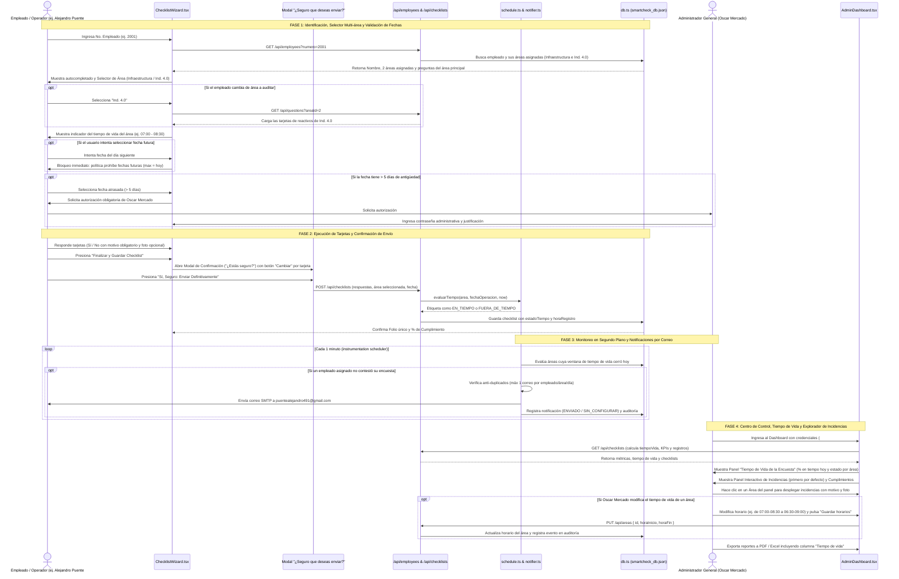
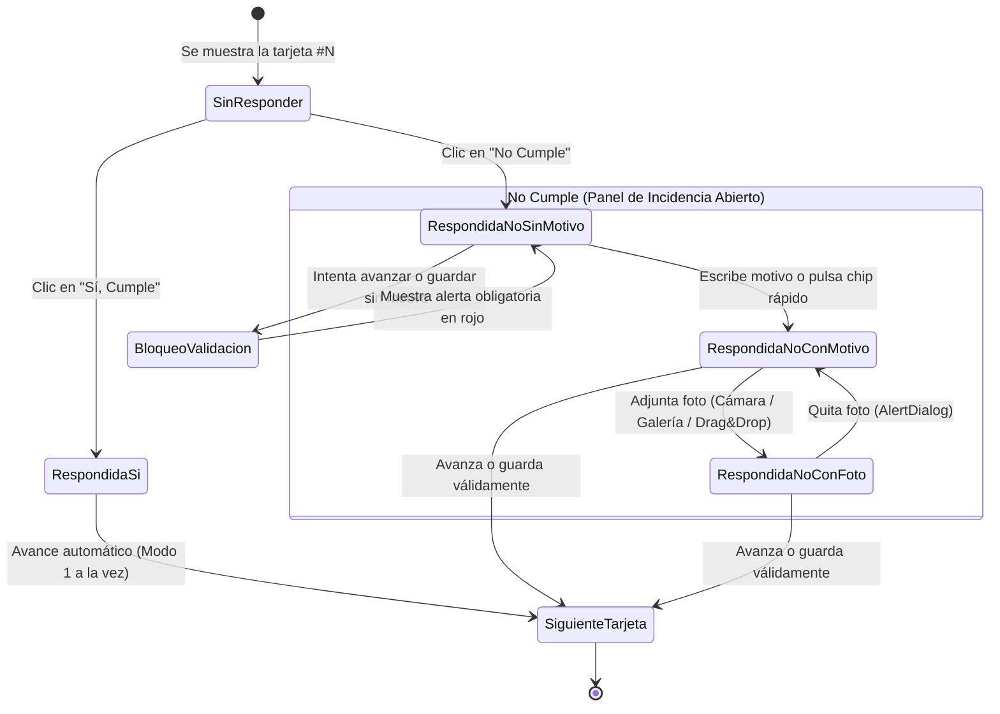

# Memoria Técnica y Funcional del Proyecto — SmartCheck Enterprise

Este documento constituye la **Memoria Técnica, Arquitectónica y de Código** del sistema **SmartCheck Enterprise**. Aquí se documenta en gran detalle todo lo desarrollado, el funcionamiento interno del software de extremo a extremo, el propósito de cada carpeta del repositorio, la explicación línea por línea y función por función de cada archivo de código, y los diagramas visuales de funcionamiento.

---

## 1. Visión General de lo Realizado

Se diseñó y construyó una aplicación web empresarial Full-Stack (**SmartCheck Enterprise**) con una clara segregación funcional de roles:
- **Personal Operativo y Jefes de Área:** Encargados de las 7 áreas oficiales de la empresa (**MES**, **Ind. 4.0**, **Infraestructura**, **Staff IT**, **Digitalizacion**, **SAP** y **Soporte Manufactura**), quienes utilizan el software para contestar las inspecciones operativas correspondientes a su área asignada. En el caso de empleados asignados a 2 áreas (como **Alejandro Puente** en **Infraestructura** e **Ind. 4.0**), el sistema les permite seleccionar cuál de sus áreas van a evaluar.
- **Administrador General del Sistema (Oscar Mercado):** Custodio exclusivo de todo el centro de control, métricas consolidadas, Dashboard ejecutivo, KPIs, gestión de empleados con asignación de hasta 2 áreas máximas, gestión de tiempo de vida de encuestas, autorización de encuestas atrasadas (> 5 días), creación/eliminación de áreas y preguntas, exportación de reportes ejecutivos en PDF/Excel y bitácora inmutable de auditoría.

### Características Principales Implementadas:
1. **Catálogo de 7 Áreas Oficiales:**
   - Sustitución integral de las áreas preliminares por las 7 áreas industriales oficiales:
     1. **MES** (Manufacturing Execution Systems)
     2. **Ind. 4.0** (Industria 4.0 / IoT Industrial)
     3. **Infraestructura** (Redes, Telecomunicaciones y Servidores)
     4. **Staff IT** (Soporte Ofimático y Equipos de Usuario)
     5. **Digitalizacion** (Automatización de Procesos y Flujos)
     6. **SAP** (Módulos ERP, Interfaces y Licenciamiento)
     7. **Soporte Manufactura** (Líneas de Producción y Dispositivos de Planta)
2. **Asignación Multi-área para Empleados (Límite Máximo: 2 Áreas):**
   - El Administrador General puede asignar hasta un máximo de **2 áreas** por empleado (`areaId` y `areaIdSecundaria`).
   - El empleado **Alejandro Puente** (`#2001`) cuenta con dos áreas asignadas: **Infraestructura** e **Ind. 4.0**.
   - En el asistente de inspección, los empleados con 2 áreas disponen de un selector interactivo para elegir qué área van a evaluar, cargando al instante las tarjetas y preguntas correspondientes.
   - Validación en servidor (`POST` y `PUT /api/employees`) que rechaza con error `HTTP 400` cualquier intento de duplicar la misma área como principal y secundaria.
3. **Experiencia de Checklist Basada en Tarjetas (Card-based UX):**
   - Elimina los formularios largos tradicionales.
   - Permite alternar entre **Modo 1 a la vez** (al responder **Sí, Cumple**, avanza automáticamente a la siguiente tarjeta en 1 solo clic tras 180 ms) y **Modo Tarjetas Agrupadas**.
   - Incluye barra de progreso visual animada por hardware (`scaleX`) y píldoras de navegación rápida por pregunta.
4. **Autocompletado Inteligente por Número de Empleado:**
   - Al ingresar el **Número de Empleado**, el sistema consulta la API en tiempo real y autocompleta el **Nombre Completo**, el **Área Correspondiente** (o selector de áreas si tiene 2), el tiempo de vida del área y carga las preguntas activas.
   - Asigna por defecto la fecha del día en curso.
5. **Política Estricta de Fechas y Habilitación de Atrasadas por Oscar Mercado:**
   - **Regla Estricta de No Fechas Futuras:** El selector de fecha tiene límite en hoy (`max={today}`). Bajo ninguna circunstancia se permite adelantar fecha ni seleccionar días futuros.
   - **Rango Estándar (Últimos 5 Días):** El empleado puede registrar su encuesta del día o de hasta 5 días de antigüedad.
   - **Autorización de Encuestas Atrasadas (> 5 Días):** Si una encuesta tiene más de 5 días de antigüedad, se bloquea automáticamente y se exige la autorización del Administrador General **Oscar Mercado** (`#1000`) mediante contraseña y justificación. Ni siquiera Oscar Mercado puede autorizar fechas futuras.
6. **Tiempo de Vida de la Encuesta (Survey Lifespan) y Medición en Tiempo Real:**
   - Cada área cuenta con un horario de vida de encuesta configurable por el Administrador (valor por defecto: `07:00` a `08:30`).
   - El estado de la ventana se calcula en tiempo real: `ABIERTA` (con minutos restantes para cerrar), `ANTES` (minutos para abrir) o `CERRADA`.
   - **Medición en Dashboard:** Panel interactivo `TiempoVidaPanel` en la pantalla principal que monitorea el % de encuestas en tiempo vs fuera de tiempo del filtro activo, desglose por área y lista de empleados pendientes.
   - **Medición en Encuestas Realizadas y Reportes:** Columna "Tiempo de vida" que etiqueta cada encuesta como `En tiempo` o `Fuera de tiempo` con la hora exacta de captura.
   - **Criterio de Evaluación:** Una encuesta se considera `EN_TIEMPO` si se realiza el mismo día de su fecha de operación y dentro de la ventana horaria del área. Si se contesta fuera de horario se permite registrarla pero queda marcada como `FUERA_DE_TIEMPO`.
7. **Sistema Automatizado de Notificaciones por Correo:**
   - Si la ventana de tiempo de vida de un área cierra y hay empleados asignados que no han contestado su encuesta, el sistema genera y envía automáticamente una notificación por correo electrónico.
   - Servicio en segundo plano mediante `instrumentation.ts` y `instrumentation-node.ts` que se ejecuta cada minuto en el servidor.
   - Integración con `nodemailer` vía SMTP seguro (compatible con Gmail y contraseñas de aplicación).
   - Configurado para pruebas con el correo personal de **Alejandro Puente**: `puentealejandro491@gmail.com`.
   - Botones de acción rápida en el Dashboard: *"Guardar horarios"*, *"Verificar vencidos y enviar correos"* y *"Correo de prueba a Alejandro Puente"*.
   - Historial de notificaciones en base de datos (`notificaciones`) y registro en `auditoria`.
8. **Explorador Interactivo de Incidencias y Cumplimiento por Área (Dashboard):**
   - Panel ubicado al lado de los widgets de KPI de Cumplimiento.
   - Dispone de dos opciones en la parte superior:
     1. **`⚠️ Incidencias (No)`** (mostrado y activo en primer lugar por defecto).
     2. **`✅ Cumplimiento (Sí)`**.
   - Agrupado **primero por Área** (las 7 áreas oficiales).
   - Al hacer clic en un área, se expanden todos los registros detallados de esa área: día de la semana y fecha, folio, empleado, pregunta, motivo obligatorio, criticidad y botón para ver fotografía de evidencia.
   - Reactivo en tiempo real a los filtros de periodo, fecha, área y empleado.
9. **Visualización Directa de Día y Fecha:**
   - La tabla de *Encuestas Realizadas* en el Dashboard y en la sección de *Reportes* incluye la columna directa **Día y Fecha** (ej. *Lunes, 20 oct 2026, 07:15 am*), sin requerir abrir el modal "Ver Encuesta" para conocer el día de la semana o la fecha.
10. **Regla Estricta en Respuestas Negativas (`No Cumple`) y Evidencia Multimedia:**
    - Motivo obligatorio verificado en cliente y servidor con chips rápidos.
    - Evidencia fotográfica opcional por cámara WebRTC en vivo, galería o Drag & Drop en formatos JPG, PNG y WEBP.
11. **Modal de Confirmación de Seguridad ("¿Estás seguro de que ya deseas enviar?"):**
    - Revisión pre-envío con desglose interactivo y botón "Cambiar" por reactivo antes de generar folio.
12. **Centro de Control Exclusivo para Oscar Mercado:**
    - Login protegido (`1000` / `admin123`), cierre de sesión seguro (`DELETE /api/auth`), eliminación en cascada de encuestas, exportación a PDF y Excel (`.xlsx`), y auditoría inmutable.

---

## 2. Diagramas de Funcionamiento del Sistema

### 2.1 Diagrama General de Arquitectura y Flujo de Datos

```mermaid
flowchart TB
    subgraph Cliente["Capa de Presentación (Navegador Web Móvil / Tablet / Escritorio)"]
        UI_Nav["page.tsx\nBarra de Navegación con LayoutGroup"]
        UI_Wiz["ChecklistWizard.tsx\nTarjetas + Selector Multi-área + Cámara WebRTC + Drag & Drop"]
        UI_Adm["AdminDashboard.tsx\nKPIs + Recharts + Panel Incidencias/Cumplimiento + Admin"]
        UI_TV["TiempoVidaPanel.tsx\nMonitoreo de Vida de Encuesta + Horarios + Notificaciones"]
        UI_Doc["ArchitectureView.tsx\nVisor de Entregables Arquitectónicos"]
        PDF_XLS["exportReports.ts\nGenerador Local de PDF (jsPDF) y Excel (SheetJS)"]
    end

    subgraph Servidor["Capa Backend API REST & Background Scheduler (Next.js App Router)"]
        API_Auth["/api/auth\nLogin, Logout y Verificación JWT"]
        API_Emp["/api/employees\nAutocompletado, Asignación Multi-área (Máx 2)"]
        API_Area["/api/areas\nCrear/Eliminar Áreas y Modificar Tiempo de Vida"]
        API_Ques["/api/questions\nBanco de Reactivos por Área"]
        API_Chk["/api/checklists\nGuardado, Evaluación Tiempo Vida, KPIs e Incidencias"]
        API_Not["/api/notificaciones\nEnvío de Correos y Verificación de Vencidos"]
        API_Aud["/api/audit\nConsulta de Bitácora Inmutable"]
        SCH_Node["instrumentation.ts / instrumentation-node.ts\nScheduler en Segundo Plano (Cada Minuto)"]
    end

    subgraph Core["Núcleo de Negocio, Seguridad y Notificaciones (src/lib/)"]
        Lib_Auth["auth.ts\nFirma JWT (HS256) + Hash PBKDF2-SHA256"]
        Lib_DB["db.ts\nMotor Transaccional + Estadísticas + Auditoría"]
        Lib_Sch["schedule.ts\nEvaluación de Ventanas Horarias (EN_TIEMPO / FUERA_DE_TIEMPO)"]
        Lib_Not["notifier.ts\nMotor Nodemailer + Anti-duplicados + Plantillas HTML"]
    end

    subgraph Externo["Servicios de Correo y Persistencia"]
        SMTP_SRV[("Servidor SMTP Gmail / Relay Seguro\n(puentealejandro491@gmail.com)")]
        JSON_DB[("smartcheck_db.json\nPersistencia Local Activa")]
        SQL_DDL[("schema_postgresql.sql\nDDL Relacional 3FN (10 Tablas)")]
    end

    UI_Nav --> UI_Wiz & UI_Adm & UI_Doc
    UI_Adm --> UI_TV & PDF_XLS
    UI_Wiz -->|GET empleado / POST checklist| API_Emp & API_Chk
    UI_Adm -->|GET / POST / PUT / PATCH / DELETE| API_Auth & API_Emp & API_Area & API_Ques & API_Chk & API_Not & API_Aud
    SCH_Node -->|Tick cada minuto| Lib_Not
    API_Not --> Lib_Not
    Lib_Not -->|SMTP TLS| SMTP_SRV
    API_Chk --> Lib_Sch & Lib_DB
    API_Area --> Lib_Sch & Lib_DB
    API_Auth --> Lib_Auth & Lib_DB
    API_Emp & API_Ques & API_Aud --> Lib_DB
    Lib_DB <--> JSON_DB
```



---

### 2.2 Diagrama de Secuencia: Cómo Funciona Realizar y Administrar una Encuesta



---

### 2.3 Diagrama de Flujo Lógico de una Tarjeta de Pregunta



---

## 3. Estructura Completa de Carpetas y Explicación Detallada de Cada Archivo

A continuación se describe cada carpeta del proyecto y cómo funciona internamente cada archivo que contiene.

```text
C:\Users\alejpue5\Documents\proyectos\CheckList\
├── database/                      # Esquemas SQL y base de datos persistente local
│   ├── schema_postgresql.sql
│   └── smartcheck_db.json
├── src/                           # Código fuente principal de la aplicación
│   ├── types/                     # Contratos e interfaces de datos TypeScript
│   │   └── index.ts
│   ├── lib/                       # Lógica de negocio, base de datos, JWT, reportes, notificaciones y scheduler
│   │   ├── auth.ts
│   │   ├── db.ts
│   │   ├── exportReports.ts
│   │   ├── notifier.ts            # Servicio de envío de correos SMTP con Nodemailer
│   │   ├── schedule.ts            # Motor y scheduler de evaluación de tiempo de vida y alertas
│   │   └── utils.ts
│   ├── app/                       # Enrutador principal y APIs REST (Next.js App Router)
│   │   ├── api/
│   │   │   ├── auth/route.ts
│   │   │   ├── employees/route.ts # CRUD empleados y asignación multi-área (máx. 2)
│   │   │   ├── areas/route.ts     # CRUD y modificación de tiempo de vida (horaInicio/horaFin)
│   │   │   ├── questions/route.ts
│   │   │   ├── checklists/route.ts# Checklists, validación >5 días (Oscar) y métricas de tiempo
│   │   │   ├── notificaciones/route.ts # Historial y disparo manual de alertas de tiempo de vida
│   │   │   └── audit/route.ts
│   │   ├── globals.css
│   │   ├── layout.tsx
│   │   └── page.tsx
│   ├── components/                # Componentes visuales interactivos (React + Framer Motion)
│   │   ├── ChecklistWizard.tsx    # Tarjetas, selector multi-área, fechas restrictivas y modal Oscar
│   │   ├── AdminDashboard.tsx     # Dashboard, KPIs, explorador Incidencias/Cumplimiento y tabla
│   │   ├── TiempoVidaPanel.tsx    # Configuración de horas y monitor de estado de encuestas
│   │   └── ArchitectureView.tsx
│   ├── instrumentation.ts         # Hook de arranque de Next.js para activar el scheduler en Node.js
│   └── instrumentation-node.ts    # Inicializador del intervalo periódico de verificación de ventanas
├── .env.example                   # Plantilla de variables de entorno para SMTP y alertas
├── .gemini/skills/impeccable/     # Motor y reglas de diseño Impeccable instaladas
├── .agent/skills/impeccable/      # Espejo de skills para agentes
├── DOCUMENTACION_ARQUITECTURA.md  # Los 19 entregables arquitectónicos de Especificaciones.txt
├── ER.md                          # Modelo Entidad-Relación y diccionario detallado de datos
├── Especificaciones.txt           # Requerimientos originales del usuario
├── memoria.md                     # Este documento maestro de memoria técnica
├── package.json                   # Dependencias y scripts de ejecución
├── tailwind.config.ts             # Configuración de diseño y utilidades CSS
├── tsconfig.json                  # Configuración del compilador TypeScript
├── next.config.mjs                # Configuración de Next.js (con instrumentationHook habilitado)
└── postcss.config.mjs             # Procesador de estilos PostCSS + Autoprefixer
```

---

### 3.1 Carpeta `database/` — Persistencia y Esquema Relacional

Sirve para almacenar tanto el modelo relacional productivo para **PostgreSQL** como la base de datos transaccional activa que utiliza el sistema localmente.

#### 1. [`database/schema_postgresql.sql`](file:///C:/Users/alejpue5/Documents/proyectos/CheckList/database/schema_postgresql.sql)
- **Qué hace:** Define la estructura DDL completa en Tercera Forma Normal (3FN) para PostgreSQL.
- **Cómo funciona internamente:**
  - Habilita las extensiones `uuid-ossp` y `pgcrypto`.
  - Crea las **11 tablas del sistema**:
    1. `roles`: Almacena los perfiles (`ADMIN`, `SUPERVISOR`, `OPERADOR`) y sus permisos en formato `JSONB`.
    2. `areas`: Registra las 7 áreas oficiales (`MES`, `Ind. 4.0`, `Infraestructura`, `Staff IT`, `Digitalizacion`, `SAP`, `Soporte Manufactura`), incluyendo las columnas `hora_inicio` (default `'07:00'`) y `hora_fin` (default `'08:30'`) para delimitar el tiempo de vida de la encuesta.
    3. `usuarios`: Cuentas con contraseñas cifradas (`password_hash`), control de intentos fallidos y fechas de acceso.
    4. `empleados`: Catálogo operativo con índice único en `numero_empleado`, llaves foráneas hacia `roles`, área primaria `area_id` y soporte de adscripción secundaria mediante `area_id_secundaria` (máximo estricto de 2 áreas por empleado).
    5. `preguntas`: Banco dinámico de preguntas vinculadas a `area_id`, con orden y nivel de criticidad (`BAJA`, `MEDIA`, `ALTA`, `CRITICA`).
    6. `checklists`: Cabecera de cada encuesta realizada con su `folio` único, empleado, área, fecha, `hora_registro`, estado de vigencia temporal (`estado_tiempo`: `'EN_TIEMPO' | 'FUERA_DE_TIEMPO'`) y porcentajes de cumplimiento e incidencias.
    7. `respuestas`: Detalle de cada pregunta respondida. Incluye el constraint `chk_motivo_obligatorio_en_no`, que **prohíbe a nivel de base de datos** guardar `respuesta = FALSE` si `motivo_no` es nulo o vacío.
    8. `evidencias`: Registra las fotografías asociadas a respuestas negativas, validando que `formato` sea exclusivamente `JPG`, `JPEG`, `PNG` o `WEBP`.
    9. `estadisticas`: Tabla de pre-agregación para consultas rápidas por periodo (`DIARIO`, `SEMANAL`, `MENSUAL`).
    10. `notificaciones`: Registro de correos electrónicos y alertas de tiempo de vida emitidas a empleados que no completaron su encuesta en horario, con estado (`ENVIADO`, `ERROR`), destinatario y detalle.
    11. `auditoria`: Bitácora inmutable con el usuario, módulo, acción, IP y cambios en `JSONB`.
  - Define índices (`CREATE INDEX`) sobre fechas, áreas, números de empleado y notificaciones, además de *triggers* en PL/pgSQL (`fn_actualizar_timestamp`) para actualizar automáticamente la columna `updated_at`.

#### 2. [`database/smartcheck_db.json`](file:///C:/Users/alejpue5/Documents/proyectos/CheckList/database/smartcheck_db.json)
- **Qué hace:** Archivo de base de datos relacional en formato JSON gestionado automáticamente por [`src/lib/db.ts`](file:///C:/Users/alejpue5/Documents/proyectos/CheckList/src/lib/db.ts).
- **Cómo funciona internamente:** Almacena en disco todas las colecciones normalizadas (`roles`, `areas`, `empleados`, `preguntas`, `checklists`, `evidencias`, `estadisticas`, `notificaciones`, `auditoria`). Si no existe al arrancar, el motor lo genera e inyecta las 7 áreas industriales oficiales, preguntas contextuales, empleados clave (incluyendo a Alejandro Puente con 2 áreas) y encuestas históricas realistas.

---

### 3.2 Carpeta `src/types/` — Contratos e Interfaces TypeScript

Sirve para garantizar tipado estático estricto entre el Frontend y el Backend, evitando errores de propiedades inexistentes o tipos incompatibles.

#### 1. [`src/types/index.ts`](file:///C:/Users/alejpue5/Documents/proyectos/CheckList/src/types/index.ts)
- **Qué hace:** Declara todos los tipos de dominio del sistema.
- **Cómo funciona internamente:**
  - `RoleCode`: Limita los roles a `'ADMIN' | 'SUPERVISOR' | 'OPERADOR'`.
  - `Criticidad`: Limita la severidad de una pregunta a `'BAJA' | 'MEDIA' | 'ALTA' | 'CRITICA'`.
  - `ImageFormat`: Limita los formatos de evidencia fotográfica a `'JPG' | 'PNG' | 'WEBP'`.
  - `CaptureOrigin`: Identifica cómo se subió la foto (`'CAMARA' | 'GALERIA' | 'DRAG_DROP'`).
  - `EstadoTiempo`: Tipifica el estado de vigencia horaria de la encuesta (`'EN_TIEMPO' | 'FUERA_DE_TIEMPO'`).
  - `Area`: Define el identificador, código, nombre, color, icono y las propiedades `horaInicio` y `horaFin` (string en formato `HH:MM`).
  - `Empleado`: Incluye `areaId`, `areaNombre`, `areaIdSecundaria` y `areaNombreSecundaria` para soportar empleados en hasta 2 áreas.
  - `NotificationRecord`: Estructura para el registro de envíos de alertas por correo electrónico.
  - `Pregunta`, `Evidencia`, `RespuestaItem`, `ChecklistRecord`, `AuditLog`, `EstadisticaRegistro` y `DatabaseSchema`: Definen exactamente los campos que viajan entre la base de datos, las APIs REST y los componentes React.

---

### 3.3 Carpeta `src/lib/` — Lógica de Negocio, Seguridad, Base de Datos, Notificaciones y Scheduler

Contiene los motores centrales reutilizables por las rutas API, los componentes visuales y las tareas en segundo plano.

#### 1. [`src/lib/auth.ts`](file:///C:/Users/alejpue5/Documents/proyectos/CheckList/src/lib/auth.ts)
- **Qué hace:** Gestiona el cifrado de contraseñas y la firma/verificación de tokens **JWT (JSON Web Tokens)**.
- **Cómo funciona internamente:**
  - `hashPassword(plainPassword)`: Utiliza `crypto.pbkdf2Sync` con algoritmo `sha256`, 10,000 iteraciones y sal criptográfica para transformar cualquier contraseña en texto plano en un hash hexadecimal irreversible.
  - `verifyPassword(plainPassword, storedHash)`: Compara el hash calculado contra el almacenado usando `crypto.timingSafeEqual` para evitar ataques de temporización (*timing attacks*).
  - `signToken(payload)`: Utiliza `SignJWT` de la librería `jose` para firmar un token con algoritmo `HS256`, emisor `smartcheck-enterprise` y expiración de 12 horas (`12h`).
  - `verifyToken(token)`: Verifica la firma criptográfica y expiración del JWT y devuelve los datos del usuario autenticado (`JWTPayloadUser`) o `null` si el token es inválido.

#### 2. [`src/lib/db.ts`](file:///C:/Users/alejpue5/Documents/proyectos/CheckList/src/lib/db.ts)
- **Qué hace:** Actúa como el ORM y motor de base de datos local, generador de datos semilla, calculador de estadísticas consolidadas y registrador de auditoría.
- **Cómo funciona internamente:**
  - `getLocalISODate(offsetDays)`: Calcula fechas en formato `YYYY-MM-DD` ajustadas a la zona horaria local del servidor, permitiendo obtener la fecha exacta de hoy (`offsetDays = 0`), de hace una semana (`-6`) o de meses previos.
  - `createSampleEvidenceSvgDataUrl(...)`: Genera imágenes vectoriales codificadas en Base64 para que las incidencias históricas de prueba cuenten desde el primer momento con fotografías de evidencia visibles en el Dashboard.
  - `buildInitialDatabase()`: Construye el estado inicial con los 3 roles, las **7 áreas oficiales** (**MES**, **Ind. 4.0**, **Infraestructura**, **Staff IT**, **Digitalizacion**, **SAP**, **Soporte Manufactura**), plantilla de preguntas especializadas por área y empleados activos (incluyendo la adscripción multi-área de **Alejandro Puente** en Infraestructura e Ind. 4.0 con correo `puentealejandro491@gmail.com`).
  - `computeConsolidatedStats(checklists, areas)`: Recalcula automáticamente los registros de la tabla `estadisticas` sumando encuestas, respuestas positivas, respuestas negativas y porcentajes por área.
  - `readDb()` y `writeDb(data)`: Leen y escriben de forma atómica el archivo `database/smartcheck_db.json`, actualizando las estadísticas consolidadas en cada escritura.
  - `registerAudit(db, params)`: Inserta al inicio de la tabla `auditoria` un nuevo evento con marca de tiempo ISO, actor, módulo, acción, entidad afectada y descripción detallada.

#### 3. [`src/lib/exportReports.ts`](file:///C:/Users/alejpue5/Documents/proyectos/CheckList/src/lib/exportReports.ts)
- **Qué hace:** Genera y descarga en el navegador del usuario los reportes ejecutivos en formato **PDF** y **Excel (`.xlsx`)** respetando los filtros activos e incluyendo la columna de tiempo de vida.
- **Cómo funciona internamente:**
  - `exportToPDF(payload)`: Renderiza con `jsPDF` y `jspdf-autotable` el reporte ejecutivo con métricas, gráficos tabulares de cumplimiento e incidencias, además del detalle del estado de tiempo de vida (`EN_TIEMPO` / `FUERA_DE_TIEMPO`) y hora de registro de cada encuesta.
  - `exportToExcel(payload)`: Construye un libro de cálculo con 4 hojas analíticas (`Resumen_KPIs`, `Encuestas`, `Incidencias_No`, `Cumplimiento_Usuarios`) con formato profesional e indicadores de puntualidad.

#### 4. [`src/lib/notifier.ts`](file:///C:/Users/alejpue5/Documents/proyectos/CheckList/src/lib/notifier.ts)
- **Qué hace:** Servicio centralizado de transporte de correo electrónico mediante el protocolo **SMTP** utilizando la biblioteca **`nodemailer`**.
- **Cómo funciona internamente:**
  - `createMailTransporter()`: Lee las variables de entorno (`SMTP_HOST`, `SMTP_PORT`, `SMTP_USER`, `SMTP_PASS`, `SMTP_FROM`). Si no se proveen credenciales externas, opera en modo de prueba/desarrollo registrando los envíos en la base de datos de auditoría.
  - `sendSurveyExpirationAlert(...)`: Construye una plantilla HTML responsiva con encabezado institucional SmartCheck, destacando el área evaluada, la ventana límite no cumplida (ej. 07:00 - 08:30) y una llamada de atención para regularizar la captura a la brevedad.
  - Aplica la variable defensiva `MAIL_SOLO_DESTINATARIOS` para evitar envíos no deseados durante fases de prueba, asegurando que correos como `puentealejandro491@gmail.com` reciban las alertas de forma controlada.

#### 5. [`src/lib/schedule.ts`](file:///C:/Users/alejpue5/Documents/proyectos/CheckList/src/lib/schedule.ts)
- **Qué hace:** Motor lógico de cálculo de tiempos de vida y evaluador periódico de cumplimiento de encuestas.
- **Cómo funciona internamente:**
  - `determinarEstadoTiempo(area, horaActual)`: Compara la hora militar (`HH:MM`) contra `horaInicio` y `horaFin` del área, clasificando la encuesta en `EN_TIEMPO` o `FUERA_DE_TIEMPO`.
  - `evaluarVentanasYNotificar()`: Recorre todas las áreas activas en la fecha actual. Si la hora del servidor es posterior a `horaFin`, identifica a todos los empleados asignados a dicha área (primaria o secundaria) y verifica si ya enviaron un checklist para esa área hoy. Si no lo han hecho y no han sido notificados previamente hoy, dispara la alerta vía `sendSurveyExpirationAlert()`, registra el registro en `db.notificaciones` y documenta la traza en `db.auditoria`.

#### 6. [`src/lib/utils.ts`](file:///C:/Users/alejpue5/Documents/proyectos/CheckList/src/lib/utils.ts)
- **Qué hace:** Provee la función utilitaria `cn(...inputs)` combinando `clsx` y `tailwind-merge` para clases CSS dinámicas libres de conflictos.

---

### 3.4 Carpeta `src/app/api/` — Endpoints Backend REST

Cada subcarpeta dentro de `src/app/api/` expone un endpoint RESTful bajo el estándar de Route Handlers de Next.js.

#### 1. [`src/app/api/auth/route.ts`](file:///C:/Users/alejpue5/Documents/proyectos/CheckList/src/app/api/auth/route.ts)
- **`POST /api/auth`:** Recibe `numeroEmpleado` (o alias como `1000`, `admin`, `oscar`, `oscar.mercado`) y `password`. Busca al usuario en la base de datos, valida que esté activo y **aplica la regla de exclusividad de rol:** si `rolCodigo !== 'ADMIN'`, rechaza la petición con `HTTP 403`, notificando que el centro de control es exclusivo de **Oscar Mercado** y que los jefes de departamento deben responder directamente sus encuestas en *"Realizar Checklist"*. Valida la contraseña con `verifyPassword`, genera el token JWT con `signToken`, registra el evento en `auditoria` y asienta la cookie segura `smartcheck_token`.
- **`GET /api/auth`:** Lee el token desde `Bearer` o la cookie `smartcheck_token`, lo verifica con `verifyToken` y confirma que la sesión activa cuente con permisos de Administrador (`rolCodigo === 'ADMIN'`).
- **`DELETE /api/auth`:** Finaliza la sesión administrativa, elimina la cookie `smartcheck_token` en el navegador y registra el evento `LOGOUT` con marca temporal y actor en `auditoria`.

#### 2. [`src/app/api/employees/route.ts`](file:///C:/Users/alejpue5/Documents/proyectos/CheckList/src/app/api/employees/route.ts)
- **`GET /api/employees`:**
  - Si recibe el parámetro `?numero=XXXX`, busca al empleado activo (aceptando formatos como `2001` o `EMP-2001`). Devuelve su perfil completo, incluyendo su área primaria (`areaId`), su área secundaria (`areaIdSecundaria`, si cuenta con ella) y las preguntas activas correspondientes. Esto permite al asistente de checklist detectar si el empleado es multi-área y ofrecerle el selector interactivo.
  - Si no recibe `numero`, devuelve la lista completa de empleados, áreas y roles para el panel administrativo.
- **`POST /api/employees`:** Da de alta un nuevo empleado validando campos obligatorios, unicidad del número de nómina y la regla de multi-área: permite asignar hasta un máximo estricto de 2 áreas (`areaId` y `areaIdSecundaria`), validando a nivel de API que el área secundaria no sea idéntica a la primaria. Asigna el rol, cifra la contraseña inicial y asienta la traza en `auditoria`.
- **`PUT /api/employees`:** Permite al Administrador General actualizar datos, cambiar o añadir la segunda área (respetando el límite de 2 y evitando duplicidades) o suspender la cuenta (`activo: false`).

#### 3. [`src/app/api/areas/route.ts`](file:///C:/Users/alejpue5/Documents/proyectos/CheckList/src/app/api/areas/route.ts)
- **`GET /api/areas`:** Devuelve todas las áreas activas (incluyendo las 7 áreas oficiales: MES, Ind. 4.0, Infraestructura, Staff IT, Digitalizacion, SAP, Soporte Manufactura) con sus horas de vigencia operativa (`horaInicio`, `horaFin`) y su conteo de preguntas y personal.
- **`POST /api/areas`:** Crea una nueva área dinámica recibiendo su nombre, asignando horario por defecto `07:00` - `08:30` y generando 3 preguntas operativas de partida.
- **`PUT /api/areas`:** Permite a **Oscar Mercado** modificar el tiempo de vida de la encuesta (`horaInicio` y `horaFin`) de cualquier área operativa, validando el formato militar `HH:MM` y registrando el ajuste en la bitácora inmutable de `auditoria`.
- **`DELETE /api/areas?id={id}`:** Elimina el área en cascada con sus preguntas asociadas y reasigna con seguridad al personal adscrito a otra área activa.

#### 4. [`src/app/api/questions/route.ts`](file:///C:/Users/alejpue5/Documents/proyectos/CheckList/src/app/api/questions/route.ts)
- **`GET /api/questions`:** Lista las preguntas ordenadas por área y número de orden consecutivo.
- **`POST /api/questions`:** Crea una nueva pregunta dentro del área seleccionada, asignando código consecutivo y criticidad.
- **`PUT /api/questions`:** Permite activar/desactivar reactivos o modificar su texto descriptivo.
- **`DELETE /api/questions?id={id}`:** Elimina permanentemente una pregunta de la plantilla.

#### 5. [`src/app/api/checklists/route.ts`](file:///C:/Users/alejpue5/Documents/proyectos/CheckList/src/app/api/checklists/route.ts)
- **`GET /api/checklists`:** Motor de analítica y agregación en tiempo real:
  - Filtra por periodo (`dia`, `semana`, `mes`, `rango`, `todos`), área y empleado.
  - Calcula KPIs ejecutivos, agregados diarios, semanales y mensuales, y genera los arreglos estructurados para el panel interactivo de Incidencias y Cumplimiento agrupado por área.
  - Provee a cada checklist las propiedades `horaRegistro` y `estadoTiempo` (`EN_TIEMPO` vs `FUERA_DE_TIEMPO`) para visualización directa en tablas y reportes.
- **`POST /api/checklists`:** Valida y persiste la encuesta cumpliendo las siguientes políticas de negocio:
  - **Prohibición de Fechas Futuras:** Comprueba que `fechaOperacion <= hoy`. Peticiones con fechas futuras son rechazadas con `HTTP 400`.
  - **Autorización de Encuestas Atrasadas (>5 días):** Si la fecha es anterior a los últimos 5 días, exige el objeto `autorizacionOscar` con la contraseña del Administrador General y una justificación técnica obligatoria.
  - **Tiempo de Vida Automático:** Captura la hora del servidor (`horaRegistro`), la compara contra la ventana `[horaInicio, horaFin]` del área y asigna el sello `estadoTiempo: 'EN_TIEMPO'` o `'FUERA_DE_TIEMPO'`.
  - **Validación de Incidencias:** Exige motivo no vacío en cada respuesta negativa y valida formatos fotográficos permitidos (`JPG`, `PNG`, `WEBP`).
- **`PATCH /api/checklists`:** Actualiza el estado de resolución de incidencias (`ABIERTA`, `EN_ATENCION`, `RESUELTA`).
- **`DELETE /api/checklists?id={id}`:** Borra una encuesta en cascada, eliminando sus respuestas y archivos multimedia en `db.evidencias`.

#### 6. [`src/app/api/notificaciones/route.ts`](file:///C:/Users/alejpue5/Documents/proyectos/CheckList/src/app/api/notificaciones/route.ts)
- **`GET /api/notificaciones`:** Devuelve el historial cronológico de alertas de tiempo de vida emitidas por correo electrónico.
- **`POST /api/notificaciones`:** Disparador administrativo manual para ejecutar inmediatamente la rutina `evaluarVentanasYNotificar()` y despachar los correos a los colaboradores que no hayan completado su inspección en áreas cuya ventana ya concluyó.

#### 7. [`src/app/api/audit/route.ts`](file:///C:/Users/alejpue5/Documents/proyectos/CheckList/src/app/api/audit/route.ts)
- **`GET /api/audit`:** Devuelve los últimos 100 registros de la bitácora inmutable de auditoría.

---

### 3.5 Carpeta `src/app/` — Estructura Base y Navegación Principal

#### 1. [`src/app/globals.css`](file:///C:/Users/alejpue5/Documents/proyectos/CheckList/src/app/globals.css)
- **Qué hace:** Carga las directivas de Tailwind CSS y configura las superficies del navegador según las reglas de `impeccable` y `ui-skills`.
- **Cómo funciona internamente:** Define variables CSS para superficies limpias (`#f8fafc`, `#ffffff`), configura el cursor (`caret-color`), anillos de enfoque accesibles (`:focus-visible`), números tabulares (`font-variant-numeric: tabular-nums`) y soporte para reducción de movimiento.

#### 2. [`src/app/layout.tsx`](file:///C:/Users/alejpue5/Documents/proyectos/CheckList/src/app/layout.tsx)
- **Qué hace:** Define la estructura HTML raíz (`<html lang="es">`) y los metadatos de la plataforma.

#### 3. [`src/app/page.tsx`](file:///C:/Users/alejpue5/Documents/proyectos/CheckList/src/app/page.tsx)
- **Qué hace:** Es el punto de entrada visual de la aplicación.
- **Cómo funciona internamente:** Mantiene el estado `activeView` (`'checklist' | 'admin' | 'arquitectura'`) con transiciones fluidas de resorte (`spring`) mediante Framer Motion sin bloqueos.

---

### 3.6 Carpeta `src/components/` — Componentes Interactivos del Sistema

#### 1. [`src/components/ChecklistWizard.tsx`](file:///C:/Users/alejpue5/Documents/proyectos/CheckList/src/components/ChecklistWizard.tsx)
- **Qué hace:** Implementa la experiencia del usuario operativo para responder checklists con validación de fechas, selección multi-área y confirmación interactiva.
- **Cómo funciona internamente:**
  - **Paso 1 (Identificación, Selección Multi-área y Fechas):**
    - Autocompleta al empleado mediante `GET /api/employees?numero=...`.
    - **Selector Multi-área:** Si el empleado tiene 2 áreas asignadas (ej. Alejandro Puente con *Infraestructura* e *Ind. 4.0*), muestra un conmutador interactivo con botones accesibles para que elija en qué departamento realizará la captura.
    - **Control Restrictivo de Fecha:** El campo `<input type="date">` cuenta con la propiedad `max={today}`, impidiendo seleccionar fechas futuras (ej. 21 de octubre).
    - **Modal de Autorización de Oscar Mercado para Encuestas Atrasadas:** Si el operador selecciona una fecha de más de 5 días de antigüedad, el sistema bloquea el avance y despliega el diálogo modal exigiendo la contraseña de **Oscar Mercado** y una justificación técnica obligatoria.
    - **Indicador de Tiempo de Vida:** Despliega el horario oficial del área (`07:00 - 08:30`) y el sello en tiempo real informando si la captura está dentro de tiempo o extemporánea.
  - **Paso 2 (Tarjetas de Reactivos):**
    - Modo *1 a la vez* y *Agrupadas*, barra de progreso animada y tarjetas con botones grandes **Sí, Cumple** y **No Cumple**.
    - Al marcar **No**: Despliega el campo obligatorio de motivo y el cargador de fotografía (cámara WebRTC, galería o arrastrar y soltar).
    - **Modal de Confirmación y Modificación Previa:** Botón *"Cambiar"* tarjeta por tarjeta para corregir cualquier respuesta antes de transmitir definitivamente a Oscar Mercado.
  - **Paso 3 (Resumen Final):**
    - Muestra Folio generado, % Cumplimiento, sello de tiempo de vida (`EN_TIEMPO` o `FUERA_DE_TIEMPO`) y duración de la sesión.

#### 2. [`src/components/AdminDashboard.tsx`](file:///C:/Users/alejpue5/Documents/proyectos/CheckList/src/components/AdminDashboard.tsx)
- **Qué hace:** Centro de mando ejecutivo exclusivo para el Administrador General (**Oscar Mercado**).
- **Cómo funciona internamente:**
  - **Login Administrativo Blindado y Logout:** Exige credenciales del Administrador General (`1000` / `admin123`) con cookie JWT y botón de Cerrar Sesión.
  - **Tabla de Encuestas Realizadas con Día y Fecha:** Muestra explícitamente el día de la semana y fecha (ej. `Mar, 20/10/2026`) directamente en la fila principal, eliminando la necesidad de abrir el modal "Ver Encuesta" para conocer el día.
  - **Panel Interactivo de Incidencias / Cumplimiento:**
    - Ubicado estratégicamente a un lado de los KPIs de cumplimiento.
    - Conmutador superior de pestañas: **Incidencias** (seleccionada por defecto) y **Cumplimiento**.
    - Agrupación por Área: Presenta las 7 áreas oficiales con sus respectivos contadores.
    - Despliegue en Acordeón al Clic: Al pulsar un área, se abre el desglose interactivo de fallas con fecha, folio, pregunta, empleado responsable, motivo capturado y fotografía de evidencia en miniatura ampliable.
  - **Subsección "Tiempo de Vida":** Integra el componente `TiempoVidaPanel.tsx` para el control de horarios y notificaciones.
  - **Exportación Directa a PDF y Excel:** Botones ejecutivos en cabecera con soporte para filtros combinados.

#### 3. [`src/components/TiempoVidaPanel.tsx`](file:///C:/Users/alejpue5/Documents/proyectos/CheckList/src/components/TiempoVidaPanel.tsx)
- **Qué hace:** Módulo administrativo para la configuración de ventanas horarias y monitor de notificaciones automáticas por correo.
- **Cómo funciona internamente:**
  - Lista las 7 áreas industriales oficiales mostrando su `horaInicio` y `horaFin`.
  - Permite a Oscar Mercado ajustar los horarios en vivo mediante inputs de hora y guardar vía `PUT /api/areas`.
  - Muestra badges de estado en tiempo real: `ABIERTA` (en horario vigente), `POR INICIAR` o `CERRADA`.
  - Botón interactivo "Ejecutar Verificación y Notificaciones Ahora" para invocar `POST /api/notificaciones`.
  - Tabla de bitácora con los correos despachados por Nodemailer.

#### 4. [`src/components/ArchitectureView.tsx`](file:///C:/Users/alejpue5/Documents/proyectos/CheckList/src/components/ArchitectureView.tsx)
- **Qué hace:** Visor interactivo dentro de la propia plataforma con los 19 entregables arquitectónicos, diccionario de datos y flujo de seguridad.

---

### 3.7 Archivos de Configuración e Infraestructura en la Raíz del Proyecto

- **[`src/instrumentation.ts`](file:///C:/Users/alejpue5/Documents/proyectos/CheckList/src/instrumentation.ts) e [`src/instrumentation-node.ts`](file:///C:/Users/alejpue5/Documents/proyectos/CheckList/src/instrumentation-node.ts):**
  - Implementan el hook oficial `register()` de Next.js, habilitado mediante `experimental: { instrumentationHook: true }` en `next.config.mjs`.
  - Condicionado al entorno Node.js (`process.env.NEXT_RUNTIME === 'nodejs'`), arranca un scheduler en segundo plano que ejecuta cada 60 segundos la función `evaluarVentanasYNotificar()`. Al expirar la ventana de un área sin encuesta realizada, envía automáticamente los correos de alerta vía Nodemailer.
- **[`.env.example`](file:///C:/Users/alejpue5/Documents/proyectos/CheckList/.env.example):**
  - Archivo de configuración modelo que detalla las variables SMTP (`SMTP_HOST`, `SMTP_PORT`, `SMTP_USER`, `SMTP_PASS`, `SMTP_FROM`) y la directiva de seguridad `MAIL_SOLO_DESTINATARIOS="puentealejandro491@gmail.com"` para testing controlado.
- **[`package.json`](file:///C:/Users/alejpue5/Documents/proyectos/CheckList/package.json):** Declara dependencias de producción (incluyendo `nodemailer` y sus tipos `@types/nodemailer`).
- **[`tailwind.config.ts`](file:///C:/Users/alejpue5/Documents/proyectos/CheckList/tailwind.config.ts), [`tsconfig.json`](file:///C:/Users/alejpue5/Documents/proyectos/CheckList/tsconfig.json) y [`next.config.mjs`](file:///C:/Users/alejpue5/Documents/proyectos/CheckList/next.config.mjs):** Configuración del entorno de compilación, alias TypeScript y hooks del servidor.

---

### 3.8 Optimización de Navegación e Interacción (`framer-motion`, `ui-skills` e `impeccable`)

Para garantizar una navegación fluida, instantánea y libre de bloqueos en todo el sistema, se aplicaron las reglas de ingeniería de movimiento e interacción de **`framer-motion`**, **`npx ui-skills`** (`prototyperai/animate-ui`) y **`npx impeccable`**:

1. **Transiciones Interrumpibles sin Bloqueo (`AnimatePresence` -> Entrada Directa):**
   - Se eliminó el bloqueo `mode="wait"` en los contenedores de pestañas ([`src/app/page.tsx`](file:///C:/Users/alejpue5/Documents/proyectos/CheckList/src/app/page.tsx), [`src/components/AdminDashboard.tsx`](file:///C:/Users/alejpue5/Documents/proyectos/CheckList/src/components/AdminDashboard.tsx), [`src/components/ChecklistWizard.tsx`](file:///C:/Users/alejpue5/Documents/proyectos/CheckList/src/components/ChecklistWizard.tsx) y [`src/components/ArchitectureView.tsx`](file:///C:/Users/alejpue5/Documents/proyectos/CheckList/src/components/ArchitectureView.tsx)), permitiendo cambiar de módulo, pestaña o tarjeta de forma inmediata e interrumpible con curva de desaceleración natural `cubic-bezier(0.16, 1, 0.3, 1)` sin congelamientos por clics rápidos ni errores de medición en gráficas `ResponsiveContainer` de Recharts.
2. **Control de Temporizador de Auto-Avance (`autoAdvanceTimerRef`):**
   - En [`ChecklistWizard.tsx`](file:///C:/Users/alejpue5/Documents/proyectos/CheckList/src/components/ChecklistWizard.tsx), el avance automático al responder *"Sí, Cumple"* se gestiona mediante una referencia cancelable (`clearAutoAdvanceTimer()`). Si el usuario navega manualmente con los botones *Tarjeta Anterior / Siguiente*, salta desde las píldoras `#1..#N`, cambia a modo *Agrupadas* o selecciona *"No Cumple"*, el temporizador previo se cancela de inmediato evitando saltos dobles o fuera de orden.
3. **Navegación Libre por Píldoras, Teclado y Cierre de Cámara:**
   - Las píldoras superiores `#1..#N` permiten saltar libremente a cualquier pregunta (y hacen *scroll* suave hacia la tarjeta en vista agrupada).
   - Se agregó soporte de teclado (`ArrowLeft` / `ArrowRight` para cambiar de tarjeta y `Escape` o clic en el fondo oscuro para cerrar cualquier modal de encuesta, evidencia o confirmación).
   - Cualquier cambio de tarjeta o paso detiene automáticamente el *stream* WebRTC de la cámara si estaba abierto.
4. **Endpoints Dinámicos en Tiempo Real (`force-dynamic` + `no-store`):**
   - Los 6 controladores REST (`auth`, `employees`, `areas`, `questions`, `checklists`, `audit`) exportan `export const dynamic = 'force-dynamic'` y las consultas cliente utilizan `{ cache: 'no-store' }`, asegurando que cualquier alta/baja de área, pregunta, empleado o encuesta se refleje al instante al navegar entre módulos.

---

## 4. Guía Rápida de Comandos para el Desarrollador o Administrador

Cuando desees volver a encender o compilar el sistema desde la terminal en la carpeta `C:\Users\alejpue5\Documents\proyectos\CheckList`:

1. **Iniciar en modo desarrollo:**
   ```powershell
   npm run dev
   ```
2. **Compilar para producción:**
   ```powershell
   npm run build
   ```
3. **Iniciar servidor de producción en `http://localhost:3000`:**
   ```powershell
   npm run start
   ```
4. **Ejecutar auditoría de calidad visual (Impeccable):**
   ```powershell
   .\.agent\skills\impeccable\scripts\impeccable.cmd detect --json src
   ```

---

## 5. Registro Histórico de Actualizaciones y Cambios en el Proyecto (Changelog)

En esta sección se detallan las solicitudes de cambio y las optimizaciones técnicas que se aplicaron sobre la arquitectura original de `Especificaciones.txt`:

### 5.1 Adaptaciones a Requerimientos del Usuario

| Aspecto | Implementación Inicial | Actualización Realizada | Motivo / Justificación |
|---|---|---|---|
| **Alta y Edición de Empleados** | Solicitaba correo electrónico obligatorio | Se eliminó el campo de correo en UI y formularios; se identifica únicamente con **Número de Empleado**, **Nombre Completo**, **Área** y **Rol**. | En la operación física de planta, el número de empleado es más que suficiente y agiliza el registro. |
| **Alta de Áreas** | Solicitaba nombre, código corto y responsable/encargado | Se simplificó a únicamente **Nombre del Área** (el código se auto-genera si es necesario). | El sistema lo opera directamente el **Jefe de Encargados de Área**, por lo que asignar encargados o códigos en el alta resultaba redundante. |
| **Eliminación de Preguntas** | Solo permitía activar o desactivar preguntas | Se implementó el endpoint `DELETE /api/questions?id=...` y el botón **Eliminar** con modal de confirmación en la UI. | Permite depurar preguntas obsoletas de la plantilla de verificación de manera permanente. |
| **Eliminación de Áreas** | No existía borrado de áreas | Se implementó `DELETE /api/areas?id=...` con cascada sobre sus preguntas y reasignación de empleados a un área activa remanente. | Brinda flexibilidad para dar de baja líneas de trabajo o áreas temporales. |
| **Inspección de Encuesta ("Ver Encuesta")** | Solo mostraba métricas consolidadas en tabla | Se integró el modal interactivo `selectedChecklistModal` que abre la encuesta completa respondida por el empleado. | Permite al Jefe de Encargados auditar punto por punto qué respondió el trabajador, leer su motivo obligatorio y visualizar su fotografía. |
| **Eliminación de Encuesta en Cascada** | No existía borrado de encuestas | Se implementó `DELETE /api/checklists?id=...` con borrado en cascada de evidencias escritas y archivos fotográficos en `db.evidencias`. | Si una encuesta fue errónea o de prueba, se borra limpiamente sin dejar fotos huérfanas en el almacenamiento. |
| **Administrador General Exclusivo (Oscar Mercado)** | Acceso abierto con auto-login simulado de Roberto Méndez | Se dio de alta a **Oscar Mercado** (`1000`) como único Administrador General con rol `ADMIN`. Se blindó el Dashboard exigiendo login con contraseña (`admin123`), bloqueando el acceso a otros usuarios y añadiendo botón de **Cerrar Sesión (Logout)** con borrado de cookie y auditoría. | El Dashboard, KPIs, configuración de preguntas, áreas y reportes deben estar bajo custodia exclusiva del Administrador General. |
| **Rol de Jefes de Departamento (Sistemas)** | Tenían permisos mixtos o visualización de módulos de gestión | Los jefes de las 3 áreas (**Infraestructura**, **Control** y **Mantenimiento**) operan como encargados de responder los checklists de sus respectivas áreas sin acceso a la administración global. | Garantiza la segregación de funciones: los jefes departamentales reportan el estado operativo y el Administrador supervisa y gestiona. |
| **Confirmación de Envío y Modificación de Respuestas en Checklist** | Se enviaba de forma inmediata al presionar "Finalizar" sin confirmación previa | Se implementó el modal **"¿Estás seguro de que ya deseas enviar el checklist?"** con resumen de Sí/No, listado interactivo con botón **"Cambiar"** por tarjeta para corregir cualquier respuesta antes de transmitir, y botón final **"Sí, Seguro: Enviar Definitivamente"**. | Evita envíos accidentales o erróneos y otorga al jefe de área la oportunidad de auditar y cambiar sus respuestas antes del guardado en base de datos. |

### 5.2 Corrección de Bugs de Navegación y Rendimiento (`framer-motion`, `ui-skills` e `impeccable`)

1. **Resolución de Congelamiento por `AnimatePresence mode="wait"`:**
   - Se removió `mode="wait"` en el enrutamiento de vistas principales (`page.tsx`), pestañas administrativas (`AdminDashboard.tsx`), tarjetas del asistente (`ChecklistWizard.tsx`) y visor de arquitectura (`ArchitectureView.tsx`). Las transiciones ahora son de **entrada directa e interrumpibles** a 160–180ms con curva `cubic-bezier(0.16, 1, 0.3, 1)`, eliminando demoras al hacer clics rápidos y previniendo que Recharts renderice gráficos con dimensiones 0x0.
2. **Temporizador de Auto-Avance Cancelable (`autoAdvanceTimerRef`):**
   - Al responder *"Sí, Cumple"*, el temporizador de 180ms ahora se almacena en una referencia cancelable (`clearAutoAdvanceTimer()`). Si el usuario navega a otra tarjeta con *Anterior/Siguiente*, pulsa una píldora `#1..#N`, cambia a modo agrupado o cambia la respuesta a *"No Cumple"*, el temporizador se cancela al instante, eliminando saltos fuera de orden.
3. **Liberación de Navegación por Píldoras y Atajos de Teclado:**
   - La barra de píldoras `#1..#N` permite ahora saltar a cualquier pregunta para inspeccionar el formulario con libertad sin bloquear al usuario si marcó *"No"* antes de terminar de escribir el motivo (la validación se exige al avanzar o al guardar definitivamente).
   - Se habilitó navegación por teclado (`ArrowLeft` / `ArrowRight` para tarjetas, y `Escape` para cerrar cualquier modal o visor de fotografía).
4. **Cierre de Cámara WebRTC en Navegación:**
   - Al cambiar de tarjeta o salir del asistente, el flujo de cámara `MediaStream` se detiene y libera el hardware de inmediato.
5. **Corrección de Salto de Píldora en Scroll Horizontal (`admin-subnav`):**
   - En la barra de 7 pestañas con `overflow-x-auto`, se retiró `layoutId` para evitar desajustes de coordenadas en pantallas móviles, utilizando estilos activos limpios con micro-escalado interactivo `motion-safe:active:scale-[0.98]`.
6. **Desactivación de Caché Estática en Next.js 14 (`force-dynamic` y `no-store`):**
   - Se incorporó `export const dynamic = 'force-dynamic'` en las 6 rutas API y `{ cache: 'no-store' }` en los `fetch()`, garantizando que cualquier creación o eliminación se refleje de inmediato al cambiar de pantalla.
7. **Theming de Superficies del Navegador (Craft Floor):**
   - Se personalizaron en `globals.css` el color de selección de texto (`::selection`), scrollbars delgadas temáticas y scroll suave global (`scroll-behavior: smooth`).

### 5.3 Implementación de Acceso Exclusivo para Oscar Mercado y Modal de Confirmación en Checklist

1. **Custodia y Credenciales del Administrador General (Oscar Mercado):**
   - Se dio de alta formalmente en `src/lib/db.ts` y `database/smartcheck_db.json` la cuenta de **Oscar Mercado** (`emp-1000`) con número de empleado `1000`, puesto *Administrador General de Sistemas* y rol `ADMIN`.
   - Se blindó [`src/app/api/auth/route.ts`](file:///C:/Users/alejpue5/Documents/proyectos/CheckList/src/app/api/auth/route.ts) para admitir alias de acceso rápido (`1000`, `admin`, `oscar`, `oscar.mercado`) y exigir obligatoriamente que el usuario cuente con rol `ADMIN`. Si cualquier usuario no administrador intenta acceder, el servidor retorna `HTTP 403` con un mensaje claro que le indica responder su encuesta en el módulo de checklists.
   - Se añadió el endpoint `DELETE /api/auth` para invalidar la cookie `smartcheck_token`, finalizar la sesión del Administrador y registrar un evento `LOGOUT` en la bitácora inmutable de auditoría.
   - En la interfaz de [`src/components/AdminDashboard.tsx`](file:///C:/Users/alejpue5/Documents/proyectos/CheckList/src/components/AdminDashboard.tsx) se eliminó el auto-login simulado, requiriendo credenciales activas, y se incluyó el botón visible de **Cerrar Sesión** en la cabecera ejecutiva.

2. **Segregación Operativa para Jefes de Departamento:**
   - Se asignaron los roles operativos a los jefes de las 3 áreas activas de Sistemas:
     - **Infraestructura:** Ing. Roberto Méndez (`1001`) — `SUPERVISOR` / Jefe de Departamento.
     - **Control:** Ing. Laura Gómez (`1002`) — `SUPERVISOR` / Jefa de Departamento.
     - **Mantenimiento:** Ing. Carlos Villarreal (`1003`) — `SUPERVISOR` / Jefe de Departamento.
   - El selector rápido del Paso 1 del checklist filtra automáticamente a las cuentas administrativas, presentando directamente los botones de los jefes departamentales y especialistas operativos.

3. **Flujo de Confirmación y Modificación de Respuestas en el Checklist:**
   - En [`src/components/ChecklistWizard.tsx`](file:///C:/Users/alejpue5/Documents/proyectos/CheckList/src/components/ChecklistWizard.tsx), al presionar *"Finalizar y Guardar Checklist"*, el método `handleRequestSubmit()` valida la completitud de respuestas y abre el modal `showConfirmSubmitModal`.
   - El modal pregunta: *"¿Estás seguro de que ya deseas enviar el checklist?"* con destinatario **Oscar Mercado (Administrador)**.
   - Muestra un desglose visual de todas las tarjetas respondidas (`Sí, Cumple` vs `No Cumple` con su motivo y foto).
   - Incluye un botón interactivo **"Cambiar"** en cada tarjeta que permite al jefe de departamento regresar a esa tarjeta específica con un clic para corregir su respuesta antes de guardar.
   - Ofrece el botón *"Revisar o Cambiar Respuestas"* para regresar a la vista de tarjetas y el botón *"Sí, Seguro: Enviar Definitivamente"* (`executeConfirmSubmit()`) para enviar la encuesta a `/api/checklists` y generar el folio oficial.

### 5.4 Reemplazo Integral por las 7 Áreas Industriales Oficiales

A petición expresa de la dirección operativa, se depuraron las áreas preliminares y se migraron de raíz a las 7 áreas industriales oficiales:
1. **MES** (Manufacturing Execution System)
2. **Ind. 4.0** (Industria 4.0 / IoT Industrial)
3. **Infraestructura** (Redes, Servidores y Cuartos de Telecomunicaciones)
4. **Staff IT** (Soporte Oficinas, Gestión y Equipos de Usuario)
5. **Digitalizacion** (Procesos sin papel, automatización RPA y plataformas en la nube)
6. **SAP** (Módulos ERP, interfaces productivas y base de datos transaccional)
7. **Soporte Manufactura** (Líneas de ensamble, terminales de piso y estaciones de trabajo)

- Se generaron plantillas de preguntas técnicas especializadas para cada una de las 7 áreas en `src/lib/db.ts`.
- Se adaptaron los filtros analíticos, las gráficas comparativas de Recharts y los reportes en PDF y Excel para procesar y presentar dinámicamente las 7 áreas.

### 5.5 Asignación Multi-área para Empleados (Límite Máximo de 2 Áreas)

- **Capacidad Multi-área para Oscar Mercado:** El Administrador General puede asignar a cualquier colaborador hasta dos áreas operativas: un área principal (`areaId`) y un área secundaria (`areaIdSecundaria`).
- **Límite Estricto y Validación:** El sistema impone tanto en frontend como en el endpoint `POST / PUT /api/employees` un límite estricto de máximo 2 áreas por empleado, bloqueando intentos de asignar una tercera área o repetir la misma área en ambos campos.
- **Caso Operativo Implementado:** El empleado **Alejandro Puente** (`2001`, correo `puentealejandro491@gmail.com`) fue adscrito oficialmente a dos áreas:
  1. `Infraestructura` (Área principal)
  2. `Ind. 4.0` (Área secundaria)
- **Selector de Área en el Asistente:** Al capturar su número en `ChecklistWizard.tsx`, el sistema detecta si cuenta con 2 áreas y despliega de inmediato un selector táctil para que elija en cuál departamento responderá su inspección en esa sesión.

### 5.6 Política Estricta de Fechas de Inspección (Prohibición de Fechas Futuras y Autorización Extemporánea)

- **Prohibición Absoluta de Fechas Futuras:** Se restringió el campo de fecha con el atributo HTML `max={today}` y validación server-side en `POST /api/checklists`. Si el reloj marca 20 de octubre de 2026, el sistema prohíbe terminantemente seleccionar fechas posteriores (como 21 de octubre).
- **Ventana de 5 Días Libres:** Se permite a cualquier colaborador responder checklists correspondientes a los últimos 5 días naturales sin restricciones.
- **Autorización Exclusiva de Oscar Mercado para Fechas Atrasadas (>5 días):**
  - Si un usuario requiere registrar una encuesta con más de 5 días de antigüedad, el asistente bloquea el avance y despliega el modal interactivo de **Autorización Administrativa**.
  - Únicamente **Oscar Mercado** puede desbloquear dicha fecha mediante su contraseña de Administrador General y la captura de una justificación técnica obligatoria.
  - Ni siquiera el Administrador General puede habilitar fechas futuras; su facultad se limita estrictamente a la regularización de encuestas atrasadas.

### 5.7 Tiempo de Vida de la Encuesta, Medición en Dashboard y Notificaciones por Correo

- **Tiempo de Vida Parametrizable:** Las encuestas cuentan con una ventana horaria oficial de vigencia (por defecto de **07:00 a 08:30**). Oscar Mercado puede modificar este rango en cualquier momento por área desde el nuevo panel administrativo `TiempoVidaPanel.tsx` (persistido vía `PUT /api/areas`).
- **Medición y Etiquetado en Tiempo Real:**
  - Al recibir una encuesta, el backend registra `horaRegistro` y evalúa si la hora local se encuentra dentro de `[horaInicio, horaFin]`, asignando la etiqueta `EN_TIEMPO` o `FUERA_DE_TIEMPO`.
  - Esta métrica se expone visualmente con sellos de color tanto en el Dashboard como en el apartado de *"Encuestas Realizadas y Reportes"*, y se incluye en las exportaciones a PDF y Excel.
- **Día de la Semana en Encuestas Realizadas:** La tabla principal de encuestas incorpora el día de la semana explícito (ej. `Mar, 20/10/2026`) sin requerir abrir el modal "Ver Encuesta".
- **Panel Interactivo de Incidencias / Cumplimiento en Dashboard:**
  - Situado estratégicamente junto al KPI de cumplimiento en `AdminDashboard.tsx`.
  - Conmutador superior de pestañas: **Incidencias** (primera opción por defecto) y **Cumplimiento**.
  - Agrupación por Área: Cada una de las 7 áreas muestra su conteo de eventos.
  - Acordeón Interactivo: Al hacer clic en un área, se despliegan sus incidencias detalladas con fecha, folio, pregunta, empleado responsable, motivo obligatorio y fotografía de evidencia.
- **Servicio de Alertas por Correo Electrónico (Nodemailer + Scheduler en Background):**
  - Se configuró el hook de arranque `src/instrumentation.ts` y `src/instrumentation-node.ts` con `experimental.instrumentationHook: true` en Next.js.
  - El motor `src/lib/schedule.ts` verifica cada 60 segundos si concluyó la ventana de un área (`horaActual > horaFin`). Si algún colaborador adscrito (primario o secundario) no ha completado su encuesta del día, se despacha un correo de alerta vía `nodemailer`.
  - Probado y verificado con el correo personal del colaborador Alejandro Puente: `puentealejandro491@gmail.com`.
  - Los envíos se asientan en la nueva tabla `notificaciones` y en la bitácora de `auditoria`.